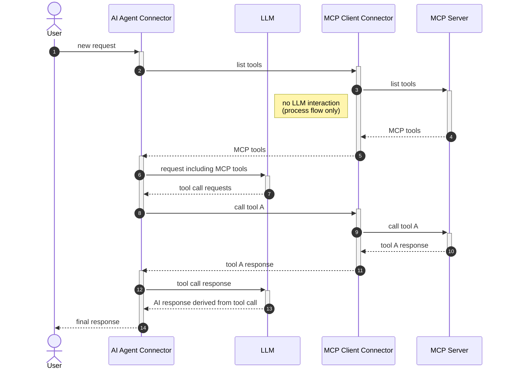

# MCP Integration

MCP (Model Context Protocol) enables the AI Agent to discover and call tools from MCP servers. Two connector types:

- **MCP Client** (`McpClientFunction`, type `io.camunda.agenticai:mcpclient:1`): Pre-configured MCP connections on the runtime
- **MCP Remote Client** (`McpRemoteClientFunction`, type `io.camunda.agenticai:mcpremoteclient:1`): On-demand remote connections

Tool naming: `MCP_<elementName>___<mcpToolName>` — one MCP server = many tools, triple-underscore separates gateway element from tool name.

For the complete MCP reference including data model, client lifecycle, transport/auth configuration, filtering, Spring configuration, and error codes, see **[`mcp-client.md`](../../connector-mcp/docs/mcp-client.md)**.

## End-to-End Sequence (Agent Integration)



## Tool Name Convention

`McpToolCallIdentifier` manages the naming scheme:

```
MCP_<elementName>___<mcpToolName>
```

- Prefix: `MCP_`
- Element name: BPMN element ID of the MCP Client in the AHSP — must NOT contain `___`
- Separator: `___` (triple underscore)
- MCP tool name: the tool's name on the MCP server — CAN contain `___`

Example: `MCP_MyFilesystem___readFile`

Pattern: `^MCP_(?<elementName>\S+?)___(?<mcpToolName>\S+)$` — note `\S+?` (non-greedy) on element name so any `___`
in the tool name is captured correctly.

Discovery tool call IDs use a different format: `MCP_toolsList_<elementId>` — NOT a valid `McpToolCallIdentifier`.

## Discovery Flow

```
1. Agent enters INITIALIZING state
2. AdHocToolsSchemaResolver identifies MCP Client element via gateway type extension
3. McpClientGatewayToolHandler.initiateToolDiscovery():
   - Validates element IDs don't contain "___"
   - Stores MCP client element IDs in agentContext.properties.mcpClients
   - Creates tool call: id="MCP_toolsList_<elementId>", name="<elementId>",
     args={method: "tools/list"}
4. Agent completes job with activateElement("<elementId>") and
   variables {toolCall: {method: "tools/list"}, toolCallResult: ""}
5. MCP Client connector picks up the tool call, calls listTools on MCP server
6. Result (McpClientListToolsResult with tool definitions) flows back via outputElement
7. Agent receives result in TOOL_DISCOVERY state
8. McpClientGatewayToolHandler.handleToolDiscoveryResults():
   - Converts each McpToolDefinition → ToolDefinition
   - Name: MCP_<elementId>___<mcpToolName>
   - Schema: inputSchema from MCP server
9. Tools merged into agentContext.toolDefinitions
10. State → READY, tools available to LLM
```

## Tool Call Execution Flow

```
1. LLM requests tool call: "MCP_MyFilesystem___readFile" with args {path: "/foo"}
2. McpClientGatewayToolHandler.transformToolCalls():
   - Parses McpToolCallIdentifier: elementName="MyFilesystem", mcpToolName="readFile"
   - Transforms to: ToolCall(id=<original>, name="MyFilesystem",
     args={method: "tools/call", params: {name: "readFile", arguments: {path: "/foo"}}})
3. Agent completes job with activateElement("MyFilesystem")
4. MCP Client connector executes callTool("readFile", {path: "/foo"})
5. Result flows back as toolCallResult (McpClientCallToolResult)
6. McpClientGatewayToolHandler.transformToolCallResults():
   - Extracts tool name from result, rebuilds fully qualified name
   - Maps content: if single McpTextContent → use string directly, else use the typed
     List<McpContent> as the transformed ToolCallResult content
   - Returns ToolCallResult with name="MCP_MyFilesystem___readFile"
7. Agent presents result to LLM with the original fully qualified tool name
8. McpClientGatewayToolHandler.extractDocuments() walks the List<McpContent> via a sealed-type
   switch and collects Camunda Documents from McpDocumentContent and
   McpEmbeddedResourceContent.BlobDocumentResource entries — feeding the synthetic document
   UserMessage produced by ToolCallResultDocumentExtractor (see extension-points.md "Document
   Extraction from Tool Call Results").
```

## McpClientAgenticToolAutoConfiguration

Auto-configuration ordered after `McpClientAutoConfiguration`.

**Condition**: `camunda.connector.agenticai.mcp.client.agentic.tool.enabled` (default: **true**)

Beans: `McpClientGatewayToolDefinitionResolver`, `McpClientGatewayToolHandler`

## Error Codes

From `McpClientGatewayToolHandler`:
- `MCP_GATEWAY_INVALID_TOOL_DEFINITIONS` — Activity IDs contain `___` separator (would break naming)

## Key Source Files

| File                                           | Purpose                                                       |
|------------------------------------------------|---------------------------------------------------------------|
| `McpClientGatewayToolHandler.java`             | Gateway handler: discovery, name transform, result transform  |
| `McpToolCallIdentifier.java`                   | Tool name parsing/construction (`MCP_<element>___<tool>`)     |
| `McpClientGatewayToolDefinitionResolver.java`  | Identifies MCP elements in AHSP                               |
| `McpClientAgenticToolAutoConfiguration.java`   | Spring config for MCP gateway beans                           |
