# Key Code Paths Reference

## Entry Points
- `AgentTaskV1Function.execute()` → Connector (Task) entry point
- `AgentSubProcessV1Function.execute()` → Job worker (Sub-process) entry point
- `AgentSubProcessV1Function.execute()` wraps into `AgentSubProcessConnectorResponse` → handled by `SpringConnectorJobHandler`

## Core Agent Logic
- `BaseAgentRequestHandler.handleRequest()` → Core orchestrator: init → load + reconstruct → compose → rehydrate → LLM (continuation loop) → ingest → persist → complete
- `BaseAgentRequestHandler.proceed()` → `do { chatModel.execute() → ChatModelRejectedException handling → ingest → … } while (continued)` — the turn-based continuation loop ([`chat-model.md`](chat-model.md#turn-based-continuation-loop))
- `AgentInitializerImpl.initializeAgent()` → State machine / initialization
- `TurnReconstructor.reconstruct()` → Rebuilds turns + system message from the stored flat message list
- `AgentConversationTurnInputComposerImpl.compose()` → Turn input assembly (tool results, events, user prompt) → `AgentInput`
- `AgentConversationTurnInputComposerImpl.resolveOrderedToolCallResults()` → Tool result matching & missing detection
- `AgentConversation.rehydrate()` / `ingest()` / `window()` / `nextContinuationRound()` / `toAgentContext()` → Immutable turn aggregate lifecycle
- `BaseAgentRequestHandler.throwIfLimitsReached()` → Model-call limit check (reads `totalMetrics().modelCalls()`)
- `AgentResponseHandlerImpl.createResponse()` → Response formatting

## Job Completion
- `AgentSubProcessConnectorResponse.elementActivations()` → AHSP element activations from tool calls
- `AgentSubProcessRequestHandler.buildConnectorResponse()` → Job worker response assembly (no-op vs response)

## Memory
- `ConversationStoreRegistryImpl.getConversationStore()` → Store resolution
- `InProcessConversationSession.loadMessages()` / `storeMessages()` → In-process persistence
- `CamundaDocumentConversationSession.loadMessages()` / `storeMessages()` → Document persistence
- `MessageWindowFilter.apply()` → Context window sliding (called by `AgentConversation.window()`)

## Tool Resolution
- `AgentToolsResolverImpl.loadAdHocToolsSchema()` → Tool schema loading
- `AgentToolsResolverImpl.updateToolDefinitions()` → Migration tool refresh
- `AdHocToolsSchemaResolverImpl` → Schema generation from tool elements
- `AdHocToolElementParameterExtractorImpl` → FEEL expression parameter extraction
- `AdHocToolSchemaGeneratorImpl` → Parameter → JSON Schema conversion

## System Prompt
- `SystemPromptComposerImpl.compose()` → Aggregates base prompt + contributions
- `A2aSystemPromptContributor` → A2A protocol instructions (order 100)

## Chat Model SPI

- `ChatModelRegistryImpl.resolve()` → Provider resolution by `ChatModelFactory.supports()`, fail-loud on zero/multiple matches

**v1 (LangChain4j-backed)**, all under `aiagent/chatmodel/provider/langchain4j/**`:
- `LangChain4JChatModel.execute()` → Main LLM call path
- `ChatMessageConverterImpl` → Message conversion chain
- `ToolSpecificationConverterImpl` → Tool definition conversion
- `factory.AnthropicChatModelFactory`, `factory.BedrockChatModelFactory`, `factory.OpenAiChatModelFactory`, `factory.OpenAiCompatibleChatModelFactory`, `factory.AzureOpenAiChatModelFactory`, `factory.GoogleVertexAiChatModelFactory` → Provider-specific `ChatModel` creation (`LangChain4JChatModelFactory` subclasses)

**v2 (fully native, no LangChain4j)**, one package per provider under `aiagent/chatmodel/provider/**`:
- `anthropic.AnthropicChatModelFactory` / `anthropic.AnthropicChatModel.execute()` → Drives the Anthropic Java SDK's stable Messages client directly, for `AnthropicChatModelConfiguration`
- `bedrock.BedrockConverseChatModelFactory` / `bedrock.BedrockConverseChatModel.execute()` → Drives the AWS SDK's async `converseStream` operation (the synchronous `BedrockRuntimeClient` has no streaming operation), assembling the streamed events into a `ConverseResponse` via `BedrockConverseStreamAssembler`, for `BedrockConverseChatModelConfiguration`
- `openai.OpenAiChatModelFactory` / `openai.OpenAiChatModel.execute()` → Drives the OpenAI Java SDK directly across both wire formats (Chat Completions, Responses) via the per-family `OpenAiApiFamilyStrategy` seam, for `OpenAiChatModelConfiguration`
- `gemini.GeminiChatModelFactory` / `gemini.GeminiChatModel.execute()` → Drives the Google GenAI Java SDK's streaming `generateContentStream` directly, for `GeminiChatModelConfiguration`

## Configuration
- `AgenticAiConnectorsAutoConfiguration` → Spring Boot bean definitions of the AI Agent (see [`spring-auto-configuration.md`](../../docs/architecture/spring-auto-configuration.md) for the other auto-configurations)
- `ConnectorConfigurationOverrides` (connector-runtime-core) → Type/timeout overrides via env vars

## Class Diagram

```mermaid
classDiagram
    direction TB

    %% --- Entry points ---
    class AgentTaskV1Function {
        <<OutboundConnectorFunction>>
    }
    class AgentSubProcessV1Function {
        <<OutboundConnectorFunction>>
    }

    %% --- Request handling ---
    class AgentRequestHandler~C, R~ {
        <<interface>>
        +handleRequest(C) R
    }
    class BaseAgentRequestHandler~C, R~ {
        <<abstract>>
    }
    class AgentTaskRequestHandler
    class AgentSubProcessRequestHandler

    BaseAgentRequestHandler ..|> AgentRequestHandler
    AgentTaskRequestHandler --|> BaseAgentRequestHandler
    AgentSubProcessRequestHandler --|> BaseAgentRequestHandler

    AgentTaskV1Function --> AgentTaskRequestHandler
    AgentSubProcessV1Function --> AgentSubProcessRequestHandler

    %% --- Core orchestration dependencies ---
    class AgentInitializer {
        <<interface>>
    }
    class AgentConversationTurnInputComposer {
        <<interface>>
    }
    class AgentResponseHandler {
        <<interface>>
    }

    BaseAgentRequestHandler --> AgentInitializer
    BaseAgentRequestHandler --> AgentConversationTurnInputComposer
    BaseAgentRequestHandler --> ChatModelRegistry
    BaseAgentRequestHandler --> AgentResponseHandler
    BaseAgentRequestHandler --> ConversationStoreRegistry
    BaseAgentRequestHandler --> SystemPromptComposer
    BaseAgentRequestHandler ..> AgentConversation : builds

    %% --- Gateway tool SPI ---
    class GatewayToolCallTransformer {
        <<interface>>
    }
    class GatewayToolHandler {
        <<interface>>
    }
    class GatewayToolHandlerRegistry {
        <<interface>>
    }

    GatewayToolHandler --|> GatewayToolCallTransformer
    GatewayToolHandlerRegistry --|> GatewayToolCallTransformer
    GatewayToolHandlerRegistry o-- GatewayToolHandler : manages *

    %% --- Tool resolution ---
    class AgentToolsResolver {
        <<interface>>
    }
    class AdHocToolsSchemaResolver {
        <<interface>>
    }

    AgentInitializer --> AgentToolsResolver
    AgentInitializer --> GatewayToolHandlerRegistry
    AgentToolsResolver --> AdHocToolsSchemaResolver

    %% --- Memory architecture ---
    class ConversationStoreRegistry {
        <<interface>>
    }
    class ConversationStore {
        <<interface>>
    }
    class ConversationSession {
        <<interface>>
    }
    class InProcessConversationStore
    class CamundaDocumentConversationStore

    ConversationStoreRegistry o-- ConversationStore : manages *
    InProcessConversationStore ..|> ConversationStore
    CamundaDocumentConversationStore ..|> ConversationStore
    ConversationStore ..> ConversationSession : creates

    %% --- Turn aggregate ---
    class AgentConversation
    class AgentConversationTurn
    class TurnReconstructor
    class ConversationSnapshot
    class MessageWindowFilter

    AgentConversation o-- AgentConversationTurn : turns *
    TurnReconstructor ..> AgentConversationTurn : reconstructs
    AgentConversation ..> ConversationSnapshot : window()
    AgentConversation ..> MessageWindowFilter : uses
    ChatModel ..> ConversationSnapshot : consumes via ChatRequest

    %% --- System prompt composition ---
    class SystemPromptComposer {
        <<interface>>
    }
    class SystemPromptContributor {
        <<interface>>
    }

    AgentConversationTurnInputComposer --> GatewayToolHandlerRegistry
    SystemPromptComposer o-- SystemPromptContributor : aggregates *

    %% --- Chat model provider SPI (ADR 009) ---
    class ChatModelRegistry {
        <<interface>>
        +resolve(ChatModelConfiguration) ChatModel
    }
    class ChatModelFactory {
        <<interface>>
        +supports(ChatModelConfiguration) bool
        +create(ChatModelConfiguration) ChatModel
    }
    class ChatModel {
        <<interface, AutoCloseable>>
        +execute(ChatRequest) ChatResult
    }
    class LangChain4JChatModel
    class LangChain4JChatModelFactory~T~ {
        <<abstract>>
    }
    class AnthropicChatModelFactory

    ChatModelRegistry o-- ChatModelFactory : routes to *
    ChatModelFactory ..> ChatModel : creates
    LangChain4JChatModel ..|> ChatModel
    LangChain4JChatModelFactory ..|> ChatModelFactory
    AnthropicChatModelFactory --|> LangChain4JChatModelFactory
    LangChain4JChatModelFactory ..> LangChain4JChatModel : creates
```

## E2E Tests

The e2e modules, their test base classes and how to run them are described in the
[e2e tests `AGENTS.md`](../../../../connectors-e2e-test/connectors-e2e-test-agentic-ai/AGENTS.md).
