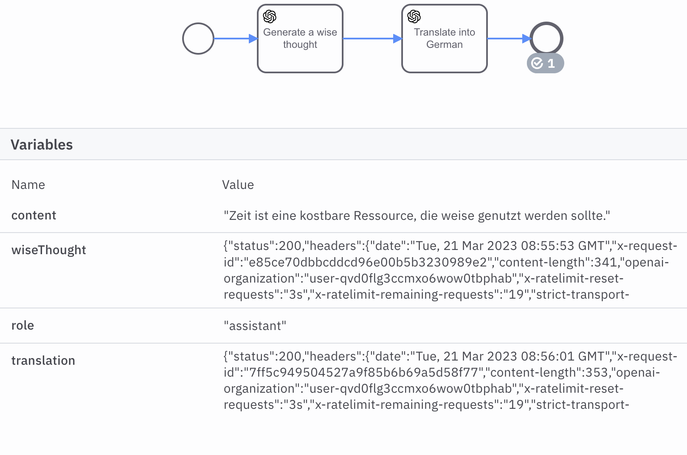

# OpenAI Connector

The **OpenAI Connector** allows you to use [ChatGPT](https://platform.openai.com/docs/guides/chat/chat-completions-beta)
or [Moderation API](https://platform.openai.com/docs/guides/moderation/moderation) in your Camunda 8 processes.

This Connector reuses the base implementation of [HTTP JSON Connector](../http-json) by providing a compatible element template.

## What can I use it for?

Large language models like GPT-3 or GPT-4 can create and edit content, or respond to user prompt in an interactive manner.
Please refer to the [example API use-cases](https://platform.openai.com/examples) provided by OpenAI.

## Model selection

Enter a model ID in the **Model** field, either as text or a FEEL expression.
The placeholder is an example, not a default: you must explicitly select a model.
Refer to the [Models](https://platform.openai.com/docs/models) section of OpenAI documentation
for current models. Availability depends on your account privileges.

Template version 9 replaces the model dropdown. Existing named selections remain valid.
When upgrading a version 8 task that uses **Custom**, `c8ctl element-template update` applies
the migration recipe and copies **Custom model version** into the new **Model** field.
If your upgrade tool does not apply the recipe, save **Custom model version** before upgrading
and paste it into **Model** afterward. Older template versions remain available.

The Google Gemini and Bedrock embeddings templates follow the same free-text pattern starting
with version 5. Their recipes let `c8ctl element-template update` copy a legacy **Custom model
name** into the new model field. If your upgrade tool does not apply the recipe, save and copy
the custom model name manually.
Bedrock embeddings require a model compatible with the Amazon Titan embedding API;
dimensions and normalization are available for `amazon.titan-embed-text-v2:0`.

## Moderation

It is recommended to use the Moderation API to sanitize both inputs and outputs of the language model.
This way you will be able to prevent violation of OpenAI policies and displaying the potentially unsafe content in your system.
