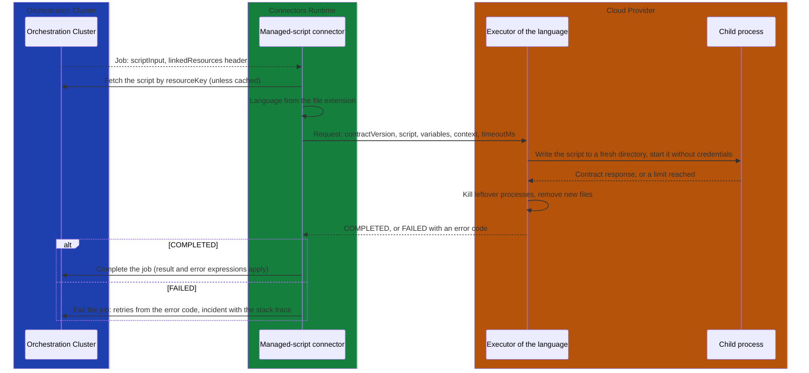
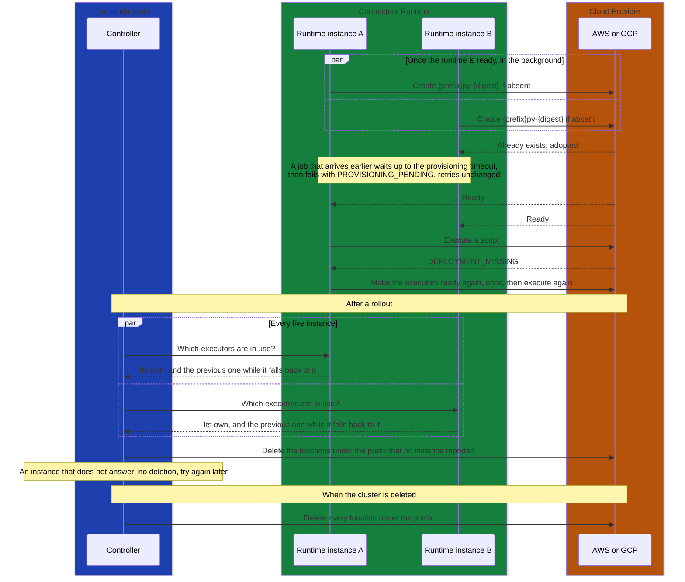

# ADR-0008: Managed Script Connector with a Generic Executor per Language

## Status
Proposed

## Context

Managed scripts let a Service Task run a customer's Python or JavaScript without the customer
operating a job worker. The script is an independent, versioned Camunda resource, linked to the
task with `zeebe:linkedResource` like a form or an RPA script. Nothing happens when the resource or
the BPMN is deployed: the engine resolves the link to a `resourceKey` when it creates the job and
passes it in the `linkedResources` job header. Someone has to fetch the script and run it in
isolation, without running customer code in the orchestration cluster or in the Connectors
Runtime, and without adding deployment-time state to the engine.

The clusters of an environment share one AWS account or GCP project for their functions, separated
by IAM on a per-cluster name prefix. A first version
([decision 0006](https://github.com/camunda/code-execution-poc/blob/main/design/decisions/0006-provision-functions-lazily.md))
created one function per script version, on the first job that needed it. In a shared account,
every version then costs a control-plane write and one more function, against limits that cannot
be raised: 60 writes per minute and 1,000 functions per GCP project, 15 control-plane calls per
second per AWS account. It also made the first job after every edit wait for provisioning: 3 to
6 seconds on AWS and 37 to 51 seconds on GCP.

[Decision 0006b](https://github.com/camunda/code-execution-poc/blob/main/design/decisions/0006b-run-scripts-through-generic-executors.md)
([solution 2b](https://github.com/camunda/code-execution-poc/blob/main/analysis/SOLUTION_2B_GENERIC_EXECUTOR.md))
replaces this with a fixed set of generic executors per cluster. POC 0.11 validated the executor
wrapper on real Lambda and Cloud Run. The draft PR
[#9341](https://github.com/camunda/connectors/pull/9341) is the reference implementation in this
repository. This ADR records what the PRs of
[#9902](https://github.com/camunda/connectors/issues/9902) are checked against. Where it differs
from #9341, this ADR applies.

## Decision

### Connector and element template

Managed scripts are an outbound connector, `ManagedScriptFunction`, served by the runtime like any
other. The runtime handles activation, variable fetching, result and error expressions, retries
and secrets.

| | |
|---|---|
| Job type | `io.camunda:managed-script:1` (reserved), with a job lease |
| Element template id | `io.camunda.connectors.ManagedScript.v1`, applies to a Service Task |
| Script link | `zeebe:linkedResource`, link name `script`, resource type `ManagedScript`, `latest` binding by default |
| Input variable | `scriptInput`, the only variable the connector fetches |

The template builds `scriptInput` with one FEEL expression, so a script receives exactly what the
modeler maps and no other process variable. The job timeout of the task must cover the time to make
the executors ready plus the execution timeout; the job worker's default, 5 minutes, covers the
defaults, so the template sets none.

### Language

The language comes from the extension of the linked resource's file name, and from nothing else:

| Extension | Language | Executor runtime on AWS and GCP |
|---|---|---|
| `.py` | Python | Python 3.13 |
| `.js` | JavaScript, run as an ES module | Node.js 22 |

The `local` provider uses the interpreter installed on the host (Python 3.10 or later, Node.js 20
or later).

There are no `language` or `runtime` task headers, because each extra runtime is one more executor
per cluster. The connector ignores such headers. A resource with any other extension fails the job
with `INVALID_JOB`.

A script defines a function `execute(variables, context)` that returns a JSON object: at module
level in Python, and as a named export in JavaScript, where it may be `async`. The returned object
becomes the connector's result, which the task's result variable or result expression maps as for
any connector. The script builds no envelope: the executor turns the returned object into a
`COMPLETED` response and a raised exception into a `FAILED` one. A business error is returned as
data, and the task's error expression turns it into a BPMN error, as for other connectors.

`print()` in Python and `console.log`, `info`, `warn` and `error` in JavaScript are redirected to
stderr, which ends in the executor's logs, not in the response. Stdout is reserved for the contract
response: a script that writes to file descriptor 1 directly, such as `os.write(1, ...)` in Python
or `process.stdout.write` in JavaScript, corrupts the response, and the job fails with
`INVALID_RESULT`.

### Generic executors

Scripts run as data through a **generic executor**: one trusted function per language and cluster,
with no user code in it.

- **Creation.** When the runtime is ready, it creates the executors of its cluster in the
  background if they are absent (`ensureExecutors`). A job that arrives earlier starts this
  creation. Executors are created with create-if-absent and adopted when they already exist, so
  concurrent runtime instances converge.
- **Naming.** An executor is named `<prefix><py|js>-<12 hex of the wrapper digest>`. The digest
  covers everything packaged into the function: the wrapper code, the manifests of its pinned
  dependencies (such as the Functions Framework on GCP) and the provider runtime identifier (such as
  `python3.13`). A dependency upgrade, a security fix included, therefore gives a new function like
  a new wrapper does, never a code update in place, because runtime instances of the previous
  release may still call the previous one. The digest leaves out the settings below. Names are
  validated against the provider's 63-character limit at startup.
- **Settings.** Memory, function timeout, execution role and, on GCP, the maximum instance count
  are runtime configuration. When the runtime creates or adopts an executor, it compares the
  function's settings with its configuration and updates them in place if they differ. Lambda and
  Cloud Run finish calls in flight with the previous settings. A configuration change therefore
  creates no function and leaves none behind.
- **Each job.** A job fetches the linked script by `resourceKey`. Because the content of a resource
  key is immutable, the script is cached by physical tenant and resource key. While secondary
  storage catches up, the fetch polls for up to 10 seconds. The job then sends the script with its
  input to the executor of its language. No job creates a function, except to recover a missing
  executor (below).
- **Each call.** The executor writes the script to a fresh directory and runs it in a new child
  process, with no cloud credentials in its environment (only `PATH`, `HOME`, `TMPDIR` and `LANG`)
  and bounded memory, time and output. After the call it kills every process that was not running
  when the instance started and removes every new temporary file, so nothing survives into the next
  call.
- **At most once per attempt.** The runtime turns off SDK and HTTP-client retries of an invocation,
  so a script runs at most once per job attempt. Job retries handle the rest.
- **Not ready yet.** A job that arrives before the executors of its language are ready waits up to
  the provisioning timeout. It then fails with `PROVISIONING_PENDING`, its retries unchanged
  (`JobContext.getRetries()`), and the operator's backoff. A retryable creation failure is retried in the
  background with a jittered exponential backoff of at most 1 minute. If that failure lasts longer
  than twice the provisioning timeout, it is reported to waiting jobs, which then consume their
  retries, so a lasting denial ends in an incident. A permission denial within the
  grant-propagation window is exempt: until the window ends, waiting jobs keep failing with
  `PROVISIONING_PENDING`, retries unchanged, however long the provisioning timeout. A permanent failure fails waiting jobs with no
  retries, and a job after the backoff tries the creation again.
- **Readiness per language.** Each language becomes ready on its own, so a failing Python executor
  does not block JavaScript jobs.
- **Missing executor.** When the provider reports `DEPLOYMENT_MISSING`, the job runs
  `ensureExecutors` once more, within its own provisioning budget, and calls the executor again.
- **Dependencies.** Dependencies are not supported yet (GAP-004). A job that links a `dependencies`
  resource fails with `UNSUPPORTED_DEPENDENCIES`.

Every job takes this path, the first one of a new script included:



The runtime never deletes executors and holds no delete rights. **Controller** deletes them: it
generates the cluster's prefix, so it can list the functions under it.

- **Cluster deletion.** Controller deletes every function and log group under the cluster's prefix.
- **Wrapper upgrade.** Once every runtime instance of the cluster runs the new release, Controller
  asks every live instance which executors it may still call, through an endpoint
  ([#9919](https://github.com/camunda/connectors/issues/9919)): those of its own wrapper and, while
  one of them is not ready yet on that instance, the previous executor it falls back to
  ([#9912](https://github.com/camunda/connectors/issues/9912)). Instances of one release can be in
  different states, so Controller deletes only the functions under the prefix that no instance
  reports. If an instance does not answer, Controller deletes nothing and tries again later, as it
  does while an instance still reports a previous executor.
- Controller retries a deletion that fails.

Listing by prefix also catches the executors of wrappers several releases old, and the functions
of a runtime that no longer answers. A runtime instance does not delete executors when it shuts
down: executors are shared by every instance of a cluster and keep their names across a restart,
so an instance cannot know whether it is the last one using them.

In Self-Managed, where there is no Controller, the operator deletes the functions under the prefix,
as the documentation describes.

This needs Controller's agreement: so far Controller manages no functions and holds no permissions
on the functions projects and accounts
([task breakdown](https://github.com/camunda/code-execution-poc/blob/main/TASK_BREAKDOWN.md#controller)).

The life of the executors of a cluster, from the first start of its runtime to their deletion:



### Execution contract v1

The runtime sends one JSON request per call. The executor answers with one JSON response. The AWS
provider sends it as the Lambda invocation payload, the GCP provider as the body of an HTTP `POST`.

Request:

```json
{
  "contractVersion": "1",
  "executionId": "2251799813685251",
  "script": "def execute(variables, context):\n    return {\"sum\": variables[\"a\"] + variables[\"b\"]}\n",
  "variables": { "a": 2, "b": 3 },
  "context": {
    "tenantId": "<default>",
    "processDefinitionId": "order-process",
    "processDefinitionVersion": 3,
    "processInstanceKey": "2251799813685249",
    "elementId": "compute-sum",
    "elementInstanceKey": "2251799813685250",
    "jobKey": "2251799813685251"
  },
  "timeoutMs": 30000
}
```

- `executionId` is the job key.
- `variables` is the value of `scriptInput`, or `{}` when it is absent. It must be a JSON object.
- In `context`, keys of the engine (`processInstanceKey`, `elementInstanceKey`, `jobKey`) are sent
  as strings, so JavaScript does not lose precision.
- `timeoutMs` is the execution timeout. The executor enforces it on the child process. The cloud
  function's own timeout is 5 seconds longer, so the wrapper reports `TIMEOUT` before the platform
  kills it.

Response, on success:

```json
{ "contractVersion": "1", "outcome": "COMPLETED", "variables": { "sum": 5 } }
```

On failure:

```json
{
  "contractVersion": "1",
  "outcome": "FAILED",
  "error": {
    "code": "SCRIPT_ERROR",
    "message": "ZeroDivisionError: division by zero",
    "stackTrace": "Traceback (most recent call last):\n  ...",
    "retryable": false,
    "truncated": false
  }
}
```

- `outcome` is `COMPLETED` or `FAILED`. Any other value, or a response that cannot be parsed, is
  `INVALID_RESULT`.
- The child is not trusted: it runs the script, which can write any JSON to stdout and exit. The
  wrapper therefore accepts from the child only `COMPLETED`, or `FAILED` with `SCRIPT_ERROR`,
  `INVALID_RESULT` or `RESOURCE_LIMIT`. It keeps only the contract fields and sets `retryable` to
  `false`. Any other child response becomes `INVALID_RESULT`, so a script cannot forge a platform
  failure or ask to be retried.
- `stackTrace` is present only for failures raised in the script (`SCRIPT_ERROR`, and
  `INVALID_RESULT` or `RESOURCE_LIMIT` when the script's own code caused them). `truncated` tells
  whether it was cut.

Limits enforced by the wrapper:

| Limit | Value |
|---|---|
| Response size (the child's stdout) | 1 MB, above it `RESOURCE_LIMIT` |
| Script logs kept per call (stderr) | 4 KB |
| Child memory, Python | 256 MB of address space through `RLIMIT_AS`, where the OS supports it (not macOS) |
| Child memory, JavaScript | 256 MB of V8 heap through `--max-old-space-size` |
| `error.message` | 1,024 characters |
| `error.stackTrace` | 8,192 characters, keeping the frames nearest the error |

Limits enforced by the provider before the call: a request (script plus input) larger than 6 MB on
AWS, a synchronous Lambda invocation, or 32 MB on GCP, a Cloud Run request, fails with
`RESOURCE_LIMIT`. The provider checks the size of the serialized request, not of the script: a
Zeebe resource is at most 4 MB, but JSON escaping can make it up to twice as large in the request
(a newline becomes `\n`), so a large script can exceed the 6 MB of AWS even with an empty input.

### Contract version

`contractVersion` is a string that increases by one whenever the meaning of a request or response
field changes. Adding an optional field that older parties ignore does not change it.

- The **trusted wrapper** checks the version before it starts the child, and accepts only its
  own. Any other version fails with `UNSUPPORTED_CONTRACT_VERSION` and no retries. The check moves
  out of the child, where #9341 made a version mismatch look like a `SCRIPT_ERROR`.
- An executor's name carries the digest of its wrapper, for every provider, including one written
  outside this repository. A runtime therefore only calls executors whose wrapper it knows, and a
  mismatch means a bug or a tampered executor, not a normal state.
- The **runtime** sends each executor the version of that executor's wrapper. While it still
  invokes the previous executor during an upgrade
  ([#9912](https://github.com/camunda/connectors/issues/9912)), it sends that executor the previous
  version.

### Error codes and retries

The set below is closed: providers and wrappers map every failure to one of these codes. "Consume
one" lets the job lose one retry, with the backoff of the task's `retryBackoff` header, as for any
connector: the modeler sets it next to the retries it spends. "None left" sets the retries to 0,
which raises an incident. "Unchanged" keeps the job's current retries, with the operator's backoff
(`provisioning-retry-backoff`), whatever the header says: these jobs retry without bound, so only
the operator sets how often they call the platform.

| Code | Raised by | Meaning | Retries |
|---|---|---|---|
| `SCRIPT_ERROR` | child | The script raised an error, or did not load (syntax error, missing `execute`) | None left |
| `TIMEOUT` | wrapper | The script ran longer than `timeoutMs` | None left |
| `RESOURCE_LIMIT` | child, wrapper, provider | Out of memory, response above 1 MB, or request above the provider's limit | None left |
| `INVALID_RESULT` | child, wrapper, runtime | `execute` did not return a JSON object, the script wrote to stdout outside the contract, or the response is not a contract response | None left |
| `INVALID_INPUT` | wrapper, provider | The request cannot be serialized, or `script` or `variables` has the wrong type | None left |
| `INVALID_JOB` | runtime | The `linkedResources` header is missing, malformed or duplicated, the resource key is not a number, or the extension is not `.py` or `.js` | None left |
| `UNSUPPORTED_DEPENDENCIES` | runtime | The job links a `dependencies` resource | None left |
| `UNSUPPORTED_CONTRACT_VERSION` | wrapper | The request's `contractVersion` is not the wrapper's own | None left |
| `DEPLOYMENT_MISSING` | provider | The executor does not exist. The job creates it once and calls again. If it is still missing: | Consume one |
| `PROVISIONING_PENDING` | runtime | The executors were not ready within the provisioning timeout, including while a new cluster's grants propagate (a permission denial on creation or invocation within the configured window) | Unchanged |
| `PLATFORM_THROTTLED` | provider | The provider throttled the call (Lambda `TooManyRequests`, HTTP 429) | Consume one |
| `PLATFORM_UNAVAILABLE` | provider, runtime | A transient failure: service error, HTTP 502 or 503, a retryable creation failure that lasted longer than twice the provisioning timeout (except a permission denial within the grant-propagation window), or a linked resource still not found after polling | Consume one |
| `PLATFORM_REJECTED` | provider, runtime | A permanent provider failure: a creation call rejected with a client error, an executor that failed to build or become active, a denial after the grant-propagation window, or no suitable local interpreter | None left |
| `PLATFORM_EXECUTION_FAILED` | wrapper, provider | The executor failed outside the script: the child crashed with no response, a wrapper error, a Lambda function error, HTTP 500 or 504 | None left |
| `PLATFORM_INTERRUPTED` | runtime | The worker thread was interrupted, for example at shutdown | Unchanged |
| `PLATFORM_ERROR` | runtime | Any other unexpected exception in the connector | Consume one |

The table is authoritative. A response's `retryable` flag must agree with it: `true` for the codes
that consume one retry, `false` for the others. `DEPLOYMENT_MISSING` is the exception: it is
`false` because the job recovers within the attempt, and it consumes one retry only when that
recovery fails. The wrapper sets `retryable` to `false` on every child response: a script cannot
ask to be retried.

The codes that #9341 emits outside this set are folded into it:

- `BUILD_FAILED`, `PROVIDER_REJECTED` and `UNSUPPORTED_RUNTIME` become `PLATFORM_REJECTED`.
- `PROVISIONING_TIMEOUT` becomes `PLATFORM_UNAVAILABLE`.
- `PERMISSION_DENIED` becomes `PROVISIONING_PENDING` within the grant-propagation window, and
  `PLATFORM_REJECTED` after it.
- `INTERRUPTED` becomes `PLATFORM_INTERRUPTED`.
- A resource that is not found after polling, which #9341 reports as `PLATFORM_ERROR`, becomes
  `PLATFORM_UNAVAILABLE`.

### Incidents

When a job fails, its error message (and so the incident message) is:

```
<code>: <message>
<stackTrace>
```

- The code and the message are always kept whole: the message is at most 1,024 characters.
- The stack trace is cut so that the whole text stays within the runtime's limit for an error
  message, 6,000 characters (`SpringConnectorJobHandler.MAX_ERROR_MESSAGE_LENGTH`). The part kept
  is the one nearest the error: the end of a Python traceback, the start of a JavaScript stack. A
  cut is marked with `... (truncated)`.
- Only failures raised in the script carry a stack trace. Script logs are not part of the incident;
  they stay in the executor's logs.
- The error code is the connector's error code, so an error expression can match on it.
- The runtime logs this text in its error log, as for any connector's failure. The connector's own
  logs never contain the script, its input or its output. Users are told not to let a sensitive
  value reach an exception message, since the languages' own errors quote values too.

### Secrets

A script receives secrets only through its input. The script itself is a Zeebe resource that the
runtime never scans for placeholders, so a placeholder written in the script stays literal text.
In the script input, secrets are resolved as for any connector: `camunda.secrets.X` by the engine
when it activates the job
([ADR-0007](ADR-0007-centralized-secret-resolution-in-the-connector-runtime.md)), and
`{{secrets.X}}` by the runtime, within its secret filter. Passing secrets to scripts through their
input is still to be validated with Product (GAP-005).

### Provider SPI

A provider implements one interface, `ManagedCodeProvider`, and is chosen by its name in
`camunda.connector.managed-code.provider`. Startup fails if no provider or more than one has that
name.

- `name()`: the value of the property.
- `ensureExecutors()`: makes sure the executors exist, run the wrapper of this runtime and have
  the configured settings, and returns once they can be invoked. Idempotent, and safe to call from
  several runtime instances at once. It has no default: every provider implements it.
- `execute(language, request)`: sends the request to the executor of the language and returns the
  contract response. It returns a failure as a `FAILED` response instead of throwing it, and reports
  a missing executor as `DEPLOYMENT_MISSING`.

Every executor runs **our wrapper**, whatever the provider: the wrapper implements the contract,
calls the script's `execute`, and enforces the child process, the limits and the cleanup. The
wrapper files of each language and their digest are published to providers in the Apache 2.0 API
module, as resources read through `ExecutorWrapper`
([#9907](https://github.com/camunda/connectors/issues/9907)), so that a provider written
outside this repository, for example in Self-Managed for another platform, can package the wrapper
and name its executors from the digest. Such a provider either creates the executors in
`ensureExecutors`, like the built-in ones, or, when they are deployed separately (for example with
Terraform, so that the runtime holds no deployment rights), checks there that they exist and run
the expected wrapper.

The connector keeps everything else: fetching the script, waiting for readiness without consuming
a retry, recovering from `DEPLOYMENT_MISSING`, the limits and the incident text. The
SPI is **not a stable API** and has no compatibility guarantee yet. In particular,
[#9909](https://github.com/camunda/connectors/issues/9909) may change the signature of
`ensureExecutors` so that readiness can be tracked per language.

### Module layout

| Module | License | Contents | Where it ships |
|---|---|---|---|
| `connector-runtime/connector-managed-script-api` | Apache 2.0 | Provider SPI, execution contract and executor wrappers; depends on nothing but Jackson annotations | Wherever a provider is built |
| `connectors/managed-script` | Camunda proprietary, like the other connectors | Connector, element template, job handler, readiness, `local` provider | Default bundle, disabled by default (`camunda.connector.managed-code.enabled=false`) |
| `connectors/managed-script-aws` | Camunda proprietary | `aws` provider: one zip Lambda function per language (`python3.13`, `nodejs22.x`) | Not in the default bundle |
| `connectors/managed-script-gcp` | Camunda proprietary | `gcp` provider: one Cloud Run function per language (`python313`, `nodejs22`), request concurrency 1 | Not in the default bundle |

The connector lives with the other connectors, so its element template is published with theirs.
The SPI stays in an Apache 2.0 module of its own, without Spring or the runtime, so that a provider,
including one a Self-Managed customer writes, depends on that module only. The dependencies go one
way: the connector and the providers depend on the API, and the runtime depends on none of them.
The AWS and GCP modules bring the Lambda, CloudWatch Logs and Cloud Run functions clients and the
permissions to create functions, so the default bundle does not include them; a
distribution that offers managed scripts, such as the SaaS image, adds the module of its provider
to the classpath.

The `local` provider is for **trusted development only and is not a sandbox**. It runs the same
wrapper as a local Node.js or Python process, in a local mode that only kills the script's process
group and uses a temporary directory of its own, because it shares the host with other processes.
It logs a warning at startup. Windows is not supported.

## Consequences

### Positive

- No engine changes: linked resources already work on Service Tasks, and there are no deployment
  records, leases or reconciler.
- Editing or adding a script makes no control-plane call. A cluster has 2 functions, whatever the
  number of scripts and versions, and an edit runs at once.
- No function belongs to a script, so nothing has to be evicted.
- The runtime's connector machinery handles activation, variable fetching, result and error
  expressions, retries and secrets, as for every connector.
- Deployment stays fast and does not depend on the provider being available.
- With managed code disabled, the ordinary connector workers are unchanged, and the default bundle
  carries no managed-script provider.
- A fixed contract, a closed set of error codes and a documented retry behaviour per code let the
  wrappers, the providers and the job handler be built and reviewed in separate PRs.

### Negative

- Every call starts a child process: tens to a couple of hundred milliseconds in smoke runs.
- Memory, timeout and network profile are per executor, so every script of a cluster gets the same
  ones. Another profile needs an executor variant, which costs more functions per cluster.
- Within its own call, a script can read the wrapper's memory on Lambda, where the child cannot run
  as another user. The execution role must therefore grant nothing but logging. Infosec has to
  review it (GAP-007).
- On GCP, one request per instance means the maximum instance count caps the parallel scripts of a
  cluster per language.
- A script and its input travel in every request: at most 6 MB on AWS and 32 MB on GCP.
- A wrapper upgrade creates new executors in every cluster. The old ones stay until Controller
  deletes them at the end of the rollout.
- Cleanup depends on Controller, which needs list and delete rights on the functions projects and
  accounts. In Self-Managed, the operator cleans up by hand.
- A configuration change updates the executors in place. During a rolling update, instances that
  still have the previous configuration call executors that already have the new one. If the
  function timeout was lowered, the platform can kill a long script of such an instance, which
  fails as `PLATFORM_EXECUTION_FAILED`. If an instance with the previous configuration restarts
  during the rolling update, after the new instances, it puts the previous settings back, and they
  stay until an instance restarts. This case is rare and accepted: restarting the runtime after the
  rolling update restores the settings.
- Syntax errors surface at the first execution, as `SCRIPT_ERROR`, not at deployment.
- A value that reaches the message or the stack trace of a failed script ends up in the incident
  and in the runtime's error log. Only the documentation guards against it.
- The runtime resolves `{{secrets.X}}` anywhere in the script input, including in text that came
  from data, such as a webhook payload mapped into it. Only the runtime's secret filter bounds
  which secrets can reach user code this way.
- The provider SPI may still change. A provider written outside this repository may break with any
  release until the SPI is declared stable.
