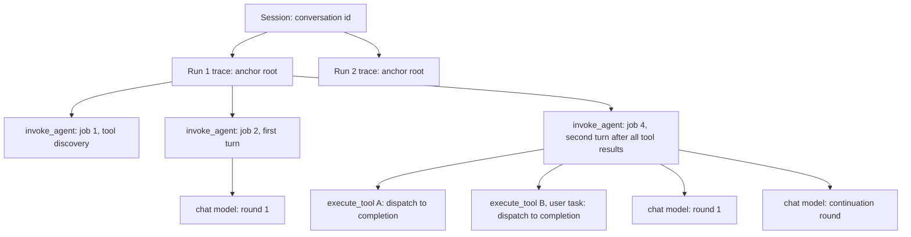
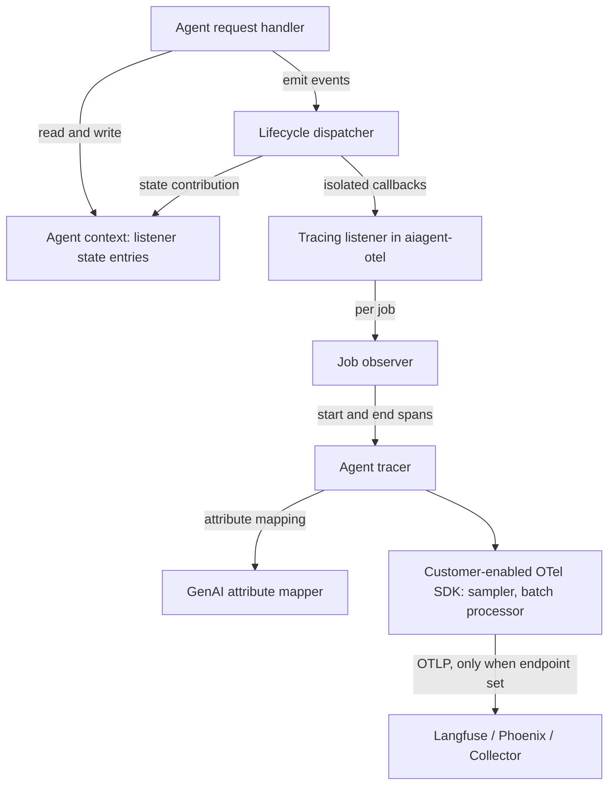
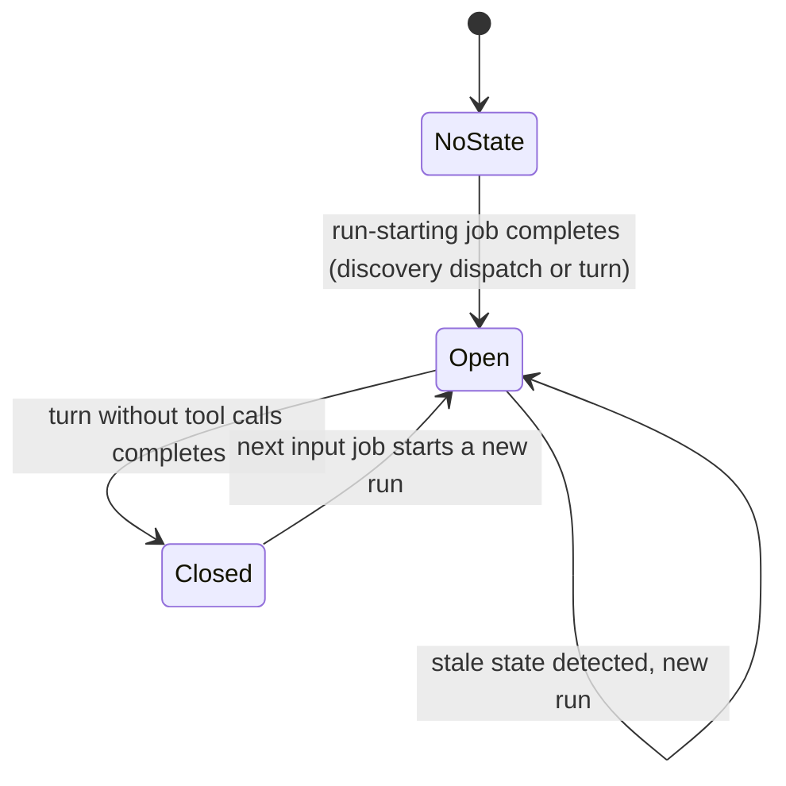
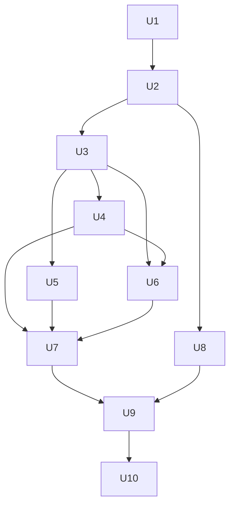

# AI Agent OpenTelemetry GenAI Tracing - Plan

## Goal Capsule

- **Objective:** Operators of self-managed and hybrid connector runtimes see every AI Agent run as an OpenTelemetry GenAI trace in their own LLM-observability backend (Langfuse, Arize Phoenix). Runs are grouped by conversation, and failed attempts are visible, so customers and the Agentic Orchestration pod can debug and evaluate agent behavior.
- **Means:** A second telemetry channel: an experimental agent lifecycle listener SPI in `aiagent-api`, event emission in the AI Agent connector, and an opt-in-by-configuration `aiagent-otel` module in the bundle that turns the events into OTel GenAI spans, next to the unchanged agent-instance history API (KTD1, KTD2, KTD15–KTD18). The customer enables Spring's OpenTelemetry support first; the default application gains no OTel SDK.
- **Product authority:** Agentic Orchestration pod owns the connector. Product has not prioritized OTel (product-hub#3314 "Production-Grade Observability for AI Agent Orchestration" is open but deprioritized; product wants to discover customer pull first). The PoC milestone is the evidence step that precedes a product decision on the production milestone.
- **Open blockers:** None for the PoC milestone. The production milestone is gated on the PoC exit criteria (Success Criteria) and on the product question in Outstanding Questions.
- **Authority hierarchy:** Product Contract requirements win on behavior; Key Technical Decisions win on mechanism within them; Implementation Units carry unit-local detail only.
- **Execution profile:** This plan's Implementation Units cover the PoC milestone only. Production-milestone work is listed under Deferred to Follow-Up Work and needs its own planning pass.
- **Stop conditions:** Stop and ask before adding any Maven dependency (repository rule), before running any real-LLM test or demo (paid), and before any `git push`. Stop and report if a PoC exit criterion fails in a way that invalidates the hybrid topology.
- **Who finishes:** U1–U8 and the documentation part of U10 are implemented on branch `ai-agent-otel-genai-tracing-plan`, committed per unit without pushing. U9 (the end-to-end tests) is not built yet, and the real-backend validation in U10 is pending the user's go-ahead. The branch is based on main with #9525 "refactor(agentic-ai): split agentic AI into libraries, connectors and integrations"; U9 additionally needs #9546 "test(agentic-ai): split the agentic AI e2e tests into modules per connector" (open, stacked on #9525), so the branch is rebased onto it before U9 starts.

---

## Product Contract

### Summary

The AI Agent connector emits lifecycle events to registered listeners (an experimental extension point), and the `aiagent-otel` module turns them into OTel GenAI semantic-convention spans over OTLP. It is enabled through Spring Boot's standard tracing configuration, which the customer adds to their runtime, and is off by default.
Each agent run, from an input to the final answer, becomes one trace: an early-exported anchor root, one `invoke_agent` span per job that does agent work, and `chat` and `execute_tool` spans beneath it.
Runs of the same conversation group into one session; they are not linked, because neither target backend stores or renders span links.
Delivery starts with a PoC slice that validates the trace shape in Langfuse and Arize Phoenix before the production hardening.

### Problem Frame

Customers have asked to see Camunda AI Agent executions in Arize Phoenix and Langfuse, the LLM-observability tools their AI teams already use for tracing and evaluation.
The pod needs the same view internally to evaluate agent behavior.
Today the only structured record is the agent-instance history API surfaced in Operate, which is Camunda-internal and records only the committed path of an agent.

Camunda has no trace propagation through jobs (camunda/camunda#9742 "As a Zeebe user, I want to see Open Telemetry support for Zeebe" and camunda/camunda#25864 "Introduce minimal job worker tracing" are open with no plan), and the connectors runtime has no tracing dependency at all.
Generic OTel Java agent instrumentation sees disconnected gRPC/HTTP calls but nothing about agents, turns, models, tokens, or tools.

The AI Agent's execution model makes naive tracing wrong.
An agent run is spread over many stateless job executions, possibly on different runtime instances.
Tool calls are BPMN activities that can take days (user tasks).
Parallel tool results produce partial-result jobs that do no agent work.
Jobs fail, retry, time out, and get superseded.
A trace design that holds spans open, re-emits spans, or assumes one process sees the whole run either loses data or produces duplicates and broken trees in the backends the customers named.

### Key Decisions

- **Connector-emitted channel over cluster-side reconstruction.** Only the connector sees failed attempts, model errors, stop reasons, request parameters, and LLM call start times. The cluster-side option remains a documented complement (see Cluster-Side Option Assessment). Governs R17, R10, R7. (session-settled: user-directed — chosen over reconstructing traces from agent-instance history records: the history data lacks required data points and the history API path must not be refactored now)
- **History API path stays unchanged.** The OTel channel is added beside the existing history pushes; no shared event seam refactor in this work. Governs R28. (session-settled: user-directed — chosen over refactoring the history API onto a shared event seam with two sinks: avoid touching the shipped history path now)
- **Hybrid topology: one trace per run with an early-exported anchor root.** The run-starting job creates the anchor root, persists its context, and exports it when that job completes; later jobs parent their spans to it. This avoids orphaned children on cancellation and keeps sampling consistent across jobs. The anchor root's duration carries no meaning. Governs R4, R5, R6, R3. (session-settled: user-directed — chosen over one trace per job grouped only by session, and over one trace per run with a root emitted after the fact at completion: user proposed the mix of both)
- **Run boundary is input to final answer.** A new run starts when the previous turn ended without tool calls. The trace is then the evaluation unit backends attach scores to. Governs R4. (session-settled: user-approved — chosen over one trace per conversation: evaluation granularity, per-request aggregates, trace size caps, and start-time indexing)
- **Every attempt visible, each tool execution recorded once.** Failed job attempts, and superseded attempts that called the model, keep their spans so wasted token spend shows; tool executions are emitted only by the job that consumes them and completes. Governs R15, R16, R17. (session-settled: user-approved — chosen over recording only the committed path like the history API: auditability of retries and spend)
- **LLM-observability backends are the acceptance bar, with strict OTel GenAI semconv.** Emitting the spec shape also gives generic APM a valid span tree. Governs R24, R25. (session-settled: user-approved — chosen over targeting generic APM first: the goal is tracking agent execution, not generic tracing)
- **Self-managed and hybrid first.** Configuration uses the standard runtime properties customers already operate. Governs R1. (session-settled: user-directed — chosen over requiring SaaS-hosted runtime export in v1: per-tenant exporter config and credentials are a separate problem)
- **Content capture off by default, enabled by a runtime flag; per-agent override later.** Follows semconv default; the capture policy is resolved in one place so the override is additive. Governs R20, R23. (session-settled: user-approved — chosen over on-by-default and over per-agent override in v1)
- **Redaction SPI in v1.** Content-on is the evaluation mode, and tool results carry business data. Governs R21. (session-settled: user-directed — chosen over truncation-only with Collector-side redaction, and over external content storage)
- **Supported mechanism, upstream-tracking vocabulary.** Enablement, configuration, trace shape, and failure semantics are supported; attribute names follow the pinned upstream GenAI semconv version, which is still "Development". Governs R24. (session-settled: user-approved — chosen over an experimental-only feature: aim for supported, at least experimental)
- **Tracing requires an agent instance.** Only agents whose element carries an agent definition, and therefore get an agent instance, are traced; the agent instance key is the session identity. Governs R12, R30. (session-settled: user-directed — chosen over fallback identifiers for agents without an agent definition: one stable identity that also links to Operate)
- **PoC slice first.** Validate backend rendering of the hybrid shape before production hardening. Governs the Delivery Milestones section. (session-settled: user-directed — chosen over building the production scope directly)
- **Agent lifecycle listeners are the emission mechanism; interceptors are deferred.** Tracing is the first consumer of an experimental, observer-style listener SPI that pro-code users can also use; the SPI has failure-isolated notifications, a state-contribution hook, and framework-owned model-round pairing. Governs R31. (session-settled: user-directed — chosen over tracing code embedded in the handler, and over a behavior-changing interceptor SPI in this work)
- **The history API is not a listener consumer in this work.** Its call sites map onto the same lifecycle points, but it takes internal turn types and is lease-fenced and fail-the-job (ADR 013), which breaks the failure-isolation contract; the decision is revisited once the SPI has stabilized. Governs R28. (session-settled: user-directed — chosen after assessing whether the history client could be a consumer: not an easy pick)
- **Provider SDK built-in tracing is off.** The Anthropic SDK has its own GenAI spans, which would duplicate generation data in the backends. Governs R32. (session-settled: user-approved — chosen over building on the SDK's spans: duplicates and not available for the other providers)

### Actors

- A1. Operator: configures the connector runtime, the OTLP endpoint, sampling, content capture, and redaction.
- A2. Agent builder or evaluator: reads traces and sessions, scores runs, and debugs agent behavior in the backend. Includes customer AI teams and Camunda pod engineers.
- A3. Connector runtime: executes agent jobs and emits spans.
- A4. LLM-observability backend: Langfuse or Arize Phoenix, receiving OTLP directly or via an OTel Collector.

### Trace Shape



Job 3 in this example is a partial-result job (tool A finished first) and emits no spans, per R15.

### Worked Example

A Sub-process agent whose element id is `travel_helper`, with an agent instance, session `prod-eu:2251799813685260` (cluster-id prefix set), tracing on, content capture off. Tool A "Search flights" is a script task, tool B "Manager approval" is a user task, and gateway tool discovery is on.

| Job | Trigger | Persists context | Spans exported | Run state after |
|---|---|---|---|---|
| 1, Mon 09:00:00 | Activation, tool discovery dispatched | Yes (discovery dispatch) | Anchor `travel_helper run` (root, 0.4 s), `invoke_agent` (job kind `tool_discovery`) | `OPEN`, new trace T1 |
| 2, Mon 09:00:01 | Discovery results arrive, first turn | Yes (turn completed) | `invoke_agent`, `chat` round 1 (4 s, tokens, finish reason `tool_call`) | `OPEN`, iteration key 1 |
| 3, Mon 09:00:08 | Tool A completes | No (job deferred) | None | Unchanged |
| 4, Wed 09:00 | Tool B completes after two days | Yes (turn completed) | `invoke_agent`, `chat` round 1 (final answer), `execute_tool` A (Mon 09:00:06 to 09:00:08), `execute_tool` B (Mon 09:00:06 to Wed 09:00) | `CLOSED` |
| 5, Wed 09:30 | Event message "move to Friday" | Yes | New anchor, `invoke_agent`, `chat` | `OPEN`, new trace T2, same session |

`chat` spans are exported when each model round ends. `invoke_agent` and the anchor are exported when the job ends: after the engine accepted the job completion, or when the job fails or its completion is rejected. `execute_tool` spans are emitted by job 4 after its completion succeeds, with their real earlier start times, so the user task appears as a two-day span under job 4's `invoke_agent`, which starts later than its own child (PoC exit criterion 1).

```text
Session prod-eu:2251799813685260
Trace T1  "travel_helper run" (anchor, 0.4 s, no gen_ai.operation.name)
├─ invoke_agent  job 1 (tool discovery)
├─ invoke_agent  job 2
│  └─ chat  round 1  (model, tokens, finish=tool_call)
└─ invoke_agent  job 4 (Wed)
   ├─ execute_tool  Search flights   (call-1, Mon 09:00:06 → 09:00:08)
   ├─ execute_tool  Manager approval (call-2, Mon 09:00:06 → Wed 09:00)
   └─ chat  round 1  (finish=stop, final answer)
Trace T2  "travel_helper run"  (same session, no link)
└─ invoke_agent  job 5 → chat
```

Attributes by span kind:

- All spans: `session.id`, `gen_ai.conversation.id`, and the `camunda.*` identity: `camunda.process_definition.key`, `camunda.process_instance.key`, `camunda.element_instance.key`, `camunda.element.id`, `camunda.bpmn_process_id`, `camunda.tenant_id`, `camunda.agent_instance.key`.
- Anchor: `gen_ai.agent.name` (the BPMN element id of the agent) and `camunda.agent.run.trigger` (`initial` for the first run, `follow_up` for a run that starts after an earlier one). With content capture on, its name continues with the first 60 characters of the run input (`travel_helper run: <input>`), and it carries the full input as `input.value` and `openinference.span.kind=AGENT`; job 1 keeps the plain name because a tool discovery dispatch has no input yet.
- `invoke_agent`: `gen_ai.operation.name=invoke_agent`, `gen_ai.agent.name`, `camunda.job.key`, `camunda.agent.job.kind` (`conversation` or `tool_discovery`), `camunda.agent.job.outcome` (`completed`, `failed`, `superseded`, or `bpmn_error`).
- `chat`: `gen_ai.operation.name=chat`, provider, request and response model, usage totals with cache and reasoning counts, finish reason, response id.
- `execute_tool`: `gen_ai.operation.name=execute_tool`, `gen_ai.tool.name`, `gen_ai.tool.call.id`, `gen_ai.tool.type=function`, `gen_ai.agent.name`, `camunda.element.id` (the BPMN element id of the tool), `camunda.agent.tool.outcome` (`completed` or `cancelled`), and `camunda.agent.tool.start_time_source` (`message_id`, or `unknown` when the issuing message id carries no time).

Failure variants. If job 4's first attempt fails after its model call (F2), it exports `invoke_agent` with outcome failed and the `chat` span with its tokens, no `execute_tool` spans, and persists nothing; the retry exports a second `invoke_agent`, a second `chat`, and the two `execute_tool` spans once. If job 1's first attempt fails (AE8), it exports its own failed trace in the same session and the retry starts the run's trace. A job creates its spans lazily, at its first model round, at a tool discovery dispatch, or at a failure: a duplicate activation of job 4 that is superseded before its first model round exports nothing (AE12), and a job that fails before its first model round, for example at the model call limit, exports a failed `invoke_agent` span (AE13).

### Errors

GenAI semantic conventions have no tool-error type of their own. A failed operation gets span status Error and a low-cardinality `error.type` (conditionally required when the operation ended in an error); `gen_ai.tool.call.result` is opt-in and documented as the result of a successful execution; instrumentation should not synthesize output content for a failed operation; and the general error recording guidance prefers log records over repeating an exception on spans. Message and exception text appear only with content capture on (KTD8).

| Source | Span | Status and `error.type` |
|---|---|---|
| Model rejection (content filter, context window, guardrail) | `chat`, and its `invoke_agent` | Error; the class name of the rejection exception, which the connector exception carries as its cause |
| Other provider or transport exception | `chat`, and its `invoke_agent` | Error; the class name of the provider SDK exception, else the error code |
| Limit hit (maximum model calls) | `invoke_agent` (and the anchor of a run-starting job) | Error; the error code value; no `chat` span; exported although no model round started |
| Agent failure (store, agent instance, parameters) | `invoke_agent` (and the anchor of a run-starting job) | Error; the class name of the first non-connector exception in the cause chain, else the error code, else the class name of the failure |
| BPMN error raised by the agent | `invoke_agent` (and the anchor of a run-starting job) | Error; the BPMN error code; outcome `bpmn_error` |
| Failure of the job completion in the runtime (rejected command, size guard, error expression) | `invoke_agent` (and the anchor of a run-starting job) | Error; outcome `failed`; derived like any failure, or `job_error_raised` when an error expression fails the job |
| Model call still open when the job ends | `chat` | Error; finish reason `error`; the error type of the ending cause, or `job_abandoned` when the job completes |
| Job superseded or completion ignored by the engine | `invoke_agent` (and the anchor of a run-starting job) | Outcome `superseded`; `error.type=job_superseded`; status unset, because it is not a failure of the agent; exported only when the job started a model round |
| Tool completed | `execute_tool` | Outcome `completed`; status unset |
| Tool cancelled | `execute_tool` | Outcome `cancelled`; status unset, because the agent or engine interrupted it |
| Tool failed (BPMN error boundary mapped to content, MCP `isError`, A2A failed task) | `execute_tool` | Not distinguishable until the tool error signal exists (R33, deferred): the span shows outcome `completed` |
| Tool incident (tool job never completes) | None | The result never arrives; visible only through cluster data |

### Tool Error Signal

Deferred to the production milestone (R33). Today a tool result carries only free `content`, an `interrupted` property for cancelled tools, and the properties the modeler maps in. Three sources of tool failure exist, and none sets a structured marker:

- **Gateway tools:** the MCP client result has an `isError` flag that the gateway handler drops when it converts the result; A2A has failed and rejected task states that end up as content.
- **BPMN tools:** a failure raised as a BPMN error and caught by an error boundary is turned into text by the modeler's mapping.
- **Tool incidents:** the tool job fails and never completes, so no result and no span exist; this stays visible only through cluster data.

What closing the gap needs:

- An additive, optional error marker on the tool call result, for example error properties in the existing `properties` map plus constants next to `PROPERTY_INTERRUPTED` in `aiagent-model`. Old data and older connectors ignore it.
- The MCP and A2A gateway handlers set it from `isError` and the failed task state.
- A documented convention for BPMN tools (the element template or modeling guide maps an error boundary to the marker).
- `aiagent-otel` then sets Error status and `error.type` on `execute_tool`. The marker also lets the agent-instance history API and Operate show failed tools, so the signal is worth designing with that consumer.

The change touches `aiagent-model` and the gateway integrations, which this work leaves unchanged, so it needs its own plan.


### Requirements

**Enablement and configuration**

- R1. Agent tracing is off by default and is enabled through the runtime's standard Spring Boot and OTel configuration, including the OTLP endpoint; when disabled it has no runtime effect.
- R2. Enabling agent tracing does not silently enable tracing for every other connector in the runtime; whether other connectors and HTTP clients are traced is an explicit operator choice.
- R3. The sampling decision is made once per run and holds for every span of that run across all jobs.
- R30. Agent tracing applies only to agents that have an agent instance; agents without one emit no spans and write no tracing state.

**Trace model**

- R4. One trace represents one agent run: it starts with the first job after an input (first activation, user message, or event) and ends with the turn whose model response has no tool calls; the next input starts a new run.
- R5. The run's anchor root is exported by each attempt of the run-starting job when that attempt ends, a failed attempt exporting its own failed anchor, and never depends on the run's completion.
- R6. Every job that does agent work (tool discovery or a turn) produces one `invoke_agent` span with its real duration; a job that fails before its first model round produces one failed `invoke_agent` span.
- R7. Every model call round, including provider continuation rounds, produces one `chat` span carrying provider, requested and response model, token usage, finish reason, and response id.
- R8. Every tool call result consumed by a turn produces one `execute_tool` span from the issue of the tool call to engine completion, carrying tool name, tool call id, BPMN element id, and outcome, including cancelled tools. The start is derived from the id of the assistant message that issued the call and is therefore approximate; the end is the engine's completion time.
- R9. Gateway tool discovery (MCP, A2A) is visible as part of the run in which it happens, through the `invoke_agent` span of the discovery job (job kind `tool_discovery`); the discovery calls get no `execute_tool` spans.
- R10. Model rejections (content filter, context window, guardrail), limit hits, and other agent failures appear as error spans with a low-cardinality error type.
- R33. A tool execution that failed is marked on its `execute_tool` span with error status and a low-cardinality `error.type` (production milestone; see Tool Error Signal).
- R11. Token usage follows the semconv totals rule: input tokens include cached tokens, with cache and reasoning counts as subsets. The token totals of a run (trace) and of an agent instance (session) therefore equal the sum of all token categories of the agent instance metrics (input, output, cache read, cache write), while the span input tokens are the metrics' input plus cache read plus cache creation.

**Correlation**

- R12. Every span carries the session identifier, the agent instance key prefixed with an operator-configured cluster id when one is set, as both `gen_ai.conversation.id` and `session.id`; it is the same for every attempt and every run of one agent instance.
- R13. Runs of one conversation are connected only by the session identifier; they are not linked to each other, because neither target backend stores or renders span links.
- R14. Spans carry Camunda identity: process definition key, process instance key, element instance key, BPMN element id, BPMN process id, tenant, and agent instance key. `gen_ai.agent.name` is the BPMN element id of the agent.

**Retries, aborts, and idempotency**

- R15. Partial-result jobs that only collect tool results, and jobs that find no input, emit no spans.
- R16. Each `execute_tool` span is emitted at most once and never twice, by the job that consumes the tool results, and only when that job completes successfully.
- R17. Each job activation produces its own spans; failed and superseded attempts are marked with their outcome, the job key identifies the activation, and their model calls and token usage remain visible. A superseded attempt that never started a model round exports nothing, so the activation that took over is the only one that exports the spans.
- R18. Telemetry is best-effort: an export failure or slow backend never fails a job; when a worker crashes mid-job, that job's `invoke_agent` span is lost while already-exported `chat` spans remain in the run without their parent; when that job started the run, its anchor root is lost too and every later span of the run points to a root that never arrives.
- R19. When a process or the agent's sub-process is terminated while tools run, the run's trace ends without a closing marker; this is a documented limitation.

**Content capture**

- R20. Message content (system instructions, input and output messages, tool definitions, tool arguments and results) is captured only when the runtime content flag is on.
- R21. A redaction SPI receives all captured content before export and can mask or drop it.
- R22. Captured content is bounded by a configurable size cap that keeps the structured format valid; Camunda documents are represented as references with metadata, never as bytes.
- R23. The capture policy is resolved once per job, so a later per-agent override needs no change at emit sites.

**Conformance and backends**

- R24. Spans follow a pinned version of the OTel GenAI semantic conventions through a single attribute-mapping layer, and the user docs state that attribute names track upstream while the conventions are in Development status.
- R25. Traces render with correct span types, model I/O, tool calls, tokens, and session grouping in Langfuse and in Arize Phoenix 15.10 or later; a generic APM backend renders a valid span tree.

**Coverage**

- R26. Both the AI Agent Sub-process and the AI Agent Task are covered.
- R27. HTTP calls to the LLM provider made within a job appear as child spans of the corresponding `chat` span.

**Compatibility**

- R28. The agent-instance history API behavior and the persisted agent context stay compatible; tracing state added to the agent context is additive, and losing it (for example during a rolling upgrade) degrades to starting a new trace rather than failing.
- R29. Tool call metadata reserves trace context for the tool's span so a later runtime feature can parent tool-internal spans to it; no runtime-wide propagation is built here.

**Extensibility and provider SDKs**

- R31. The AI Agent publishes lifecycle events to registered listeners through an experimental extension point; listener failures never fail a job, and a listener cannot skip or alter model calls.
- R32. Tracing built into provider SDKs never adds spans or trace-context headers to agent runs unless explicitly enabled.

### Delivery Milestones

- **PoC milestone.** Covers R1, R3–R18, R19 (documentation), R20, R22 (document references only), R23, R24 (core attributes and the attribute-policy documentation), R28, R30, R31, R32, and the R25 validation, for the AI Agent Sub-process only. Delivers the experimental listener SPI, the event emission, and the `aiagent-otel` module. Content capture works without the redaction SPI and size cap. Validated end to end against local Langfuse and Arize Phoenix with a multi-tool agent that includes a user task, in a runtime where the customer recipe (Spring OTel jars plus properties) was applied to the stock image. Exit criteria are in Success Criteria.
- **Production milestone.** Adds R2, R21, the R22 size cap, R26, R27, R29, R33, the full R24 mapping, and a sampling policy. Starts only after the PoC exit criteria hold and the product question in Outstanding Questions is answered.

### Key Flows

- F1. Run with parallel tools including a user task
  - **Trigger:** A user message activates an AI Agent Sub-process with gateway tools.
  - **Actors:** A3, A4
  - **Steps:** The first job performs tool discovery, exports the anchor root, and emits its `invoke_agent` span. The next job runs the first turn and emits `invoke_agent` plus a `chat` span; the model calls tools A and B. Tool A completes; that partial-result job emits nothing. Tool B (user task) completes two days later; the proceeding job emits `invoke_agent`, `execute_tool` spans for A and B with their real dispatch and completion times, and `chat` spans for its model rounds. The model answers without tool calls, closing the run.
  - **Outcome:** One trace in the backend containing the whole run; the session lists it under the conversation.
  - **Covered by:** R4–R8, R12, R15, R16
- F2. Failed attempt and retry
  - **Trigger:** A job that continues an already-started run makes a successful model call, then fails and is retried.
  - **Actors:** A3, A4
  - **Steps:** The failing attempt's `invoke_agent` span ends with error status and outcome failed; its `chat` span and tokens are exported. The retry produces a new `invoke_agent` span with its own `chat` span in the same run trace.
  - **Outcome:** Both attempts and both model calls are visible in the run.
  - **Covered by:** R17, R18
- F3. Conversational re-trigger
  - **Trigger:** After the agent answered, a new user message or event reaches the same agent context.
  - **Actors:** A3, A2
  - **Steps:** The job sees that the previous turn had no tool calls, starts a new anchor root, and persists the new context.
  - **Outcome:** A second trace in the same session, not linked to the first.
  - **Covered by:** R4, R12, R13

### Acceptance Examples

- AE1. **Covers R15, R16.** Given a turn that called three tools in parallel, when the results arrive in three separate jobs, then the first two jobs emit no spans and the third job emits exactly three `execute_tool` spans.
- AE2. **Covers R16, R17.** Given the job consuming tool results (not the run-starting job) fails after its model call and is retried, when the retry completes, then the run shows two `invoke_agent` spans and two `chat` spans, and the `execute_tool` spans appear once, from the successful attempt.
- AE3. **Covers R17.** Given a job activation that called the model is superseded before it completes, when its completion command is rejected, then its `invoke_agent` span is exported with outcome superseded and `error.type=job_superseded`, and its status is left unset.
- AE4. **Covers R4, R13.** Given the agent answered without tool calls, when an event message arrives later, then a new trace starts with the same session identifier and no link to the previous run.
- AE5. **Covers R20.** Given the content flag is off, when any span is exported, then it carries no message, instruction, tool-definition, tool-argument, or tool-result content.
- AE6. **Covers R19.** Given a user-task tool is still open, when the process instance is cancelled, then the run trace contains the anchor root and the completed jobs' spans, and no `execute_tool` span for the cancelled tool.
- AE7. **Covers R28.** Given a runtime on an older connector version ran a turn and left the tracing state stale or removed it, when the next job runs on a new runtime, then it starts a new run trace and the job succeeds.
- AE8. **Covers R5, R12, R17.** Given the run-starting job makes a model call and then fails, when it is retried and succeeds, then the failed attempt's spans form their own trace, ended and marked failed, the retry's trace carries the run, and both traces share one session identifier.
- AE9. **Covers R10.** Given the model rejects a request because the context window is exceeded, when the job fails, then the `chat` span carries error status and a context-window error type.
- AE10. **Covers R32.** Given a global OpenTelemetry is registered in the process (for example by a Java agent), when the Anthropic client is built and a model call is made, then the SDK emits no span and sends no trace-context header.
- AE11. **Covers R31.** Given a listener throws from every callback, when a job runs, then the job completes with the same result and context as without the listener.
- AE12. **Covers R15, R17.** Given a duplicate activation of a job is superseded before its first model round, when its job fails with the superseded error, then it exports no span, and the activation that took over exports the run's spans.
- AE13. **Covers R6, R10.** Given the model call limit is reached, when the job fails before its first model round, then a failed `invoke_agent` span (and the anchor, when the job starts the run) is exported with error status and the error code as `error.type`, and no `chat` span exists.
- AE14. **Covers R4, R20.** Given content capture is on and a user message starts a run, when the run's first job exports its spans, then the anchor is named `<element id> run: <first 60 characters of the message>` and carries the message as `input.value` and `openinference.span.kind=AGENT`; with capture off, the anchor is named `<element id> run` and carries neither.

### Success Criteria

- PoC exit criterion 1: Langfuse and Arize Phoenix render an anchor-root run trace whose child spans arrive hours or days after the root, including `execute_tool` spans that start before their `invoke_agent` parent, with usable timeline, latency, and trace list ordering; any rendering defect has a documented mitigation or invalidates the topology decision.
- PoC exit criterion 1b: Both backends keep spans findable when a parent was never exported: a job whose `invoke_agent` was lost (worker crash), and a run whose anchor root was lost (crash after the run-starting job's commit); a run whose first job fails on every attempt shows up as failed traces in its session.
- PoC exit criterion 2: Runs of one conversation appear as one session in both backends, using `session.id` and `gen_ai.conversation.id`.
- PoC exit criterion 3: The effect of a customer enabling Spring's OTel support on other connectors (REST calls, inbound webhooks) is measured with and without the Observation-bridge exclusion, and the documented recipe keeps them span-free per R2.
- PoC exit criterion 4: With content capture on, both backends show correct span types for `invoke_agent`, `chat`, and `execute_tool`, with model input and output, tool calls, token usage, and finish reasons.
- PoC exit criterion 5: A single run can be scored in both backends with its triggering input and final answer in view; if trace-level scoring cannot reach the final answer, the topology goes back to the user.
- Production: an evaluator can score a single run in Langfuse or Phoenix with content capture on and redaction applied, without reading process variables or Operate.

Outcomes of the PoC exit criteria are not recorded yet: the validation against real Langfuse and Phoenix backends (U10) is pending the user's go-ahead.

### Cluster-Side Option Assessment

Reconstructing traces from agent-instance and agent-history records (a custom Zeebe exporter in self-managed, or polling the agent-instance history search API, which also works for SaaS) was assessed as an alternative.
It has real advantages: one pipeline for Camunda and external agents that report through the same API, visibility of process cancellation, no connector runtime change, and alignment with product's "standard data pipeline" direction.
It cannot meet this work's goal today because the records lack data points the traces need:

| Data point | Connector at runtime | Agent history record |
|---|---|---|
| Model call start time | Yes (span start) | No; only `producedAt` and a duration |
| Stop or finish reason | Yes | No |
| Response model and provider message id | Yes | No; model only on configuration items |
| Request parameters (temperature, max tokens) | Yes, in provider converters | No |
| Model rejections, limit hits, errors | Yes | No error items or failure status |
| Failed and retried attempts | Yes, per activation | No; items of other leases are discarded on commit, and items of never-completing jobs stay pending |
| Tool dispatch and completion time | Yes (message id time and engine completion) | Completion only (`producedAt` on tool results) |
| Trace and span ids, HTTP child spans | Yes | No |

Closing these gaps requires engine schema changes owned by the Core Features team.
The option stays a candidate complement for SaaS and external agents once those gaps close.

### Scope Boundaries

**Deferred for later**

- Export from the SaaS-hosted connectors runtime (per-cluster exporter configuration and credentials).
- Interceptors: listener hooks that change agent behavior (guardrails, compaction, prompt rewriting), with their own failure contract.
- The agent-instance history client as a lifecycle listener (see the Key Decision); the lifecycle points are named and placed like its call sites so a later migration is mechanical.
- Per-agent content capture override through an element template property.
- External content storage with references on spans (semconv has no reference format yet).
- Runtime-wide trace propagation into tool activities executed as other connector jobs; R29 only reserves the hook.
- Cluster-side reconstruction from agent-history records.
- A shared agent-event seam that also feeds the history API, and other sinks such as Kafka token metrics.
- Token-usage and duration metrics beyond what the chosen span instrumentation yields for free.

#### Deferred to Follow-Up Work

Production-milestone work, planned separately after the PoC exit criteria hold:

- Explicit scoping of other connectors' tracing in custom runtimes (R2) beyond the documented Observation-bridge exclusion; the PoC documents the recipe and measures its effect (PoC exit criterion 3).
- Redaction SPI and content size cap (R21, R22).
- AI Agent Task coverage (R26), including its per-pass element instances.
- Provider HTTP child spans (R27): the Anthropic SDK has its own CLIENT spans with HTTP attributes but also duplicates `gen_ai` data (KTD19); the other providers need OkHttp, AWS SDK, or Azure instrumentation. Decide in the production milestone.
- Tool error signal (R33): see Tool Error Signal in the Product Contract. Until it exists, `execute_tool` spans carry only the outcomes `completed` and `cancelled`, and a failed tool is not distinguishable from a successful one.
- Trace context reserved in tool call metadata (R29).
- `execute_tool` spans for gateway tool discovery calls (MCP, A2A); the PoC shows discovery through the discovery job's `invoke_agent` span (R9).
- Full attribute mapping: request parameters, per-modality usage splits, server address (R24).
- Cluster id auto-detection: a cluster-id accessor on the Camunda Java client topology (the REST topology has returned it since 8.9), used as the default session prefix.

#### Considered and Not Built

- A startup warning when agent tracing is on and the sampling ratio is below 1.0: operators see the ratio in the documented configuration and notice missing runs immediately; revisit if support cases show silent sampling confusion.
- A library-side span export filter that drops non-agent spans: the customer recipe excludes the Observation-to-span bridge instead (KTD2); revisit if customers cannot set that exclusion.
- Micrometer Observation metrics for agent spans: retroactive spans yield no Observation metrics and the semconv metrics are out of PoC scope; revisit with the production metrics decision.

**Outside this work**

- Any change to the agent-instance history API, its records, or Operate.
- Camunda engine or Zeebe tracing.

### Dependencies / Assumptions

- OTel GenAI semconv is in Development status in the `semantic-conventions-genai` repository (split from the main semconv repository at v1.42.0 on 2026-06-12) with no tagged release; the core span types and attributes have been de facto stable since about v1.37.
- Arize Phoenix converts `gen_ai.*` attributes to OpenInference from 15.10.0, including `gen_ai.conversation.id` to `session.id` (its release note omits this; the conversion source has it). R12 emits both attributes anyway because Langfuse v4 and OpenInference-native tools read `session.id`.
- Langfuse v4 (the current self-host release) maps `gen_ai.operation.name` to observation types, reads the session from `session.id` or `gen_ai.conversation.id`, requires every span to be exported once and complete, and does not inherit trace-level attributes onto child spans; how it renders a short root with long-running later children is unverified and is PoC exit criterion 1.
- Arize Phoenix keeps the first write for a span id, so spans must never be re-emitted (R16, R17).
- Spring Boot 4.1.1 samples with a parent-based 10% trace-id ratio by default (`management.tracing.sampling.probability=0.10`), so only one run in ten is traced unless the operator raises it (R3, KTD12).
- Agent instance creation is idempotent per element instance, so a retried first job gets the same agent instance key and its spans land in the same session.
- Zeebe keys restart at 0 on every fresh cluster, so agent instance keys repeat across clusters; without the cluster-id prefix, two clusters exporting to one backend project merge unrelated sessions (trace ids are random and never collide).
- Datadog APM rejects spans that start more than 18 hours in the past; `execute_tool` spans for long user tasks will not ingest there. Accepted, because Langfuse and Phoenix are the acceptance bar.
- Tool dispatch time is derived from the UUIDv7 id of the assistant message that issued the tool calls: ADR 012 gives every message a time-ordered id at construction that stays stable across persistence, and only legacy conversations get fresh ids at load time. Agents with an agent instance are new enough to carry original ids, so no dispatch time is stored (KTD9).
- Customer demand is stated by the pod (customers asking for Phoenix and Langfuse); the internal research found no written customer request naming these tools.
- Module layout: the agentic AI code is split into libraries, connectors, and integrations by [ADR 015](../../connectors/agentic-ai/docs/adr/015-split-agentic-ai-into-modules.md) (#9525). The AI Agent connector, its handlers, and the agent instance client are in `connector-aiagent`; the agent model (`AgentContext`, `ChatModelConfiguration`, `ToolCallResult`, `StopReason`, `AgentMetrics`) is in `aiagent-model`; the extension points are in `aiagent-api`. Architecture tests in `agentic-ai-archunit-tests` enforce the layering, package cycles, vendor SDK containment, and auto-configuration conventions, so placement is a design input here (KTD15). The e2e tests are split into modules by #9546; tracing e2e tests go to the AI Agent e2e module.
- The default bundle, and the SaaS bundle built on it, contain the `aiagent-otel` module but no OTel SDK, exporter, or Boot OTel module: without an `OpenTelemetry` bean the module is inert. `opentelemetry-api` 1.62.0 already reaches `connector-aiagent` transitively through `anthropic-java-core`.
- Provider SDK instrumentation on the current classpath: only `anthropic-java-core` 2.73.0 emits OTel spans (`gen_ai.*` request, response, usage and optional content attributes, CLIENT kind, trace-context propagation), and only when a global `OpenTelemetry` is registered or a tracer provider is passed; the connector passes none today and builds the client with `AnthropicOkHttpClient.builder()` without `fromEnv()`. `openai-java-core`, `google-genai`, the AWS Bedrock runtime and core, `azure-core` (its tracing SPI has no OTel plugin on the classpath), and the LangChain4j modules have no OTel references. Boot's `spring-boot-opentelemetry` module does not register the global instance; a Java agent does.

### Outstanding Questions

**Deferred to Planning**

- Does product want the production milestone tracked under product-hub#3314, and does it need a PDP before shipping as a supported feature? This gates the production milestone, not planning of the PoC milestone.
- Default size cap for R22 and the redaction SPI contract for R21 (production milestone).
- How the Task flavor's per-pass element instances interact with R4 and R14 (production milestone).
- Provider HTTP client instrumentation for R27: OkHttp for Anthropic, OpenAI, Mistral, and Gemini; the AWS SDK Netty client for Bedrock.

### Sources / Research

- Execution model: `connectors/agentic-ai/connector-aiagent/src/main/java/io/camunda/connector/agenticai/aiagent/agent/BaseAgentRequestHandler.java` (turn flow, continuation loop, partial-result no-op path, completion listeners) and `connectors/agentic-ai/docs/reference/ai-agent.md` (distributed execution model).
- Module boundaries and architecture tests: ADR 015 (`connectors/agentic-ai/docs/adr/015-split-agentic-ai-into-modules.md`), the module table and architecture test list in `connectors/agentic-ai/AGENTS.md`, and the rules in `connectors/agentic-ai/agentic-ai-archunit-tests` (`PackageCyclesArchTest`, `VendorSdkArchTest`, `AutoConfigurationArchTest`, `ConfigurationPropertyNamesArchTest`, `NullMarkedPackagesArchTest`). E2E module layout: `connectors-e2e-test/connectors-e2e-test-agentic-ai/AGENTS.md` as introduced by #9546.
- Earlier Camunda-specific event model (reused for the lifecycle taxonomy): branch `agentic-ai-execution-tracing-solution-design`, `connectors/agentic-ai/docs/tracing/design.md` §6 (event types) and §11 (emission points).
- Provider SDK tracing: `com.anthropic.core.opentelemetry` (`OpenTelemetryOptions`, `TraceApiCall`) in `anthropic-java-core`.
- History channel: `connectors/agentic-ai/connector-aiagent/src/main/java/io/camunda/connector/agenticai/aiagent/agentinstance/CamundaAgentInstanceClient.java`, ADR 008 and ADR 013 under `connectors/agentic-ai/docs/adr/`.
- Conversation id: `ConversationContext.conversationId()`, implemented by the in-process, Camunda document, and AWS AgentCore stores.
- Job completion callbacks: SDK `JobCompletionListener` and `connector-runtime/connector-runtime-spring/.../outbound/job/SpringConnectorJobHandler.java`.
- Earlier Camunda-specific tracing design (OTel listed as a non-goal): branch `agentic-ai-execution-tracing-solution-design`, `connectors/agentic-ai/docs/tracing/design.md`.
- Product context: product-hub#3314 "Production-Grade Observability for AI Agent Orchestration"; product-hub#3462 "Real-Time Agent Visibility"; camunda/camunda#9742 and #25864.
- OTel GenAI semconv: https://github.com/open-telemetry/semantic-conventions-genai
- Arize Phoenix GenAI conversion: https://arize.com/docs/phoenix/release-notes/05-2026/05-15-2026-otel-semconv-conversion.md
- Langfuse OTel ingestion: https://langfuse.com/integrations/native/opentelemetry
- Spring Boot 4.1.1 tracing modules and properties: https://github.com/spring-projects/spring-boot/tree/v4.1.1 (`module/spring-boot-opentelemetry`, `module/spring-boot-micrometer-tracing`, `module/spring-boot-micrometer-tracing-opentelemetry`); reference: https://docs.spring.io/spring-boot/4.0/reference/actuator/tracing.html
- Langfuse v4 OTel ingestion requirements: https://langfuse.com/integrations/native/opentelemetry/migration-to-v4
- Phoenix GenAI conversion source: https://github.com/Arize-ai/phoenix (`src/phoenix/trace/gen_ai/conversion.py`)

---

## Planning Contract

**Product Contract status:** R16 is "at most once, never twice" rather than exactly once, because completion callbacks run after the job's complete command and a worker crash in between loses them (see R18). Run identity is assigned by the OpenTelemetry SDK and the session identity is the agent instance key (R5, R12, AE8); only agents with an agent instance are traced (R30); a lost anchor root is part of R18; runs are not linked (R13). Tracing is delivered through an experimental agent lifecycle listener SPI and an `aiagent-otel` module in the bundle (R31, R32, AE10, AE11, KTD2–KTD4, KTD7, KTD15–KTD19), so the default application gains no OTel SDK and the customer enables Spring OTel first. Placement, paths, ADR numbers, and verification commands follow the module split of #9525 "refactor(agentic-ai): split agentic AI into libraries, connectors and integrations" and the e2e split of #9546 "test(agentic-ai): split the agentic AI e2e tests into modules per connector".

### Key Technical Decisions

- KTD1. **Raw OpenTelemetry API for agent spans; Spring integration through Boot's OTel SDK, exporter, and `management.opentelemetry.*` / `management.tracing.*` configuration.** Agent spans need explicit start timestamps, remote parents, and status without exceptions, which the Micrometer Observation API cannot express; Micrometer Tracing would add an adapter without gaining anything. Spans use their own instrumentation scope and the runtime's `OpenTelemetry` bean. Governs R1, R24. (session-settled: user-approved — chosen over building agent spans on the Micrometer Observation API: no start time or status, and enabling the Observation bridge traces every connector)
- KTD2. **Dependency split: only `aiagent-otel` uses the OTel API, declared explicitly with the Boot-managed version; the default bundle gains no SDK, exporter, or Boot OTel module.** The module is in `agentic-ai-bundle` but inert: it registers its listener only when tracing is enabled and an `OpenTelemetry` bean exists. A customer who wants traces adds Boot's OpenTelemetry tracing module and an OTLP exporter to their runtime (on the stock image: jars in the custom library directory, version-matched to the image), sets the Boot properties, and excludes Boot's Observation-to-span auto-configuration so inbound webhooks, actuator calls, scheduled tasks, and other connectors' HTTP clients stay span-free; the docs carry that recipe. `connector-aiagent`, the libraries, and the integrations do not reference OpenTelemetry. Governs R1, R2. (session-settled: user-approved — chosen over shipping the SDK and exporter in the runtime application: the default application must not enable OTel, and the customer enables Spring's OTel first)
- KTD3. **Agent tracing has its own switches: `camunda.connector.agenticai.aiagent.tracing.enabled` (default false) and `camunda.connector.agenticai.aiagent.tracing.capture-content` (default false), plus the optional `camunda.connector.agenticai.aiagent.tracing.cluster-id` session prefix.** The properties are a record in `aiagent-otel` with kebab-case keys below `camunda.connector.agenticai`, as the architecture tests require; `camunda.connector.agenticai.enabled=false` still disables the module's auto-configuration. When tracing is disabled or no `OpenTelemetry` bean exists, the module registers no listener and the core emits events to nobody. Export is controlled separately by Boot: no exporter exists until `management.opentelemetry.tracing.export.otlp.endpoint` is set. Governs R1, R12, R20, R23.
- KTD4. **Run tracing state lives in the listener's state slot: one additive, namespaced entry of the agent context `properties` map, written by the framework from the listener's contribution.** The entry holds the run's trace id, anchor span id, sampled flag, open/closed status, the iteration key at write time, and a layout version; the process instance key is not stored, because the agent instance identifies the execution. It is written only on paths that already persist the agent context (tool-discovery dispatch and turns); a contribution that is not plain JSON or exceeds 4096 bytes serialized is dropped and the previous entry stays, which degrades to a new run. Governs R3, R4, R28. (session-settled: user-approved — chosen over a new top-level agent-context field and over inferring run state from conversation turns: older connectors keep unknown `properties` keys, and turn inference breaks across gateway tool discovery)
- KTD5. **Run identity uses SDK-assigned random ids.** The run-starting job starts the anchor as a live root span with its job start time; the SDK assigns trace and span ids, and they are persisted with the run tracing state when the job completes. Each attempt ends its own anchor exactly once: completed on success, failed on failure, so a failed first attempt is its own failed trace in the same session and the retry starts the run's trace. Governs R5, R17, AE8. (session-settled: user-directed — chosen over ids derived from the run-starting job key with a cluster salt: no ID-generator hook or salt is needed, and the failed attempt stays visible in the right session)
- KTD6. **Session identifier is the agent instance key, prefixed `<cluster-id>:` when the cluster-id property is set.** It is computed on every job, needs no persistence, and is set on every span because Langfuse v4 does not inherit trace-level attributes; jobs without an agent instance, and jobs of the Task flavor, are not traced (R30). Governs R12, R30. (session-settled: user-directed — chosen over the conversation store's id and key-derived fallbacks: retry-stable from the first job and linkable to Operate; the operator-set prefix, documented with a one-backend-project-per-cluster recommendation, chosen over a runtime topology lookup and an upstream client change for the PoC)
- KTD7. **Per-job observer with a single-ended `invoke_agent` span.** The listener returns a per-job observer at job start; the observer creates its spans lazily: at the first model round (the write that fences a superseded activation has run by then), at a tool-discovery dispatch, or at a failure, with the job's start time as span start. A job that completes without a model round, such as a deferred partial-result job, emits nothing. The `invoke_agent` span, and the anchor when this job started the run, is ended exactly once by whichever comes first: the job-failed callback (outcome failed, the handler rethrows unchanged), the job-completed callback (outcome completed), or the completion-failed callback (outcome superseded, BPMN error, or command failure). A superseded job that never started a model round, including a discovery job whose completion the engine ignores, ends none of its spans, so the activation that took over is the only one that exports them. Governs R6, R15, R17, R18.
- KTD8. **`chat` spans wrap the one provider-neutral chat-model call site**, so every provider and every continuation round is covered. Token usage is set only on `chat` spans (Langfuse skips usage on agent spans; R11 totals computed from the normalized token usage, where input excludes cache, so the span input is that input plus cache read and cache write and the trace and session totals equal the sum of all categories of the agent instance metrics), and a `chat` span is exported when its model call ends, so the session and run totals include calls whose turn was rejected afterwards. The failure events carry the exception and the error code; `aiagent-otel` derives the low-cardinality `error.type` from them: the class name of the first exception in the cause chain that is not a connector exception (the provider SDK exception, or the rejection exception that the connector exception carries as its cause), else the error code, else the class name of the failure. Error spans carry error status and `error.type`; the status description (the exception message) is attached only when content capture is on, and exception events are never recorded, because provider error bodies and parameter-parsing messages can contain prompt or tool content. Governs R7, R10, R11, R20.
- KTD9. **`execute_tool` spans are built in the job-completed callback** from the tool executions of the turn-started event. The start is the time the tool calls were issued, which the framework derives from the time-ordered UUIDv7 id of the assistant message that issued them (ADR 012) and passes in the turn-started event; the end is the engine's `completedAt`. Only agents with an agent instance are traced (R30), so their messages carry their original ids; an id that is not time-based yields a zero-length span at completion with a marker attribute. The derived start precedes the engine's activation of the tool by the store write and completion command latency, the same bias a stored timestamp would have. Cancelled tools get outcome cancelled without error status. Names and call ids come from the originating tool call, element ids from the result. Governs R8, R16.
- KTD10. **Anchor root is a Camunda-named INTERNAL span (agent name plus "run") without `gen_ai.operation.name`**, carrying agent name, session identifier, run trigger, Camunda identity, and, when content capture is on, the run's triggering input (the name continues with the first 60 characters of the input, and the input is set as `input.value` with `openinference.span.kind=AGENT`). It sets no output. Keeping the GenAI operation off the anchor keeps `invoke_agent` durations and backend type mapping honest, since the anchor's duration is only the first job's. PoC exit criterion 1 checks the rendering; the fallback is a GenAI-typed anchor. Governs R5, R24, R25.
- KTD11. **No attempt discriminator is exported.** Events carry neither the job's lease token nor a hash of it, and the spans carry no attempt attribute. The job key identifies an activation, and the retries count is not on the connector SDK job context. Governs R17.
- KTD12. **Sampling uses the runtime's configured sampler.** The anchor root is the only span sampled by ratio; every later span is parented to the persisted context with its sampled flag, so a run is all-in or all-out. The PoC configuration and docs set the probability to 1.0. Governs R3.
- KTD13. **Run boundary.** A job continues the run when the stored state is open and its iteration key equals the last iteration key of the agent context; a tool-discovery dispatch keeps the persisted iteration key, and no persisted turn counts as 0. Any other job starts a new run: no readable state, a closed state, or a stale iteration key. The state is closed in the context written by the job whose response has no tool calls. The process instance does not take part, so a job from another ad-hoc sub-process element instance that re-enters the same agent context continues the open run. Runs are not linked to each other. Governs R4, R28.
- KTD14. **Attribute vocabulary lives in one constants-and-mapping class pinned to open-telemetry/semantic-conventions-genai main at commit 547934afa90a34298441caf80c43b27255c3a292 (core attributes from semantic-conventions v1.44.0)**, not in the stale incubating semconv Java artifact. Provider names use the well-known values (`anthropic`, `openai`, `aws.bedrock`, `gcp.gemini`, `gcp.vertex_ai`, `mistral`, `azure.ai.openai`); the cache write count is `gen_ai.usage.cache_write.input_tokens`; finish reasons use the schema's normalized values: `stop`, `length`, and `tool_call` for the provider-neutral stop reasons, `error` for a failed model call, and any other stop reason verbatim. Governs R24.
- KTD15. **Module placement under ADR 015.** The listener SPI is in `aiagent-api` (package `aiagent.api.lifecycle`, Spring-free). Event emission is in `connector-aiagent` in a new first-level package `aiagent.lifecycle` that depends only on the API, model, and common libraries and never on `aiagent.agent`, `aiagent.configuration`, `aiagent.agentinstance`, or `aiagent.conversation`, so `PackageCyclesArchTest` gains no known cycle. The tracing consumer is the new module `aiagent-otel` (package root `otel`, a new module kind `EXTENSION`): it depends on the API, model, and common libraries only, is shipped in `agentic-ai-bundle`, and no other module depends on it. `aiagent-model`, the client connectors, and the gateway integrations stay unchanged. `AgenticAiModules`, the layering rule, the module inventory test, and `VendorSdkArchTest` change; the new `VendorSdkArchTest` row confines `io.opentelemetry..` to `otel..` and is needed because `opentelemetry-api` already reaches `connector-aiagent` transitively. The SPI is additive, so `docs/breaking-changes.md` gets only the experimental-API policy (KTD18). Governs R1, R2, R28, R31. (session-settled: user-directed — chosen over tracing code inside `connector-aiagent` and over a module outside the bundle: the listener SPI serves other pro-code uses, and the inert module costs stock-image users nothing)
- KTD16. **Agent lifecycle listeners are experimental observers with three callback categories, each with its own contract.** Notifications (job deferred, turn started, job failed, job completed, job completion failed) are failure-isolated: the lifecycle layer catches and logs every listener exception, preserves order, and runs listeners on the job thread; a listener that throws from job started gets no observer for the job. State contribution at persist points (turn completed, tool discovery dispatched) returns a value that the framework writes into the listener's own namespace of the agent context, only on paths that already persist the context; an exception or an invalid value (not plain JSON, or over 4096 bytes serialized) drops the contribution and keeps the previous state. Model-round pairing is owned by the framework with try/finally on the same thread: a listener can neither skip nor alter the model call. Behavior-changing interceptors are not part of this SPI. Governs R31, R17, R18. (session-settled: user-directed — chosen over a read-only observer, which cannot carry tracing's state and span scoping; interceptors deferred)
- KTD17. **Events carry complete data; content policy, redaction, and size limits belong to the consumer.** Any registered listener bean sees prompts, tool arguments, and tool results, and the SPI documents this. Events never carry the lease token (KTD11). The capture flag (R20), the redaction SPI (R21), and exception-message handling (KTD8) live in `aiagent-otel`. Governs R20, R21, R31.
- KTD18. **The event surface follows the earlier tracing design's taxonomy and the history client's call sites, limited to what tracing needs, and is experimental.** Event points: job started, tool discovery dispatched, job deferred (with the arrived partial results), turn started (with the consumed tool executions), model round started and completed or failed, turn completed (with the issued tool calls), job failed (a limit hit is a failure), job completed, job completion failed. Events are built only when a listener exists, and nothing in the lifecycle layer fails a job. A small public job-kind enum replaces the internal initialization and composition result types. Events fire for both flavors and carry the flavor; the tracing consumer handles only the Sub-process flavor in the PoC (R26). The deferred partial-result job emits its own event, which tracing ignores, and a job that only waits for gateway tool discovery results emits no events at all. A marker annotation in `aiagent-api` flags the types experimental; they are excluded from compatibility guarantees, and `docs/breaking-changes.md` states that policy and does not track changes to them. The event set may change after the PoC exit criteria. Governs R31. (session-settled: user-directed — experimental from the start)
- KTD19. **Provider SDK built-in tracing is disabled on every provider client that has any, which today is the Anthropic client.** The Anthropic SDK emits its own `gen_ai` CLIENT spans (operation, model, token usage, optionally content, HTTP attributes) and propagates trace-context headers when a global OpenTelemetry is registered or a tracer provider is passed; Boot's OTel module registers no global, but a Java agent does. Left on, those spans would duplicate the `chat` spans' generation data and token usage in LLM-observability backends and add trace headers to provider requests. The connector sets the SDK's OpenTelemetry option to disabled when it builds the Anthropic client, and only when `camunda.connector.agenticai.aiagent.tracing.enabled` is true. The other provider clients carry no OTel instrumentation on this classpath (Assumptions). Governs R27, R32.

### Run Tracing State Example

The entry in `agentContext.properties` after job 2 of the worked example:

```json
"properties": {
  "lifecycle:otel-tracing": {
    "version": 1,
    "traceId": "4bf92f3577b34da6a3ce929d0e0e4736",
    "anchorSpanId": "00f067aa0ba902b7",
    "sampled": true,
    "status": "OPEN",
    "iterationKey": 1
  }
}
```

It is about 140 bytes. The key is the listener namespace (`lifecycle:` plus the listener id).

| Field | Used for |
|---|---|
| `traceId`, `anchorSpanId` | Rebuild the remote parent so every later job's spans join the run's trace. |
| `sampled` | Sampling is decided once on the anchor; later jobs inherit it (R3, KTD12). |
| `status` | `CLOSED` means the last turn had no tool calls, so the next job starts a new run. |
| `iterationKey` | Stale detection after a migration or an older connector: a mismatch starts a new run. |

A `CLOSED` entry stays until the next run replaces it. Not stored: the session identifier (derived on every job), the process instance key (the agent instance identifies the execution), span ids of `invoke_agent`, `chat`, and `execute_tool`, attributes, content, tool timing (derived from message ids, KTD9), and the lease token. If the entry is lost or malformed, the next job starts a fresh run and succeeds (R28).

### High-Level Technical Design

Component and data flow. One component per box; arrows show calls or data hand-off.



Job lifecycle for a job that consumes tool results and calls the model.

```mermaid
sequenceDiagram
  participant Z as Zeebe job
  participant H as Handler
  participant D as Dispatcher
  participant S as Job observer
  participant T as Tracer and SDK
  Z->>H: activate job
  H->>D: job started (previous listener state)
  D->>S: create observer
  H->>H: initialize and compose input
  alt partial results only
    H->>D: job deferred
    H-->>Z: no-op completion, no spans
  else turn proceeds
    H->>D: turn started (consumed tool results)
    loop each model round
      H->>D: model round started
      S->>T: first round only: start the anchor (run-starting job) and invoke_agent (parent: the anchor)
      S->>T: start chat span
      H->>D: model round completed or failed
      S->>T: end chat span
    end
    H->>D: turn completed (tool calls issued, final answer)
    D-->>H: state contribution (open or closed)
    H-->>Z: complete job with agent context
    Z-->>D: success callback, job completed
    S->>T: emit execute_tool spans, end invoke_agent (and anchor if run-starting)
  end
  Note over H,S: exception path emits job failed, starts the spans if the job has not started them yet, ends invoke_agent with error, and rethrows; completion failure ends it as superseded, BPMN error, or failed
```

Run tracing state as persisted across jobs.



### Assumptions

- The engine keeps one active job per AI Agent Sub-process element instance, so two jobs never both consume the same complete set of tool results; if this does not hold, the superseded one is labeled as such and tool spans still come only from the committed job.
- Boot 4.1.1's Observation-to-span auto-configuration can be excluded by the customer while its OTel tracing auto-configuration keeps the SDK, sampler, and exporter (verified in the 4.1.1 sources by the framework research; confirmed in U10).

### Sequencing

U1 records both decisions. U2 defines the experimental listener SPI. U3 creates the `aiagent-otel` module and its wiring; U8 emits the events from the AI Agent connector. Both depend only on U2. U4, U5, and U6 build the independent pieces of the tracing consumer on top of U3; U7 combines them into the listener. U9 proves job-level behavior end to end in the AI Agent e2e module and needs #9546. U10 documents and validates against real backends.



---

## Implementation Units

### U1. ADRs 018 and 019: agent lifecycle listeners and OpenTelemetry tracing

**Status:** Implemented.

**Goal:** Record both decisions before implementation, as the module requires.

**Requirements:** R1–R18, R20, R24, R28, R31, R32; KTD1, KTD2, KTD4, KTD5, KTD7, KTD10, KTD13, KTD15–KTD19

**Dependencies:** none

**Files:**
- Create: `connectors/agentic-ai/docs/adr/018-agent-lifecycle-listeners.md`
- Create: `connectors/agentic-ai/docs/adr/019-opentelemetry-genai-tracing.md`

016 and 017 are reserved by pending ADRs on other branches, so 018 and 019 are the next free numbers; use the next free numbers when other ADRs land first.

**Approach:**
- Follow the header and section format of ADR 014 and ADR 015; decision altitude only, no code or line numbers.
- Include the worked example, the run tracing state example, and the error mapping table of this plan: the callback and persist-point table in ADR 018, the example and error mapping in ADR 019.
- ADR 018: context (pro-code users want hooks into the agent, tracing needs lifecycle events, the earlier tracing design already enumerated them), considered options (tracing code inside the handler, a read-only observer SPI, observers plus interceptors, reusing the history client as the event seam), the decision (KTD15–KTD18: experimental SPI with three callback categories, complete data with consumer-owned content policy, no interceptors yet, history API not a consumer), and consequences (public experimental surface, listener beans see sensitive data, compatibility check exclusion, policy for experimental changes).
- ADR 019: context (stateless jobs, days-long tools, history API gaps), considered options (cluster-side reconstruction, per-job traces, run trace with anchor root), the decision (KTD1, KTD2, KTD5, KTD13, KTD19: raw OTel API, `aiagent-otel` in the bundle but inert, customer enables Spring OTel, provider SDK tracing off), and consequences (at-most-once tool spans, Datadog 18-hour window, semconv churn).
- ADR 019 ends with a `## Follow-up` section that names the tool error signal (R33) with its closing condition: an error marker on tool call results set by the gateway handlers, as described in Tool Error Signal.
- Cite ADR 008 (tool-result timestamps), ADR 012 (message ids), ADR 013 (turn updates and lease fencing), and ADR 015 (module boundaries).

**Patterns to follow:** `connectors/agentic-ai/docs/adr/014-route-v1-requests-through-native-providers.md`, `connectors/agentic-ai/docs/adr/015-split-agentic-ai-into-modules.md`

**Test scenarios:** Test expectation: none -- documentation only.

**Verification:** Each ADR names the chosen and rejected options and links this plan's Product Contract decisions.

### U2. Agent lifecycle listener SPI in `aiagent-api` (experimental)

**Status:** Implemented.

**Goal:** A public, experimental extension point to observe agent execution, with no behavior of its own.

**Requirements:** R31; KTD15, KTD16, KTD17, KTD18

**Dependencies:** U1

**Files:** (paths relative to `connectors/agentic-ai/aiagent-api/src`)
- Create: `main/java/io/camunda/connector/agenticai/aiagent/api/Experimental.java` (marker annotation)
- Create: `main/java/io/camunda/connector/agenticai/aiagent/api/lifecycle/AgentLifecycleListener.java` (stateless bean-registered entry point returning a per-job observer; default returns a no-op observer)
- Create: `main/java/io/camunda/connector/agenticai/aiagent/api/lifecycle/AgentJobObserver.java` (per-job callbacks with no-op defaults)
- Create: `main/java/io/camunda/connector/agenticai/aiagent/api/lifecycle/` event records and the public job-kind and flavor enums
- Create: a `package-info.java` for each new package
- Test: `test/java/io/camunda/connector/agenticai/aiagent/api/lifecycle/` defaults and record tests

**Approach:**
- Event set per KTD18: job started (job identity without the lease token, flavor, job kind, start time, agent instance key when present, last iteration key, the listener's previous state), tool discovery dispatched, job deferred (arrived tool results), turn started (consumed tool results with their originating calls and the time those calls were issued, derived from the issuing assistant message's id, input messages, tool definitions, system prompt, `ChatModelConfiguration`), model round started (round number, chat model, messages, tool definitions), completed (assistant message, metrics, continuation flag), or failed (cause and error code), turn completed (tool calls issued or final answer), job failed (cause and error code), job completed, job completion failed (SDK `JobCompletionFailure`).
- Callback contracts per KTD16 in the javadoc: notifications are isolated and ordered; state contributions come only from the turn-completed and tool-discovery callbacks; the framework closes every started model round with a completed or failed callback, and a listener cannot alter the call. The javadoc states that events carry complete data, including content, and never the lease token (KTD17).
- Types come from `aiagent-model` and the connector SDK only; the module stays Spring-free.
- State is a JSON-serializable `Map<String, Object>` with a documented size cap, stored under `lifecycle:<listener id>`; a listener declares an explicit `id()` (no default), so renaming a bean cannot orphan persisted state. Typed records stay in the consumer.

**Patterns to follow:** `ConversationSession` and `GatewayToolHandler` in `aiagent-api` (per-job object with default no-ops; SPI registered as beans).

**Test scenarios:**
- A listener that implements nothing yields a no-op observer, and every observer callback has a no-op default.
- Event records expose the previous state as absent when none exists.

**Verification:** `aiagent-api` builds; `SpringFreeModelAndApiArchTest`, `NullMarkedPackagesArchTest`, and `ModulePackageOwnershipArchTest` pass.

### U3. `aiagent-otel` module skeleton, properties, and wiring

**Status:** Implemented.

**Goal:** Add the module to the bundle, switchable and inert unless the customer enabled Spring OTel and tracing.

**Requirements:** R1, R2, R3; KTD2, KTD3, KTD12, KTD15

**Dependencies:** U2

**Files:**
- Create: `connectors/agentic-ai/aiagent-otel/pom.xml`, `LICENSE.txt` (as in `aiagent-mcp-integration`)
- Create: `connectors/agentic-ai/aiagent-otel/src/main/java/io/camunda/connector/agenticai/otel/configuration/AgentTracingAutoConfiguration.java`
- Create: `connectors/agentic-ai/aiagent-otel/src/main/java/io/camunda/connector/agenticai/otel/configuration/AgentTracingProperties.java`
- Create: `connectors/agentic-ai/aiagent-otel/src/main/resources/META-INF/spring/org.springframework.boot.autoconfigure.AutoConfiguration.imports`
- Modify: `connectors/agentic-ai/pom.xml` (module list), `connectors/agentic-ai/agentic-ai-bundle/pom.xml`
- Modify: `connectors/agentic-ai/agentic-ai-archunit-tests/src/test/java/io/camunda/connector/agenticai/archunit/AgenticAiModules.java` (new `EXTENSION` kind and the `otel` root), `ModuleLayersArchTest.java`, `ModuleInventoryTest.java`, `VendorSdkArchTest.java` (row confining `io.opentelemetry..` to `otel..`)
- Modify: `connectors/agentic-ai/AGENTS.md` (module table and architecture test list)
- Test: `connectors/agentic-ai/aiagent-otel/src/test/java/io/camunda/connector/agenticai/otel/configuration/AgentTracingAutoConfigurationTest.java`

**Approach:**
1. Ask the user before adding dependencies (repository rule): `io.opentelemetry:opentelemetry-api` with the Boot-managed version (already on `connector-aiagent`'s classpath through the Anthropic SDK; declared explicitly here), and `aiagent-api`, `aiagent-model`, `agentic-ai-common` as module dependencies.
2. Properties record per KTD3 (names and defaults).
3. The auto-configuration follows `AutoConfigurationArchTest`: in a `configuration` package, switched by `@ConditionalOnBooleanProperty` on `camunda.connector.agenticai.enabled` with `matchIfMissing = true`, listed in the module's imports resource, ordered after Boot's OpenTelemetry SDK auto-configuration by class name (no compile dependency on Boot). It registers the tracing listener (U7) only when the tracing property is true and an `OpenTelemetry` bean exists.
4. Every new package gets a `@NullMarked` `package-info.java` (generator script under `connector-aiagent/bin`) and a license header.
5. Add the module to the layering rule (it may access API, model, common; nothing accesses it), the module inventory (the bundle depends on exactly the connector, integration, and extension modules), and `AgenticAiModules`.

**Patterns to follow:** `aiagent-mcp-integration` (module layout, pom, auto-configuration, imports resource); the Prometheus-style "needed at runtime" pattern is not used because the module needs no SDK.

**Test scenarios:**
- Default properties: no listener bean.
- Tracing enabled without an `OpenTelemetry` bean: no listener bean and startup succeeds.
- Tracing enabled with an `OpenTelemetry` bean: the listener bean exists.
- `camunda.connector.agenticai.enabled=false`: the module registers nothing.

**Verification:** The module builds with dependency analysis passing, the architecture tests pass (Verification Contract), and the default bundle context starts with tracing disabled and no OTLP traffic.

### U4. GenAI attribute vocabulary and mapping

**Status:** Implemented.

**Goal:** One place that turns lifecycle event data into semconv attributes, so upstream renames are a one-file change.

**Requirements:** R7, R8, R11, R12, R14, R20, R24; KTD8, KTD14, KTD17

**Dependencies:** U3

**Files:** (paths relative to `connectors/agentic-ai/aiagent-otel/src`)
- Create: `main/java/io/camunda/connector/agenticai/otel/GenAiAttributes.java`
- Create: `main/java/io/camunda/connector/agenticai/otel/GenAiAttributeMapper.java`
- Test: `test/java/io/camunda/connector/agenticai/otel/GenAiAttributeMapperTest.java`

**Approach:**
- Constants for the `gen_ai.*`, `session.id`, `error.type`, and Camunda attributes (`camunda.process_instance.key`, `camunda.element_instance.key`, `camunda.bpmn_process_id`, `camunda.tenant_id`, `camunda.agent_instance.key`, `camunda.process_definition.key`, `camunda.element.id`, `camunda.job.key`, `camunda.agent.job.kind`, `camunda.agent.job.outcome`, `camunda.agent.run.trigger`, `camunda.agent.tool.outcome`, `camunda.agent.tool.start_time_source`) and the OpenInference names of the anchor (`input.value`, `openinference.span.kind`).
- Provider-name mapping from `ChatModelConfiguration.provider()` (`descriptiveProvider()` for a custom provider) to the KTD14 values.
- Finish-reason mapping from the provider-neutral stop reason; unknown stop reasons pass through verbatim.
- Usage: input total = new input + cache read + cache write; cache and reasoning counts as subsets (R11).
- Content (only when capture is on): system instructions, input and output messages, and tool definitions as semconv JSON parts; tool calls as `tool_call` parts, tool results as `tool_call_response` parts, reasoning as `reasoning` parts, Camunda documents as references with metadata.

**Patterns to follow:** provider-neutral types `StopReason`, `AgentMetrics.TokenUsage`, `AssistantMessage`, `ToolCallResultContent` (all in `aiagent-model`).

**Test scenarios:**
- Each supported provider type maps to its well-known provider name; an unknown type maps to its configured provider id.
- Stop reasons STOP, LENGTH, TOOL_USE map to `stop`, `length`, `tool_call`; an unknown vendor reason passes through.
- Usage with 100 new input, 40 cache read, 10 cache write, 50 output of which 20 reasoning yields input 150, cache read 40, cache write 10, output 50, reasoning 20; the span totals 150 + 50 = 200 equal the metrics' 100 + 40 + 10 + 50.
- Content capture off: the mapper produces no message, instruction, tool-definition, argument, or result attributes. Covers AE5.
- Content capture on: a conversation with system prompt, user text, assistant tool call, tool result, and a Camunda document yields valid JSON parts in order, with the document as a reference and no bytes.

**Verification:** Mapper tests pass and no other class references a `gen_ai.*` string literal.

### U5. Run tracing state and run-boundary decision

**Status:** Implemented.

**Goal:** Interpret and produce the per-run tracing state so stateless jobs agree on run identity.

**Requirements:** R3, R4, R12, R13, R28, R30; KTD4, KTD6, KTD9, KTD13

**Dependencies:** U3

**Files:** (paths relative to `connectors/agentic-ai/aiagent-otel/src`)
- Create: `main/java/io/camunda/connector/agenticai/otel/RunTraceState.java`
- Create: `main/java/io/camunda/connector/agenticai/otel/RunTraceStateResolver.java`
- Test: `test/java/io/camunda/connector/agenticai/otel/RunTraceStateResolverTest.java`

**Approach:**
- A serializable record that the listener reads from the job-started event (its previous state) and returns as its state contribution; the framework stores it in the listener's namespace of the agent context (U8). Reading tolerates a missing or malformed value.
- Resolution input: the previous state, and the flavor, agent instance key, and last iteration key of the job-started event. Output: not traced (no agent instance, or the Task flavor), continue the open run, or start a new run (KTD13).
- Session identifier: the agent instance key with the optional cluster-id prefix (KTD6).
- The new run's ids are filled in from the started anchor (KTD5), not computed here.
- The state is contributed with status open or closed; the record holds no tool timing and no process instance key.

**Patterns to follow:** `@AgenticAiRecord` records with record-builder.

**Test scenarios:**
- No agent instance key, or the Task flavor: not traced, no state contributed. Covers R30.
- No state: a new run.
- Open state with a matching iteration key: continue, same trace and session.
- Closed state: a new run, same session. Covers AE4.
- Stale state (iteration key mismatch): a new run. Covers AE7.
- State written by another element instance or process instance of the same agent instance: the run continues.
- Malformed value, or an entry of another layout version: treated as no state, no exception. An unknown entry such as a process instance key is ignored.
- Open state written by a tool-discovery dispatch and no previous turn: the first turn continues the same run.
- Session identifier: `<cluster-id>:<agent instance key>` when the property is set, the bare agent instance key otherwise.
- The state round-trips through its map form with all fields.

**Verification:** Resolver tests cover every branch of KTD13.

### U6. Agent tracer

**Status:** Implemented.

**Goal:** A small facade that creates the four span kinds with explicit timestamps and remote parents.

**Requirements:** R3, R5, R6, R7, R8, R17; KTD1, KTD5, KTD10, KTD12

**Dependencies:** U3, U4

**Files:** (paths relative to `connectors/agentic-ai/aiagent-otel/src`)
- Create: `main/java/io/camunda/connector/agenticai/otel/AgentTracer.java`
- Test: `test/java/io/camunda/connector/agenticai/otel/AgentTracerTest.java`

**Approach:**
- The tracer is built on the runtime `OpenTelemetry` bean with its own instrumentation scope.
- Anchor creation starts a root span with the job start time and returns its SDK-assigned trace id, span id, and sampled flag for persistence (KTD5).
- Child spans take a remote parent context rebuilt from the run state, including its sampled flag.
- `execute_tool` spans take explicit start and end timestamps.
- Status and `error.type` are set without requiring exceptions.

**Test scenarios:**
- An anchor started with a past start time exports with that start time, and the returned ids match the exported span.
- A child created from a rebuilt sampled context exports under the anchor's trace id; from an unsampled context it does not export.
- `execute_tool` span start and end equal the given timestamps, including a start earlier than its parent's start.
- An anchor that is never ended is never exported.

**Verification:** Tracer tests pass against the OTel SDK test exporter, and the architecture tests pass (Verification Contract).

### U7. Tracing listener and per-job observer

**Status:** Implemented.

**Goal:** Implement the lifecycle listener that owns one job's spans and their single end, including outcome classification and tool-span emission.

**Requirements:** R6, R7, R8, R10, R15, R16, R17, R18, R20, R23, R26 (PoC: Sub-process only); KTD7, KTD8, KTD9, KTD11, KTD17

**Dependencies:** U4, U5, U6

**Files:** (paths relative to `connectors/agentic-ai/aiagent-otel/src`)
- Create: `main/java/io/camunda/connector/agenticai/otel/AgentTracingListener.java`
- Create: `main/java/io/camunda/connector/agenticai/otel/AgentTracingJobObserver.java`
- Modify: `main/java/io/camunda/connector/agenticai/otel/configuration/AgentTracingAutoConfiguration.java`
- Test: `test/java/io/camunda/connector/agenticai/otel/AgentTracingJobObserverTest.java`

**Approach:**
- The listener returns a no-op observer for the Task flavor and for jobs without an agent instance (R30); otherwise it resolves the run state (U5) and the content-capture policy once per job (R23).
- The observer opens lazily, at the first model round, at a tool-discovery dispatch, or at a failure, starting the anchor (when the job starts a run) and `invoke_agent` with the job start time. A job that completes without a model round exports nothing.
- Each model round starts and ends a `chat` span and records usage, finish reason, response id, response model, and error type.
- It keeps the tool executions of the turn-started event and returns the updated run state from the turn-completed and tool-discovery callbacks.
- End methods: job completed (emit tool spans, end `invoke_agent`, end the anchor if this job started the run), job failed, and completion failed (end `invoke_agent` and, for a run-starting job, the anchor as failed); an internal guard makes ending idempotent.
- Every telemetry error is caught and logged at debug level, never propagated (R18); the dispatcher isolates the callbacks as well (U8).
- Content, redaction, and exception messages are gated here (KTD17, KTD8).

**Patterns to follow:** `ConversationSession` (per-job, default no-ops); the SDK `JobCompletionFailure` subtypes for classification.

**Test scenarios:**
- Success path: `invoke_agent` ends with outcome completed, tool spans emitted once, anchor ended only when the job started the run.
- Exception during a model round: the `chat` span has error status and the rejection error type, and `invoke_agent` ends failed. Covers AE9.
- Completion failure with a superseded outcome after a response: `invoke_agent` ends superseded and no tool spans are emitted. Covers AE3.
- Completion failure for a BPMN error: outcome BPMN error.
- Ending twice (job failed, then completion failed): only the first end takes effect.
- Run-starting job failing: the anchor is ended once with failed status alongside `invoke_agent`. Covers AE8.
- Cancelled tool record: span outcome cancelled without error status.
- Issued-at time absent (the issuing message id is not time-based): zero-length span at completion with the marker attribute.
- Issued-at time present: the span starts at that time, even days before the job's `invoke_agent` span.
- A conversation job that completes without a model round exports no span. A superseded job that never started a model round exports none. A job that fails before its first model round exports a failed `invoke_agent` span and, when it starts the run, a failed anchor. Covers AE12, AE13.
- With content capture on, the anchor of a run that starts with a turn carries the run input in its name and as `input.value`; a run that starts with a tool discovery dispatch keeps the plain name. Covers AE14.
- An exporter or attribute failure inside the observer does not propagate.
- Content capture off and a model round failing with an error whose message contains prompt text: the exported spans carry error status and `error.type` only, with no status description and no exception event. Covers AE5.
- Task flavor and no-agent-instance jobs: no spans and no state contribution. Covers R30.

**Verification:** Observer tests pass, each end path produces exactly one `invoke_agent` span, and the architecture tests pass (Verification Contract).

### U8. Lifecycle event emission and provider SDK tracing off in `connector-aiagent`

**Status:** Implemented.

**Goal:** Emit the lifecycle events from the shared handler at the existing points without changing agent behavior, and keep provider SDK tracing out of agent runs.

**Requirements:** R4, R5, R6, R7, R8, R9, R15, R16, R17, R28, R31, R32; KTD4, KTD7, KTD8, KTD9, KTD13, KTD15, KTD16, KTD18, KTD19

**Dependencies:** U2

**Files:** (paths relative to `connectors/agentic-ai/connector-aiagent/src`)
- Create: `main/java/io/camunda/connector/agenticai/aiagent/lifecycle/AgentLifecycleDispatcher.java` (announces a job to the listeners), `AgentJobLifecycle.java` (the callbacks of one job: isolation, ordering, state-slot write), `ListenerStateGuard.java` (validation of contributed state), and `LifecycleFailureLog.java`, with `package-info.java`
- Modify: `main/java/io/camunda/connector/agenticai/aiagent/agent/BaseAgentRequestHandler.java`
- Modify: `main/java/io/camunda/connector/agenticai/aiagent/agent/AgentSubProcessRequestHandler.java`
- Modify: `main/java/io/camunda/connector/agenticai/aiagent/agent/AgentTaskRequestHandler.java`
- Modify: `main/java/io/camunda/connector/agenticai/aiagent/configuration/AgenticAiConnectorsAutoConfiguration.java` (dispatcher bean from the registered listeners)
- Modify: `main/java/io/camunda/connector/agenticai/aiagent/chatmodel/provider/anthropic/AnthropicChatModelFactory.java` and `main/java/io/camunda/connector/agenticai/aiagent/chatmodel/provider/configuration/AgenticAiNativeProvidersConfiguration.java` (passes the tracing switch to the factory)
- Test: `test/java/io/camunda/connector/agenticai/aiagent/lifecycle/AgentLifecycleDispatcherTest.java`
- Test: `test/java/io/camunda/connector/agenticai/aiagent/agent/AgentSubProcessRequestHandlerTest.java`, `AgentTaskRequestHandlerTest.java`
- Test: `test/java/io/camunda/connector/agenticai/aiagent/chatmodel/provider/anthropic/AnthropicChatModelFactoryTest.java`

**Approach:**
1. The dispatcher takes the registered listeners and announces each job to them, creating one observer per listener (a listener that throws gets no observer). It returns an `AgentJobLifecycle` that runs every callback in registration order with exceptions caught and logged, and writes each listener's state contribution into its namespace of the agent context (dropping invalid or oversized contributions). With no listeners it does nothing.
2. Inject the dispatcher into the handlers' constructors (singleton handler, not the prototype function beans).
3. Record the job start time on entry and emit job started after initialization.
4. Emit tool discovery dispatched, job deferred (with the arrived results), and turn started (with the consumed tool results, composed input, configuration, and the time the tool calls were issued, derived from the time-ordered id of the assistant message that issued them when that id is a UUIDv7) at the existing branch points in `BaseAgentRequestHandler`; emit them for both flavors.
5. Wrap the existing chat-model call site with the model-round callbacks (started before the call, completed or failed after it); the failed event carries the exception the handler rethrows, with its error code, and the tracing consumer derives the `error.type` from it.
6. Emit turn completed after `responseHandler.createResponse(...)`, apply the state contributions to `agentResponse.context()` (the conversation store already wrote its pointer, and listener state is not part of the store; on the discovery path, to the response's context), and give the response a completion listener that composes the store listener with the dispatcher's job-completed and completion-failed callbacks, each isolated.
7. Catch exceptions around the agent work only to emit job failed, then rethrow the same exception.
8. Build the Anthropic client with the SDK's OpenTelemetry option disabled when agent tracing is enabled (KTD19); confirm the builder method against the SDK version in use.

**Execution note:** Keep existing handler test expectations green first; add the dispatcher as a mock or no-listener instance in both handler tests, because `@InjectMocks` leaves unmatched constructor arguments null.

**Patterns to follow:** the existing `createStoreCompletionListener`, `buildConnectorResponse`, and `AgentContext.withProperty` usage; the gateway tool handler bean lists in `AgenticAiConnectorsAutoConfiguration`.

**Test scenarios:**
- Dispatcher: a throwing listener does not stop later listeners or change the job; callbacks arrive in registration order; a failing state contribution is dropped; the contribution lands in the listener's namespace only. Covers AE11.
- Tool-call turn: events arrive in order (job started, turn started, model round, turn completed), the response's agent context contains the contributed state, and both the store listener and the dispatcher run on success.
- Final-answer turn: the contributed state marks the run closed.
- Tool results arriving after an assistant message with a UUIDv7 id: the turn-started event carries that message's time as the issued-at time; a message with a non-time-based id yields none.
- Deferred partial-result job: job deferred is emitted, no turn events, and the response carries no context or state change. Covers AE1 (job-level part).
- Tool-discovery dispatch: the persisted context carries the contributed state and the response carries the completion listener.
- Model rejection: the same coded connector exception is still thrown, the round is closed as failed, and job failed is emitted.
- Store listener throws on completion: the dispatcher callbacks still run, and the reverse.
- No listeners registered: handler behavior and persisted context are identical to today (no extra entry written).
- Task flavor emits the same events, and a Task turn without a state-contributing listener writes no entry.
- Anthropic factory: with agent tracing enabled, the built client has SDK tracing disabled; with it disabled, the SDK keeps its default. Covers AE10.

**Verification:** All existing handler and listener-delegation tests pass unchanged apart from constructor wiring, the new scenarios pass, and the architecture tests pass (Verification Contract), in particular `PackageCyclesArchTest`.

### U9. End-to-end tests with an in-memory span exporter

**Status:** Not built yet.

**Goal:** Prove job-completion semantics, persistence, and span shape across real jobs in the in-process runtime.

**Requirements:** R4–R8, R12, R13, R15–R17, R20, R28, R30, R31; F1, F2, F3; AE1–AE5, AE8, AE11, AE13

**Dependencies:** U7, U8, and #9546 "test(agentic-ai): split the agentic AI e2e tests into modules per connector" merged or this branch rebased onto it

**Files:** (paths relative to `connectors-e2e-test/connectors-e2e-test-agentic-ai/connectors-e2e-test-agentic-ai-aiagent`, the AI Agent e2e module)
- Modify: `pom.xml` (the `aiagent-otel` module, because the e2e modules depend on connector modules instead of the bundle, and a test-scoped OpenTelemetry SDK testing dependency, which needs the user's approval)
- Create: `src/test/java/io/camunda/connector/e2e/agenticai/aiagent/tracing/InMemoryTracingTestConfiguration.java`
- Create: `src/test/java/io/camunda/connector/e2e/agenticai/aiagent/subprocess/AgentSubProcessTracingTests.java`

The package `aiagent.tracing` belongs to the AI Agent e2e module, which owns every `aiagent` package except `aiagent.fixtures`; the e2e `AGENTS.md` needs no change for it.

**Approach:**
- A test configuration provides an OTel SDK with an always-on sampler and an in-memory exporter as the `OpenTelemetry` bean, and the test class enables agent tracing through test properties.
- The exporter is reset before each test.
- Assertions wait for spans with Awaitility, because completion callbacks run after the complete command.
- Scenarios are driven by WireMock provider stubs and held-back tool jobs, and the process test context completes the held-back tool job.

**Execution note:** Install the agentic AI modules and the `*-base` e2e modules to the local Maven repository before running the AI Agent e2e module, and point `-pl` at that module, not at the `connectors-e2e-test-agentic-ai` aggregator, which runs no tests. Check `git status` after an `-am` build of the e2e module.

**Patterns to follow:** `AgentSubProcessAgentInstanceTests` (parallel tools with a held-back slow tool and a user-feedback task); `BaseAgentSubProcessTest`; the document store test configuration in the base e2e module and `@TestPropertySource` usage in `AgentSubProcessMcpIntegrationTests` and `AgentSubProcessA2aIntegrationTests`; the WireMock stubs in the `aiagent.wiremock` package.

**Test scenarios:**
- Covers F1 / AE1. Two parallel tools with one held back, then a final answer: one trace with one anchor, one `invoke_agent` span for the first turn and one for the consuming turn, two `execute_tool` spans under the consuming turn with start before end and end equal to engine completion, and no spans from the partial-result job.
- Covers F3 / AE4. User feedback after the final answer starts a second trace with the same session identifier and no link to the first anchor.
- Covers F2 / AE2. A model stub fails once on the consuming turn and the job is retried: two `invoke_agent` spans (failed and completed), two `chat` spans, `execute_tool` spans once.
- Covers AE8. The run-starting job fails once after its model call: the failed attempt exports its own trace with a failed anchor, the retry's trace carries the run, and both share the session identifier.
- Covers AE13. The model call limit is reached on the first job of a run: a failed `invoke_agent` span and a failed anchor are exported, and no `chat` span.
- Covers AE5. With content capture off, no exported span carries content attributes, status descriptions, or exception events, including on a failed model call; with it on, `chat` spans carry input and output messages.
- Tracing disabled for one test class: no spans exported and the agent context has no tracing entry.
- Covers R30. An agent element without an agent definition: no spans exported with tracing enabled.
- Covers AE11. A registered listener that throws from every callback: the process completes with the same result.

**Verification:** The new e2e class passes alongside the existing tests of the AI Agent e2e module.

### U10. Documentation and PoC backend validation

**Status:** The documentation is written. The validation against real Langfuse and Phoenix backends is pending the user's go-ahead (it needs real-LLM usage); no exit criterion outcome is recorded yet.

**Goal:** Document how to enable and read agent traces and how to use the listener SPI, and run the PoC exit checks against real Langfuse and Phoenix.

**Requirements:** R1, R2, R12, R18, R19, R24, R25, R31; Success Criteria (PoC exit criteria 1, 1b, 2, 3, 4, 5)

**Dependencies:** U9

**Files:**
- Create: `connectors/agentic-ai/docs/reference/opentelemetry-tracing.md`
- Modify: `connectors/agentic-ai/docs/reference/ai-agent.md` (Spring configuration and agent-context-properties sections, and the extension playbooks: a lifecycle listener entry)
- Modify: `connectors/agentic-ai/AGENTS.md` (navigation entry, the gotcha that listener state is written only on persisting paths, the lifecycle package in the architecture notes)
- Modify: `connectors/agentic-ai/docs/breaking-changes.md` (the policy line for experimental API changes; no migration entry, since nothing existing breaks)
- Modify: `docs/plans/2026-10-05-1445-feat-ai-agent-otel-genai-tracing-plan.md`

**Approach:**
- Reference doc: the customer recipe (Boot OpenTelemetry tracing module and OTLP exporter jars for the stock image, `management.opentelemetry.*` and `management.tracing.sampling.probability=1.0`, the Observation-bridge exclusion), configuration properties (KTD3 including the cluster-id prefix), the recommendation of one backend project per cluster, the agent-definition prerequisite, the trace model with run boundary and session identifier, attribute policy (pinned semconv, Development status), content capture and the sensitivity of listener data, limitations (at-most-once on crash after commit, process termination, Datadog 18-hour window), the note that provider SDK tracing is off, the limitation that a failed tool is not distinguishable from a successful one (`execute_tool` shows only `completed` or `cancelled`, tool incidents produce no span) with the planned error marker, and a local validation recipe: Langfuse v4 self-host compose with the Basic auth header and `x-langfuse-ingestion-version: 4`, and Phoenix via its pinned container with the protobuf OTLP endpoint.
- Validation, after the user approves real-LLM usage, in a stock-image runtime with the customer recipe applied, against both backends:
  1. One multi-tool agent run with a user task and content capture on (criteria 1, 2, 4, 5), including scoring one run in each backend.
  2. A run whose first job fails on every attempt, and a worker killed after the run-starting job's commit and once mid-job (criterion 1b).
  3. A REST connector call and an inbound webhook with the recipe applied, counting the spans they produce with and without the bridge exclusion (criterion 3).
  4. Record each criterion's outcome in this plan's Success Criteria section.

**Test scenarios:** Test expectation: none -- documentation and manual validation; the automated proof is U9.

**Verification:** Each PoC exit criterion has a recorded outcome, any failure is either mitigated or raised to the user as a topology decision, and the recipe works on the stock image.

---

## System-Wide Impact

- The default bundle gains the `aiagent-otel` module and the experimental listener SPI; it gains no OTel SDK, exporter, or Boot OTel module, so nothing is traced or exported until the customer adds Spring's OTel support and enables agent tracing. The SaaS bundle inherits the inert module.
- Customers who add Spring's OTel support get Boot's Observation-to-span bridge unless they exclude it; the recipe documents the exclusion (R2).
- `aiagent-api` gains an experimental public surface; `aiagent-model`, the client connectors, the integrations, and the element templates are untouched.
- `connector-aiagent` gains event emission and a state slot: the `agentContext` process variable grows by one small entry per state-contributing listener; nothing changes without such a listener.
- The Anthropic client is built with SDK tracing disabled; other provider clients are unchanged.
- The agent-instance history API is untouched.

## Risks & Dependencies

| Risk | Mitigation |
|---|---|
| Langfuse v4 or Phoenix render the anchor-root shape poorly (PoC exit criterion 1) | KTD10 fallback to a GenAI-typed anchor; topology revisited with the user if both fail |
| Session views merge unrelated agents when several or reset clusters share one backend project without a cluster-id prefix | Optional prefix property and one-project-per-cluster guidance in the docs; trace ids are random and unaffected |
| The final answer exists only on the last job's spans, so trace-level evaluation may not see it (PoC exit criterion 5) | Anchor carries the triggering input when capture is on; if scoring needs the answer at trace level, the topology goes back to the user |
| Semconv renames attributes again | KTD14 isolates names in one class pinned to a commit of the upstream repository |
| Retroactive tool spans older than a backend's ingest window are dropped (Datadog 18 hours) | Documented limitation; not an acceptance backend |
| Worker crash after job completion loses that job's `invoke_agent` and tool spans | Documented at-most-once guarantee (R16, R18); flush happens through the SDK's shutdown hook |
| The experimental SPI changes after the PoC and breaks early adopters | Marker annotation, compatibility-check exclusion, and the documented policy (KTD18); the event set is limited to what tracing needs |
| A listener bean reads prompts, tool arguments, or results it should not | Documented in the SPI javadoc and the reference doc (KTD17); content gating stays in the tracing consumer |
| A global OpenTelemetry (Java agent) makes the Anthropic SDK emit duplicate generation spans and trace headers | KTD19: tracing disabled on the client, covered by AE10 and a factory test |
| The new module kind or layering breaks the architecture tests | U3 updates `AgenticAiModules`, the layer rules, and the inventory test together; tests run after each unit |
| Tracing code or the dispatcher introduces a package cycle in `connector-aiagent` | KTD15: `aiagent.lifecycle` depends on the libraries only; wiring stays in `aiagent.configuration`; architecture tests run after U2, U3, U7, and U8 |
| Stock-image users hit version mismatches adding the Boot OTel and exporter jars | The recipe pins versions per release; U10 validates it on the stock image |
| #9546 is not merged when U9 starts, so the e2e module paths do not exist | U9 depends on it explicitly; rebase onto it first |
| Another ADR takes 018 or 019 first | U1 uses the next free numbers |
| New dependencies need approval and pass dependency analysis | U3 and U9 ask first |

---

## Verification Contract

| Gate | Command or check | Proves |
|---|---|---|
| Module build and unit tests | `./mvnw clean install -f connectors/agentic-ai/pom.xml` (run outside the sandbox when Mockito fails on MockMaker); includes the architecture tests | U2–U8 unit tests, dependency analysis, NullAway, architecture rules |
| Architecture tests | `./mvnw test -f connectors/agentic-ai/pom.xml -pl agentic-ai-archunit-tests -am '-Dtest=*ArchTest,ModuleInventoryTest' -Dsurefire.failIfNoSpecifiedTests=false` after U2, U3, U7, and U8 | No new package cycle (`PackageCyclesArchTest`), module layering and inventory, vendor SDK containment, package ownership, `@NullMarked` packages, Spring-free API, naming, auto-configuration and property conventions |
| Formatting and license headers | `mvn spotless:apply` and `mvn license:format` on the touched modules; check `git status` for rewritten headers after any phase other than `test` run with `-am` | Repository conventions |
| End-to-end tracing tests | `mvn test -pl connectors-e2e-test/connectors-e2e-test-agentic-ai/connectors-e2e-test-agentic-ai-aiagent -Dtest=AgentSubProcessTracingTests` after `mvn install -DskipTests -f connectors/agentic-ai/pom.xml` and installing the `*-base` e2e modules | U9 scenarios, F1–F3, AE1–AE5, AE8, AE11, AE13 |
| AI Agent e2e regression | `mvn test -pl connectors-e2e-test/connectors-e2e-test-agentic-ai/connectors-e2e-test-agentic-ai-aiagent` once at the end (the aggregator path runs no tests) | No behavior change with tracing disabled |
| PoC backend validation | Manual runs per U10, only after user approval for real-LLM calls | PoC exit criteria 1, 1b, 2, 3, 4, 5 |

## Definition of Done

- U1–U10 are implemented and committed on `ai-agent-otel-genai-tracing-plan`, nothing pushed, and ADRs 018 and 019 are written before the implementation units.
- The architecture tests pass with no new entry in the known package cycles, and the module layering and inventory include `aiagent-otel`.
- With no listener or tracing disabled, the agentic-ai unit tests and the AI Agent e2e module pass with no change to persisted agent context.
- With tracing enabled, `AgentSubProcessTracingTests` passes all scenarios.
- The PoC exit criteria have recorded outcomes in Success Criteria.
- Reference docs, `ai-agent.md`, `AGENTS.md`, and the experimental-API policy in `breaking-changes.md` describe the current behavior only.
- No experimental or abandoned code from approaches that did not pan out remains in the diff.
