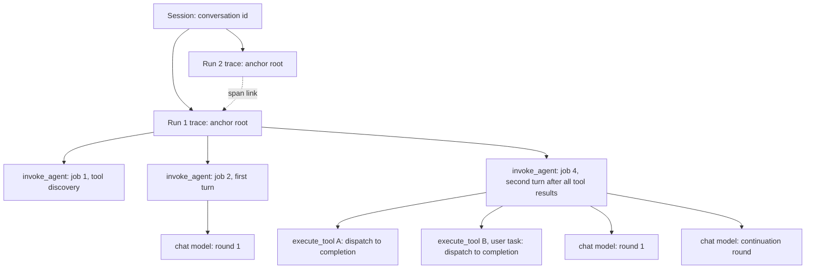
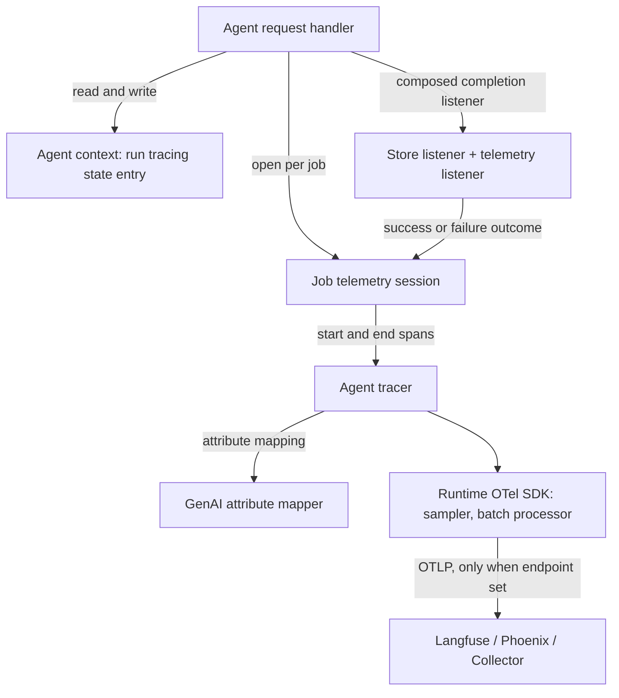
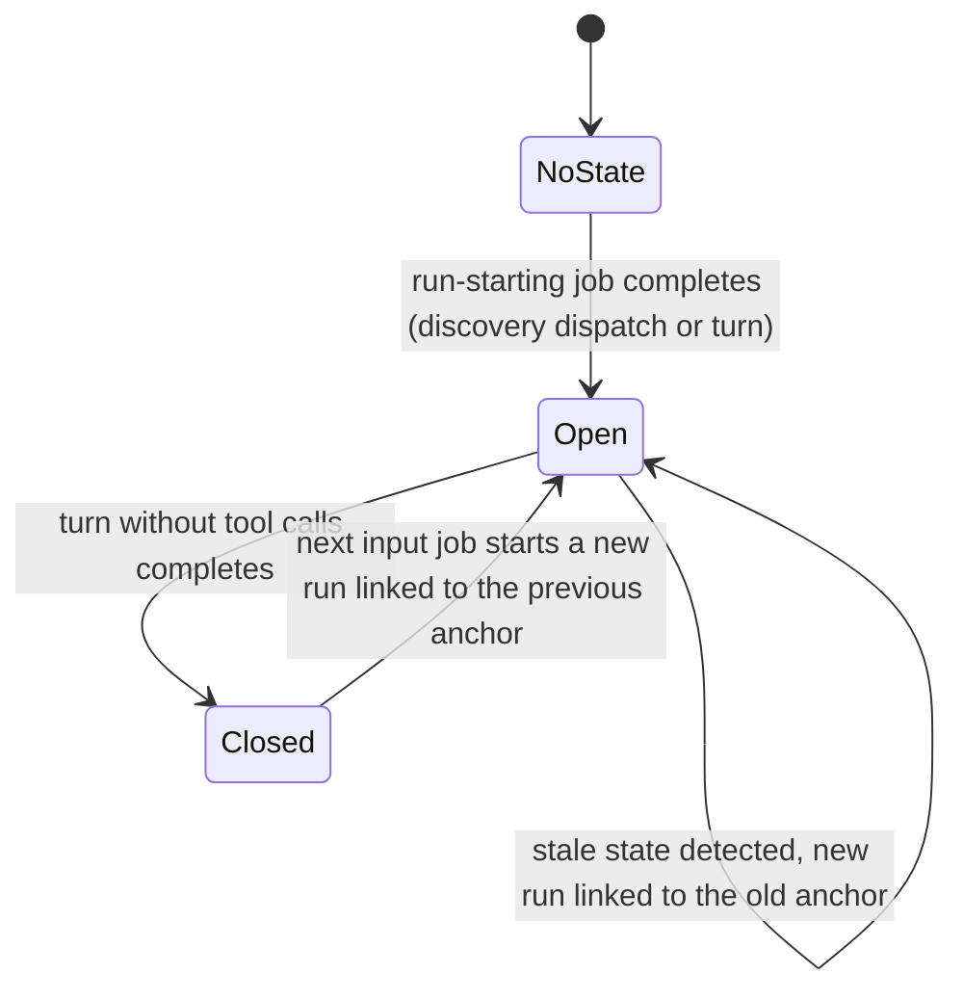
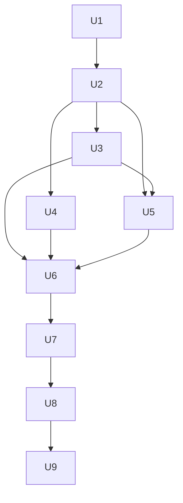

# AI Agent OpenTelemetry GenAI Tracing - Plan

## Goal Capsule

- **Objective:** Operators of self-managed and hybrid connector runtimes see every AI Agent run as an OpenTelemetry GenAI trace in their own LLM-observability backend (Langfuse, Arize Phoenix). Runs are grouped by conversation, and failed attempts are visible, so customers and the Agentic Orchestration pod can debug and evaluate agent behavior.
- **Means:** A second telemetry channel emitted by the AI Agent connector over OTLP through the runtime's Spring Boot OpenTelemetry setup, next to the unchanged agent-instance history API (KTD1, KTD2).
- **Product authority:** Agentic Orchestration pod owns the connector. Product has not prioritized OTel (product-hub#3314 "Production-Grade Observability for AI Agent Orchestration" is open but deprioritized; product wants to discover customer pull first). The PoC milestone is the evidence step that precedes a product decision on the production milestone.
- **Open blockers:** None for the PoC milestone. The production milestone is gated on the PoC exit criteria (Success Criteria) and on the product question in Outstanding Questions.
- **Authority hierarchy:** Product Contract requirements win on behavior; Key Technical Decisions win on mechanism within them; Implementation Units carry unit-local detail only.
- **Execution profile:** This plan's Implementation Units cover the PoC milestone only. Production-milestone work is listed under Deferred to Follow-Up Work and needs its own planning pass.
- **Stop conditions:** Stop and ask before adding any Maven dependency (repository rule), before running any real-LLM test or demo (paid), and before any `git push`. Stop and report if a PoC exit criterion fails in a way that invalidates the hybrid topology.
- **Who finishes:** `ce-work` implements U1–U9 on branch `ai-agent-otel-genai-tracing-plan`, committing per unit without pushing; the real-backend validation in U9 needs the user's go-ahead.

---

## Product Contract

### Summary

The AI Agent connector emits OTel GenAI semantic-convention spans over OTLP, enabled through Spring Boot's standard tracing configuration and off by default.
Each agent run, from an input to the final answer, becomes one trace: an early-exported anchor root, one `invoke_agent` span per job, and `chat` and `execute_tool` spans beneath it.
Runs of the same conversation group into one session, and consecutive runs are linked.
Delivery starts with a PoC slice that validates the trace shape in Langfuse and Arize Phoenix before the production hardening.

### Problem Frame

Customers have asked to see Camunda AI Agent executions in Arize Phoenix and Langfuse, the LLM-observability tools their AI teams already use for tracing and evaluation.
The pod needs the same view internally to evaluate agent behavior.
Today the only structured record is the agent-instance history API surfaced in Operate, which is Camunda-internal and records only the committed path of an agent.

Camunda has no trace propagation through jobs (camunda/camunda#9742 "As a Zeebe user, I want to see Open Telemetry support for Zeebe" and camunda/camunda#25864 "Introduce minimal job worker tracing" are open with no plan), and the connectors runtime has no tracing dependency at all.
Generic OTel Java agent instrumentation sees disconnected gRPC/HTTP calls but nothing about agents, turns, models, tokens, or tools.

The AI Agent's execution model makes naive tracing wrong.
An agent run is spread over many stateless job executions, possibly on different runtime instances.
Tool calls are BPMN activities that can take days (user tasks).
Parallel tool results produce partial-result jobs that do no agent work.
Jobs fail, retry, time out, and get superseded.
A trace design that holds spans open, re-emits spans, or assumes one process sees the whole run either loses data or produces duplicates and broken trees in the backends the customers named.

### Key Decisions

- **Connector-emitted channel over cluster-side reconstruction.** Only the connector sees failed attempts, model errors, stop reasons, request parameters, and LLM call start times. The cluster-side option remains a documented complement (see Cluster-Side Option Assessment). Governs R17, R10, R7. (session-settled: user-directed — chosen over reconstructing traces from agent-instance history records: the history data lacks required data points and the history API path must not be refactored now)
- **History API path stays unchanged.** The OTel channel is added beside the existing history pushes; no shared event seam refactor in this work. Governs R28. (session-settled: user-directed — chosen over refactoring the history API onto a shared event seam with two sinks: avoid touching the shipped history path now)
- **Hybrid topology: one trace per run with an early-exported anchor root.** The run-starting job creates the anchor root, persists its context, and exports it when that job completes; later jobs parent their spans to it. This avoids orphaned children on cancellation and keeps sampling consistent across jobs. The anchor root's duration carries no meaning. Governs R4, R5, R6, R3. (session-settled: user-directed — chosen over one trace per job grouped only by session, and over one trace per run with a root emitted after the fact at completion: user proposed the mix of both)
- **Run boundary is input to final answer.** A new run starts when the previous turn ended without tool calls. The trace is then the evaluation unit backends attach scores to. Governs R4. (session-settled: user-approved — chosen over one trace per conversation: evaluation granularity, per-request aggregates, trace size caps, and start-time indexing)
- **Every attempt visible, each tool execution recorded once.** Failed and superseded job attempts keep their spans so wasted token spend shows; tool executions are emitted only by the job that consumes them and completes. Governs R15, R16, R17. (session-settled: user-approved — chosen over recording only the committed path like the history API: auditability of retries and spend)
- **LLM-observability backends are the acceptance bar, with strict OTel GenAI semconv.** Emitting the spec shape also gives generic APM a valid span tree. Governs R24, R25. (session-settled: user-approved — chosen over targeting generic APM first: the goal is tracking agent execution, not generic tracing)
- **Self-managed and hybrid first.** Configuration uses the standard runtime properties customers already operate. Governs R1. (session-settled: user-directed — chosen over requiring SaaS-hosted runtime export in v1: per-tenant exporter config and credentials are a separate problem)
- **Content capture off by default, enabled by a runtime flag; per-agent override later.** Follows semconv default; the capture policy is resolved in one place so the override is additive. Governs R20, R23. (session-settled: user-approved — chosen over on-by-default and over per-agent override in v1)
- **Redaction SPI in v1.** Content-on is the evaluation mode, and tool results carry business data. Governs R21. (session-settled: user-directed — chosen over truncation-only with Collector-side redaction, and over external content storage)
- **Supported mechanism, upstream-tracking vocabulary.** Enablement, configuration, trace shape, and failure semantics are supported; attribute names follow the pinned upstream GenAI semconv version, which is still "Development". Governs R24. (session-settled: user-approved — chosen over an experimental-only feature: aim for supported, at least experimental)
- **Tracing requires an agent instance.** Only agents whose element carries an agent definition, and therefore get an agent instance, are traced; the agent instance key is the session identity. Governs R12, R30. (session-settled: user-directed — chosen over fallback identifiers for agents without an agent definition: one stable identity that also links to Operate)
- **PoC slice first.** Validate backend rendering of the hybrid shape before production hardening. Governs the Delivery Milestones section. (session-settled: user-directed — chosen over building the production scope directly)

### Actors

- A1. Operator: configures the connector runtime, the OTLP endpoint, sampling, content capture, and redaction.
- A2. Agent builder or evaluator: reads traces and sessions, scores runs, and debugs agent behavior in the backend. Includes customer AI teams and Camunda pod engineers.
- A3. Connector runtime: executes agent jobs and emits spans.
- A4. LLM-observability backend: Langfuse or Arize Phoenix, receiving OTLP directly or via an OTel Collector.

### Trace Shape



Job 3 in this example is a partial-result job (tool A finished first) and emits no spans, per R15.

### Requirements

**Enablement and configuration**

- R1. Agent tracing is off by default and is enabled through the runtime's standard Spring Boot and OTel configuration, including the OTLP endpoint; when disabled it has no runtime effect.
- R2. Enabling agent tracing does not silently enable tracing for every other connector in the runtime; whether other connectors and HTTP clients are traced is an explicit operator choice.
- R3. The sampling decision is made once per run and holds for every span of that run across all jobs.
- R30. Agent tracing applies only to agents that have an agent instance; agents without one emit no spans and write no tracing state.

**Trace model**

- R4. One trace represents one agent run: it starts with the first job after an input (first activation, user message, or event) and ends with the turn whose model response has no tool calls; the next input starts a new run.
- R5. The run's anchor root is exported by each attempt of the run-starting job when that attempt ends, and never depends on the run's completion.
- R6. Every job that does agent work (tool discovery or a turn) produces one `invoke_agent` span with its real duration.
- R7. Every model call round, including provider continuation rounds, produces one `chat` span carrying provider, requested and response model, token usage, finish reason, and response id.
- R8. Every tool call result consumed by a turn produces one `execute_tool` span from tool dispatch to engine completion, carrying tool name, tool call id, BPMN element id, and outcome, including cancelled tools.
- R9. Gateway tool discovery (MCP, A2A) is visible as part of the run in which it happens.
- R10. Model rejections (content filter, context window, guardrail), limit hits, and other agent failures appear as error spans with a low-cardinality error type.
- R11. Token usage follows the semconv totals rule: input tokens include cached tokens, with cache and reasoning counts as subsets.

**Correlation**

- R12. Every span carries the session identifier, the agent instance key prefixed with an operator-configured cluster id when one is set, as both `gen_ai.conversation.id` and `session.id`; it is the same for every attempt and every run of one agent instance.
- R13. Each run's anchor root links to the previous run's anchor root of the same conversation.
- R14. Spans carry Camunda identity: process instance key, element instance key, BPMN process id, tenant, the agent instance key when one exists, and the agent definition key as the agent id.

**Retries, aborts, and idempotency**

- R15. Partial-result jobs that only collect tool results emit no spans.
- R16. Each `execute_tool` span is emitted at most once and never twice, by the job that consumes the tool results, and only when that job completes successfully.
- R17. Each job activation produces its own spans; failed, timed-out, and superseded attempts are marked with their outcome and attempt, and their model calls and token usage remain visible.
- R18. Telemetry is best-effort: an export failure or slow backend never fails a job and adds no unbounded latency to it; when a worker crashes mid-job, that job's `invoke_agent` span is lost while already-exported `chat` spans remain in the run without their parent; when that job started the run, its anchor root is lost too and every later span of the run points to a root that never arrives.
- R19. When a process or the agent's sub-process is terminated while tools run, the run's trace ends without a closing marker; this is a documented limitation.

**Content capture**

- R20. Message content (system instructions, input and output messages, tool definitions, tool arguments and results) is captured only when the runtime content flag is on.
- R21. A redaction SPI receives all captured content before export and can mask or drop it.
- R22. Captured content is bounded by a configurable size cap that keeps the structured format valid; Camunda documents are represented as references with metadata, never as bytes.
- R23. The capture policy is resolved once per job, so a later per-agent override needs no change at emit sites.

**Conformance and backends**

- R24. Spans follow a pinned version of the OTel GenAI semantic conventions through a single attribute-mapping layer, and the user docs state that attribute names track upstream while the conventions are in Development status.
- R25. Traces render with correct span types, model I/O, tool calls, tokens, and session grouping in Langfuse and in Arize Phoenix 15.10 or later; a generic APM backend renders a valid span tree.

**Coverage**

- R26. Both the AI Agent Sub-process and the AI Agent Task are covered.
- R27. HTTP calls to the LLM provider made within a job appear as child spans of the corresponding `chat` span.

**Compatibility**

- R28. The agent-instance history API behavior and the persisted agent context stay compatible; tracing state added to the agent context is additive, and losing it (for example during a rolling upgrade) degrades to starting a new trace rather than failing.
- R29. Tool call metadata reserves trace context for the tool's span so a later runtime feature can parent tool-internal spans to it; no runtime-wide propagation is built here.

### Delivery Milestones

- **PoC milestone.** Covers R1, R3–R18, R19 (documentation), R20, R22 (document references only), R23, R24 (core attributes and the attribute-policy documentation), R28, R30, and the R25 validation, for the AI Agent Sub-process only. Content capture works without the redaction SPI and size cap. Validated end to end against local Langfuse and Arize Phoenix with a multi-tool agent that includes a user task. Exit criteria are in Success Criteria.
- **Production milestone.** Adds R2, R21, the R22 size cap, R26, R27, R29, the full R24 mapping, and a sampling policy. Starts only after the PoC exit criteria hold and the product question in Outstanding Questions is answered.

### Key Flows

- F1. Run with parallel tools including a user task
  - **Trigger:** A user message activates an AI Agent Sub-process with gateway tools.
  - **Actors:** A3, A4
  - **Steps:** The first job performs tool discovery, exports the anchor root, and emits its `invoke_agent` span. The next job runs the first turn and emits `invoke_agent` plus a `chat` span; the model calls tools A and B. Tool A completes; that partial-result job emits nothing. Tool B (user task) completes two days later; the proceeding job emits `invoke_agent`, `execute_tool` spans for A and B with their real dispatch and completion times, and `chat` spans for its model rounds. The model answers without tool calls, closing the run.
  - **Outcome:** One trace in the backend containing the whole run; the session lists it under the conversation.
  - **Covered by:** R4–R8, R12, R15, R16
- F2. Failed attempt and retry
  - **Trigger:** A job that continues an already-started run makes a successful model call, then fails and is retried.
  - **Actors:** A3, A4
  - **Steps:** The failing attempt's `invoke_agent` span ends with error status and outcome failed; its `chat` span and tokens are exported. The retry produces a new `invoke_agent` span with its own `chat` span in the same run trace.
  - **Outcome:** Both attempts and both model calls are visible in the run.
  - **Covered by:** R17, R18
- F3. Conversational re-trigger
  - **Trigger:** After the agent answered, a new user message or event reaches the same agent context.
  - **Actors:** A3, A2
  - **Steps:** The job sees that the previous turn had no tool calls, starts a new anchor root linked to the previous run's root, and persists the new context.
  - **Outcome:** A second trace in the same session, linked to the first.
  - **Covered by:** R4, R12, R13

### Acceptance Examples

- AE1. **Covers R15, R16.** Given a turn that called three tools in parallel, when the results arrive in three separate jobs, then the first two jobs emit no spans and the third job emits exactly three `execute_tool` spans.
- AE2. **Covers R16, R17.** Given the job consuming tool results (not the run-starting job) fails after its model call and is retried, when the retry completes, then the run shows two `invoke_agent` spans and two `chat` spans, and the `execute_tool` spans appear once, from the successful attempt.
- AE3. **Covers R17.** Given a job activation is superseded before it completes, when its completion command is rejected, then its `invoke_agent` span is exported with outcome superseded.
- AE4. **Covers R4, R13.** Given the agent answered without tool calls, when an event message arrives later, then a new trace starts with the same session identifier and a link to the previous run's anchor root.
- AE5. **Covers R20.** Given the content flag is off, when any span is exported, then it carries no message, instruction, tool-definition, tool-argument, or tool-result content.
- AE6. **Covers R19.** Given a user-task tool is still open, when the process instance is cancelled, then the run trace contains the anchor root and the completed jobs' spans, and no `execute_tool` span for the cancelled tool.
- AE7. **Covers R28.** Given a runtime on an older connector version ran a turn and left the tracing state stale or removed it, when the next job runs on a new runtime, then it starts a new run trace (linked to the previous one when the old state is still readable) and the job succeeds.
- AE8. **Covers R5, R12, R17.** Given the run-starting job makes a model call and then fails, when it is retried and succeeds, then the failed attempt's spans form their own trace, ended and marked failed, the retry's trace carries the run, and both traces share one session identifier.
- AE9. **Covers R10.** Given the model rejects a request because the context window is exceeded, when the job fails, then the `chat` span carries error status and a context-window error type.

### Success Criteria

- PoC exit criterion 1: Langfuse and Arize Phoenix render an anchor-root run trace whose child spans arrive hours or days after the root, including `execute_tool` spans that start before their `invoke_agent` parent, with usable timeline, latency, and trace list ordering; any rendering defect has a documented mitigation or invalidates the topology decision.
- PoC exit criterion 1b: Both backends keep spans findable when a parent was never exported: a job whose `invoke_agent` was lost (worker crash), and a run whose anchor root was lost (crash after the run-starting job's commit); a run whose first job fails on every attempt shows up as failed traces in its session.
- PoC exit criterion 2: Runs of one conversation appear as one session in both backends, using `session.id` and `gen_ai.conversation.id`.
- PoC exit criterion 3: The impact of adding tracing to the connector bundle on other connectors is measured, and a way to scope it per R2 is identified.
- PoC exit criterion 4: With content capture on, both backends show correct span types for `invoke_agent`, `chat`, and `execute_tool`, with model input and output, tool calls, token usage, and finish reasons.
- PoC exit criterion 5: A single run can be scored in both backends with its triggering input and final answer in view; if trace-level scoring cannot reach the final answer, the topology goes back to the user.
- Production: an evaluator can score a single run in Langfuse or Phoenix with content capture on and redaction applied, without reading process variables or Operate.

### Cluster-Side Option Assessment

Reconstructing traces from agent-instance and agent-history records (a custom Zeebe exporter in self-managed, or polling the agent-instance history search API, which also works for SaaS) was assessed as an alternative.
It has real advantages: one pipeline for Camunda and external agents (LangGraph, CrewAI) that report through the same API, visibility of process cancellation, no connector runtime change, and alignment with product's "standard data pipeline" direction.
It cannot meet this work's goal today because the records lack data points the traces need:

| Data point | Connector at runtime | Agent history record |
|---|---|---|
| Model call start time | Yes (span start) | No; only `producedAt` and a duration |
| Stop or finish reason | Yes | No |
| Response model and provider message id | Yes | No; model only on configuration items |
| Request parameters (temperature, max tokens) | Yes, in provider converters | No |
| Model rejections, limit hits, errors | Yes | No error items or failure status |
| Failed and retried attempts | Yes, per activation | No; items of other leases are discarded on commit, and items of never-completing jobs stay pending |
| Tool dispatch and completion time | Yes (message id time and engine completion) | Completion only (`producedAt` on tool results) |
| Trace and span ids, HTTP child spans | Yes | No |

Closing these gaps requires engine schema changes owned by the Core Features team.
The option stays a candidate complement for SaaS and external agents once those gaps close.

### Scope Boundaries

**Deferred for later**

- Export from the SaaS-hosted connectors runtime (per-cluster exporter configuration and credentials).
- Per-agent content capture override through an element template property.
- External content storage with references on spans (semconv has no reference format yet).
- Runtime-wide trace propagation into tool activities executed as other connector jobs; R29 only reserves the hook.
- Cluster-side reconstruction from agent-history records.
- A shared agent-event seam that also feeds the history API, and other sinks such as Kafka token metrics.
- Token-usage and duration metrics beyond what the chosen span instrumentation yields for free.

#### Deferred to Follow-Up Work

Production-milestone work, planned separately after the PoC exit criteria hold:

- Explicit scoping of other connectors' tracing in custom runtimes and its documentation (R2); the PoC only configures the default bundle.
- Redaction SPI and content size cap (R21, R22).
- AI Agent Task coverage (R26), including its per-pass element instances.
- Provider HTTP child spans: OkHttp library instrumentation for the Anthropic, OpenAI, Mistral, and Gemini SDK clients, and the AWS SDK integration for Bedrock (R27).
- Trace context reserved in tool call metadata (R29).
- `execute_tool` spans for gateway tool discovery calls (MCP, A2A); the PoC shows discovery through the discovery job's `invoke_agent` span (R9).
- Full attribute mapping: request parameters, per-modality usage splits, server address (R24).
- Cluster id auto-detection: a cluster-id accessor on the Camunda Java client topology (the REST topology has returned it since 8.9), used as the default session prefix.

#### Considered and Not Built

- A startup warning when agent tracing is on and the sampling ratio is below 1.0: operators see the ratio in the documented configuration and notice missing runs immediately; revisit if support cases show silent sampling confusion.
- A library-side span export filter that drops non-agent spans: the default bundle excludes the Observation-to-span bridge instead (KTD2); revisit if custom runtimes cannot set that exclusion.
- Micrometer Observation metrics for agent spans: retroactive spans yield no Observation metrics and the semconv metrics are out of PoC scope; revisit with the production metrics decision.

**Outside this work**

- Any change to the agent-instance history API, its records, or Operate.
- Camunda engine or Zeebe tracing.

### Dependencies / Assumptions

- OTel GenAI semconv is in Development status in the `semantic-conventions-genai` repository (split from the main semconv repository at v1.42.0 on 2026-06-12) with no tagged release; the core span types and attributes have been de facto stable since about v1.37.
- Arize Phoenix converts `gen_ai.*` attributes to OpenInference from 15.10.0, including `gen_ai.conversation.id` to `session.id` (its release note omits this; the conversion source has it). R12 emits both attributes anyway because Langfuse v4 and OpenInference-native tools read `session.id`.
- Langfuse v4 (the current self-host release) maps `gen_ai.operation.name` to observation types, reads the session from `session.id` or `gen_ai.conversation.id`, requires every span to be exported once and complete, and does not inherit trace-level attributes onto child spans; how it renders a short root with long-running later children is unverified and is PoC exit criterion 1.
- Arize Phoenix keeps the first write for a span id, so spans must never be re-emitted (R16, R17).
- Spring Boot 4.1.1 samples with a parent-based 10% trace-id ratio by default (`management.tracing.sampling.probability=0.10`), so only one run in ten is traced unless the operator raises it (R3, KTD12).
- Agent instance creation is idempotent per element instance, so a retried first job gets the same agent instance key and its spans land in the same session.
- Zeebe keys restart at 0 on every fresh cluster, so agent instance keys repeat across clusters; without the cluster-id prefix, two clusters exporting to one backend project merge unrelated sessions (trace ids are random and never collide).
- Datadog APM rejects spans that start more than 18 hours in the past; `execute_tool` spans for long user tasks will not ingest there. Accepted, because Langfuse and Phoenix are the acceptance bar.
- Tool dispatch time is persisted in the run tracing state when tool calls are issued (KTD9); message-id timestamps are not relied on because legacy ids are backfilled at read time.
- Customer demand is stated by the pod (customers asking for Phoenix and Langfuse); the internal research found no written customer request naming these tools.

### Outstanding Questions

**Deferred to Planning**

- Does product want the production milestone tracked under product-hub#3314, and does it need a PDP before shipping as a supported feature? This gates the production milestone, not planning of the PoC milestone.
- Default size cap for R22 and the redaction SPI contract for R21 (production milestone).
- How the Task flavor's per-pass element instances interact with R4 and R14 (production milestone).
- Provider HTTP client instrumentation for R27: OkHttp for Anthropic, OpenAI, Mistral, and Gemini; the AWS SDK Netty client for Bedrock.

### Sources / Research

- Execution model: `connectors/agentic-ai/connector-agentic-ai/src/main/java/io/camunda/connector/agenticai/aiagent/agent/BaseAgentRequestHandler.java` (turn flow, continuation loop, partial-result no-op path, completion listeners) and `connectors/agentic-ai/docs/reference/ai-agent.md` (distributed execution model).
- History channel: `connectors/agentic-ai/connector-agentic-ai/src/main/java/io/camunda/connector/agenticai/aiagent/agentinstance/CamundaAgentInstanceClient.java`, ADR 008 and ADR 013 under `connectors/agentic-ai/docs/adr/`.
- Conversation id: `ConversationContext.conversationId()`, implemented by the in-process, Camunda document, and AWS AgentCore stores.
- Job completion callbacks: SDK `JobCompletionListener` and `connector-runtime/connector-runtime-spring/.../outbound/job/SpringConnectorJobHandler.java`.
- Earlier Camunda-specific tracing design (OTel listed as a non-goal): branch `agentic-ai-execution-tracing-solution-design`, `connectors/agentic-ai/docs/tracing/design.md`.
- Product context: product-hub#3314 "Production-Grade Observability for AI Agent Orchestration"; product-hub#3462 "Real-Time Agent Visibility"; camunda/camunda#9742 and #25864.
- OTel GenAI semconv: https://github.com/open-telemetry/semantic-conventions-genai
- Arize Phoenix GenAI conversion: https://arize.com/docs/phoenix/release-notes/05-2026/05-15-2026-otel-semconv-conversion.md
- Langfuse OTel ingestion: https://langfuse.com/integrations/native/opentelemetry
- Durable-execution precedents: Temporal OpenTelemetry interceptors (replay skipping, linked short spans), Azure Durable Task tracing (retroactive spans with explicit start time), Restate (one span per attempt).
- Spring Boot 4.1.1 tracing modules and properties: https://github.com/spring-projects/spring-boot/tree/v4.1.1 (`module/spring-boot-opentelemetry`, `module/spring-boot-micrometer-tracing`, `module/spring-boot-micrometer-tracing-opentelemetry`); reference: https://docs.spring.io/spring-boot/4.0/reference/actuator/tracing.html
- Langfuse v4 OTel ingestion requirements: https://langfuse.com/integrations/native/opentelemetry/migration-to-v4
- Phoenix GenAI conversion source: https://github.com/Arize-ai/phoenix (`src/phoenix/trace/gen_ai/conversion.py`)

---

## Planning Contract

**Product Contract preservation:** changed: R16 — "exactly once" weakened to "at most once, never twice", because completion callbacks run after the job's complete command and a worker crash in between loses them (already implied by R18). Changed by user decision during review: R5, R12, AE8 (random run ids, session identity from the agent instance key), R30 and its Key Decision added (agent instance required), R18 extended (lost anchor root), Success Criteria extended (criteria 1, 1b, 4, 5), Delivery Milestones aligned with the PoC units. Clarified, no scope change: R5 (anchor exported when the run-starting job completes), R12 (session identifier defined as known from the first job onwards), the hybrid-topology Key Decision wording, AE7 (older connectors may leave stale state rather than drop it), AE8 (target behavior now concrete). Outstanding Questions resolved by planning were removed in place.

### Key Technical Decisions

- KTD1. **Raw OpenTelemetry API for agent spans; Spring integration through Boot's OTel SDK, exporter, and `management.opentelemetry.*` / `management.tracing.*` configuration.** Agent spans need explicit start timestamps, remote parents, links, and status without exceptions, which the Micrometer Observation API cannot express; Micrometer Tracing would add an adapter without gaining anything. Spans use their own instrumentation scope and the runtime's `OpenTelemetry` bean. Governs R1, R24. (session-settled: user-approved — chosen over building agent spans on the Micrometer Observation API: no start time, status, or links, and enabling the Observation bridge traces every connector)
- KTD2. **Dependency split: the agentic-ai module depends only on what it calls (the OTel API); the runtime application adds Boot's OTel tracing module, the Micrometer OTel bridge Boot requires, and the OTLP exporter, and excludes Boot's Observation-to-span auto-configuration.** The exclusion keeps inbound webhooks, actuator calls, `@Scheduled` tasks, and Boot-built HTTP clients of other connectors span-free while the SDK and exporter stay. Custom runtimes add the same dependencies and exclusion themselves. Governs R1, R2. (session-settled: user-approved — chosen over shipping the SDK and exporter inside the connector module: that would put tracing auto-configuration into every runtime that embeds the connector)
- KTD3. **Agent tracing has its own switches: `camunda.connector.agenticai.aiagent.tracing.enabled` (default false) and `camunda.connector.agenticai.aiagent.tracing.capture-content` (default false), plus the optional `camunda.connector.agenticai.aiagent.tracing.cluster-id` session prefix.** When tracing is disabled, or no `OpenTelemetry` bean exists, the handler receives a NO_OP tracer. Export is controlled separately by Boot: no exporter exists until `management.opentelemetry.tracing.export.otlp.endpoint` is set. Governs R1, R12, R20, R23.
- KTD4. **Run tracing state lives in one additive entry of the agent context `properties` map.** The entry holds the run's trace id, anchor span id, sampled flag, open/closed flag, the iteration key at write time, the process instance key, and the dispatch time of pending tool calls; a new run reads the previous anchor from the entry it replaces. It is written only on paths that already persist the agent context (tool-discovery dispatch and turns); no schema-version bump. Governs R3, R4, R13, R28. (session-settled: user-approved — chosen over a new top-level agent-context field and over inferring run state from conversation turns: older connectors keep unknown `properties` keys, and turn inference breaks across gateway tool discovery)
- KTD5. **Run identity uses SDK-assigned random ids.** The run-starting job starts the anchor as a live root span with its job start time; the SDK assigns trace and span ids, and they are persisted with the run tracing state when the job completes. Each attempt ends its own anchor exactly once: completed on success, failed on failure, so a failed first attempt is its own failed trace in the same session and the retry starts the run's trace. Governs R5, R17, AE8. (session-settled: user-directed — chosen over ids derived from the run-starting job key with a cluster salt: no ID-generator hook or salt is needed, and the failed attempt stays visible in the right session)
- KTD6. **Session identifier is the agent instance key, prefixed `<cluster-id>:` when the cluster-id property is set.** It is computed on every job, needs no persistence, and is set on every span because Langfuse v4 does not inherit trace-level attributes; jobs without an agent instance get the NO_OP session (R30). Governs R12, R30. (session-settled: user-directed — chosen over the conversation store's id and key-derived fallbacks: retry-stable from the first job and linkable to Operate; the operator-set prefix, documented with a one-backend-project-per-cluster recommendation, chosen over a runtime topology lookup and an upstream client change for the PoC)
- KTD7. **Per-job telemetry session with a single-ended `invoke_agent` span.** The session opens lazily once the job is known to do agent work (tool-discovery dispatch or a turn) with the job's start time as span start, so partial-result and other no-op jobs emit nothing. The `invoke_agent` span, and the anchor when this job started the run, is ended exactly once by whichever comes first: the handler's exception path (outcome failed, rethrow unchanged), the success callback (outcome completed), or the failure callback (outcome superseded, BPMN error, or command failure). The handler's existing store listener and the telemetry listener are composed so that a telemetry failure never affects the store callback. Governs R6, R15, R17, R18.
- KTD8. **`chat` spans wrap the one provider-neutral chat-model call site**, so every provider and every continuation round is covered. Token usage is set only on `chat` spans (Langfuse skips usage on agent spans; R11 totals computed from the normalized token usage, where input excludes cache). Rejections map to a low-cardinality `error.type` taken from the existing model error codes; other exceptions map to their class name. Error spans carry only error status and `error.type`; exception messages, status descriptions, and exception events are attached only when content capture is on, because provider error bodies and parameter-parsing messages can contain prompt or tool content. Governs R7, R10, R11, R20.
- KTD9. **`execute_tool` spans are built in the success callback** from tool-execution records captured while the turn composes its input: start is the dispatch time stored in the run tracing state when the previous turn issued the tool calls, end is the engine's `completedAt`; cancelled tools get outcome cancelled without error status; results without a stored dispatch time become zero-length spans at completion with a marker attribute. Names and call ids come from the originating tool call, element ids from the result. Governs R8, R16.
- KTD10. **Anchor root is a Camunda-named INTERNAL span (agent name plus "run") without `gen_ai.operation.name`**, carrying agent name, session identifier, run trigger, Camunda identity, and, when content capture is on, the run's triggering input. Keeping the GenAI operation off the anchor keeps `invoke_agent` durations and backend type mapping honest, since the anchor's duration is only the first job's. PoC exit criterion 1 checks the rendering; the fallback is a GenAI-typed anchor. Governs R5, R24, R25.
- KTD11. **Attempt discriminator is a short hash of the job's lease token**, set as an attribute on the job's `invoke_agent` span; the raw token is never exported. Retries count is not on the connector SDK job context and is not added in the PoC. Governs R17.
- KTD12. **Sampling uses the runtime's configured sampler.** The anchor root is the only span sampled by ratio; every later span is parented to the persisted context with its sampled flag, so a run is all-in or all-out. The PoC configuration and docs set the probability to 1.0. Governs R3.
- KTD13. **Run boundary.** A job starts a new run when no tracing state exists, when the state is closed, or when the state is stale: its iteration key differs from the agent context's last iteration key, its process instance differs, or it is open while a previous turn exists and ended without tool calls (an open state written by a tool-discovery dispatch, with no previous turn yet, continues the run). The state is closed in the context written by the job whose response has no tool calls. A new run links to the previous anchor when one is readable. Governs R4, R13, R28.
- KTD14. **Attribute vocabulary lives in one constants-and-mapping class pinned to semantic-conventions-genai main as of 2026-10-02**, not in the stale incubating semconv Java artifact. Provider names use the well-known values (`anthropic`, `openai`, `aws.bedrock`, `gcp.gemini`, `gcp.vertex_ai`, `mistral_ai`, `azure.ai.openai`); finish reasons use the schema's normalized set (`stop`, `length`, `content_filter`, `tool_call`, `error`). Governs R24.

### High-Level Technical Design

Component and data flow. One component per box; arrows show calls or data hand-off.



Job lifecycle for a job that consumes tool results and calls the model.

```mermaid
sequenceDiagram
  participant Z as Zeebe job
  participant H as Handler
  participant S as Telemetry session
  participant T as Tracer and SDK
  Z->>H: activate job
  H->>H: initialize and compose input
  alt partial results only
    H-->>Z: no-op completion, no spans
  else turn proceeds
    H->>S: open with job start time and run state
    S->>T: start invoke_agent (parent: anchor from run state)
    H->>S: record consumed tool executions
    loop each model round
      H->>T: chat span around the model call
    end
    H->>H: stamp run state (dispatch time, open or closed)
    H-->>Z: complete job with agent context
    Z-->>S: success callback
    S->>T: emit execute_tool spans, end invoke_agent (and anchor if run-starting)
  end
  Note over H,S: exception path ends invoke_agent with error and rethrows; failure callback ends it as superseded or BPMN error
```

Run tracing state as persisted across jobs.



### Assumptions

- The engine keeps one active job per AI Agent Sub-process element instance, so two jobs never both consume the same complete set of tool results; if this does not hold, the superseded one is labeled as such and tool spans still come only from the committed job.
- Boot 4.1.1's Observation-to-span auto-configuration can be excluded at the runtime application level while its OTel tracing auto-configuration keeps the SDK, sampler, and exporter (verified in the 4.1.1 sources by the framework research; confirmed in U2).

### Sequencing

U1 records the decision. U2 sets up dependencies and configuration. U3 and U4 build independent components on top of U2; U5 builds on U2 and U3. U6 combines them into the per-job session. U7 wires the handler. U8 proves job-level behavior end to end. U9 documents and validates against real backends.



---

## Implementation Units

### U1. ADR 015: OpenTelemetry GenAI tracing for the AI Agent

**Goal:** Record the decision before implementation, as the module requires.

**Requirements:** R1–R18, R20, R24, R28; KTD1, KTD2, KTD4, KTD5, KTD7, KTD10, KTD13

**Dependencies:** none

**Files:**
- Create: `connectors/agentic-ai/docs/adr/015-opentelemetry-genai-tracing.md`

**Approach:**
- Follow the header and section format of ADR 014; decision altitude only, no code or line numbers.
- State context (stateless jobs, days-long tools, history API gaps), considered options (cluster-side reconstruction, per-job traces, run trace with anchor root), the decision (KTD1, KTD2, KTD5, KTD13), and consequences (at-most-once tool spans, Datadog 18-hour window, semconv churn).
- Cite ADR 008 (tool-result timestamps), ADR 012 (message ids), and ADR 013 (turn updates).

**Patterns to follow:** `connectors/agentic-ai/docs/adr/014-route-v1-requests-through-native-providers.md`

**Test scenarios:** Test expectation: none -- documentation only.

**Verification:** The ADR names the chosen and rejected options and links this plan's Product Contract decisions.

### U2. Dependencies, configuration properties, and tracer wiring

**Goal:** Make agent tracing switchable and give the handler a tracer that is NO_OP unless enabled, while the default bundle gets an SDK and exporter without tracing other connectors.

**Requirements:** R1, R2 (default bundle), R3; KTD2, KTD3, KTD12

**Dependencies:** U1

**Files:**
- Modify: `connectors/agentic-ai/connector-agentic-ai/pom.xml`
- Modify: `apps/connector-runtime-application/pom.xml`
- Modify: `apps/connector-runtime-application/src/main/resources/application.properties`
- Modify: `connectors/agentic-ai/connector-agentic-ai/src/main/java/io/camunda/connector/agenticai/autoconfigure/AgenticAiConnectorsConfigurationProperties.java`
- Create: `connectors/agentic-ai/connector-agentic-ai/src/main/java/io/camunda/connector/agenticai/aiagent/tracing/configuration/AgentTracingConfiguration.java`
- Modify: `connectors/agentic-ai/connector-agentic-ai/src/main/java/io/camunda/connector/agenticai/autoconfigure/AgenticAiConnectorsAutoConfiguration.java`
- Test: `connectors/agentic-ai/connector-agentic-ai/src/test/java/io/camunda/connector/agenticai/autoconfigure/AgenticAiConnectorsAutoConfigurationTest.java`

**Approach:**
1. Ask the user before adding dependencies (repository rule), presenting the KTD2 list with Boot-managed versions.
2. Add a nested tracing properties record under the AI Agent properties (KTD3 names and defaults).
3. Add a tracing configuration imported by the master auto-configuration: the real tracer bean when the enable property is true and an `OpenTelemetry` bean exists, else the NO_OP tracer.
4. In the runtime application, add the KTD2 runtime dependencies (listed as ignored in the dependency-analysis plugin like the Prometheus registry) and exclude Boot's Micrometer Tracing auto-configuration.
5. Every new package gets a `package-info.java`.

**Patterns to follow:** `McpClientConfiguration` (off-by-default `@ConditionalOnBooleanProperty`, own sub-configuration imported from the master auto-configuration); the Prometheus registry entry in `apps/connector-runtime-application/pom.xml`.

**Test scenarios:**
- Default properties: the context contains the NO_OP tracer and no real tracer bean.
- Enable property true with an `OpenTelemetry` bean present: the real tracer bean is created.
- Enable property true without any `OpenTelemetry` bean: the NO_OP tracer is used and startup succeeds.
- Bean inventory list in the auto-configuration test includes the new tracing bean types.

**Verification:** The agentic-ai module builds with dependency analysis passing, and the runtime application starts with tracing disabled and no OTLP traffic.

### U3. GenAI attribute vocabulary and mapping

**Goal:** One place that turns agent data into semconv attributes, so upstream renames are a one-file change.

**Requirements:** R7, R8, R11, R12, R14, R20, R24; KTD8, KTD14

**Dependencies:** U2

**Files:**
- Create: `connectors/agentic-ai/connector-agentic-ai/src/main/java/io/camunda/connector/agenticai/aiagent/tracing/GenAiAttributes.java`
- Create: `connectors/agentic-ai/connector-agentic-ai/src/main/java/io/camunda/connector/agenticai/aiagent/tracing/GenAiAttributeMapper.java`
- Test: `connectors/agentic-ai/connector-agentic-ai/src/test/java/io/camunda/connector/agenticai/aiagent/tracing/GenAiAttributeMapperTest.java`

**Approach:**
- Constants for the `gen_ai.*`, `session.id`, `error.type`, and Camunda attributes (`camunda.process_instance.key`, `camunda.element_instance.key`, `camunda.bpmn_process_id`, `camunda.tenant_id`, `camunda.agent_instance.key`, `camunda.agent.job.kind`, `camunda.agent.job.outcome`, `camunda.agent.job.attempt`, `camunda.agent.run.trigger`, `camunda.agent.tool.outcome`, `camunda.agent.tool.start_time_source`).
- Provider-name mapping from the chat model configuration's provider type (KTD14 values).
- Finish-reason mapping from the provider-neutral stop reason; unknown stop reasons pass through verbatim.
- Usage: input total = new input + cache read + cache write; cache and reasoning counts as subsets (R11).
- Content (only when capture is on): system instructions, input and output messages, and tool definitions as semconv JSON parts; tool calls as `tool_call` parts, tool results as `tool_call_response` parts, reasoning as `reasoning` parts, Camunda documents as references with metadata.

**Patterns to follow:** provider-neutral types `StopReason`, `AgentMetrics.TokenUsage`, `AssistantMessage`, `ToolCallResultContent`.

**Test scenarios:**
- Each supported provider type maps to its well-known provider name; an unknown type maps to its configured provider id.
- Stop reasons STOP, LENGTH, TOOL_USE map to `stop`, `length`, `tool_call`; an unknown vendor reason passes through.
- Usage with 100 new input, 40 cache read, 10 cache write, 50 output of which 20 reasoning yields input 150, cache read 40, cache write 10, output 50, reasoning 20.
- Content capture off: the mapper produces no message, instruction, tool-definition, argument, or result attributes. Covers AE5.
- Content capture on: a conversation with system prompt, user text, assistant tool call, tool result, and a Camunda document yields valid JSON parts in order, with the document as a reference and no bytes.

**Verification:** Mapper tests pass and no other class references a `gen_ai.*` string literal.

### U4. Run tracing state and run-boundary decision

**Goal:** Persist and interpret the per-run tracing state so stateless jobs agree on run identity.

**Requirements:** R3, R4, R12, R13, R28, R30; KTD4, KTD6, KTD9, KTD13

**Dependencies:** U2

**Files:**
- Create: `connectors/agentic-ai/connector-agentic-ai/src/main/java/io/camunda/connector/agenticai/aiagent/tracing/RunTraceState.java`
- Create: `connectors/agentic-ai/connector-agentic-ai/src/main/java/io/camunda/connector/agenticai/aiagent/tracing/RunTraceStateResolver.java`
- Test: `connectors/agentic-ai/connector-agentic-ai/src/test/java/io/camunda/connector/agenticai/aiagent/tracing/RunTraceStateResolverTest.java`

**Approach:**
- A serializable record stored under one key in the agent context `properties` map, with read and write helpers that tolerate a missing or malformed entry.
- Resolution input: the stored state, the agent context's last iteration key and agent instance key, the job context, and whether the previous turn issued tool calls. Output: not traced (no agent instance), continue the open run, or start a new run with the previous anchor as link target (KTD13).
- Session identifier: the agent instance key with the optional cluster-id prefix (KTD6).
- The new run's ids are filled in from the started anchor (KTD5), not computed here.
- Update helpers stamp the tool-call dispatch time and close the run.

**Patterns to follow:** `AgentContext.withProperty`; `@AgenticAiRecord` records with record-builder; existing gateway property keys in `McpClientGatewayToolHandler`.

**Test scenarios:**
- No agent instance key: not traced, no state written. Covers R30.
- No state: a new run with no link target.
- Open state with a matching iteration key: continue, same trace and session.
- Closed state: a new run linked to the previous anchor, same session. Covers AE4.
- Stale state (iteration key mismatch, different process instance, or open while the previous turn had no tool calls): a new run linked to the old anchor. Covers AE7.
- Malformed entry: treated as no state, no exception.
- Open state written by a tool-discovery dispatch and no previous turn: the first turn continues the same run.
- Session identifier: `<cluster-id>:<agent instance key>` when the property is set, the bare agent instance key otherwise.
- Serialization round-trip through the connectors object mapper keeps all fields.

**Verification:** Resolver tests cover every branch of KTD13.

### U5. Agent tracer

**Goal:** A small facade that creates the four span kinds with explicit timestamps, remote parents, and links.

**Requirements:** R3, R5, R6, R7, R8, R13, R17; KTD1, KTD5, KTD10, KTD12

**Dependencies:** U2, U3

**Files:**
- Create: `connectors/agentic-ai/connector-agentic-ai/src/main/java/io/camunda/connector/agenticai/aiagent/tracing/AgentTracer.java`
- Create: `connectors/agentic-ai/connector-agentic-ai/src/main/java/io/camunda/connector/agenticai/aiagent/tracing/AgentTracerImpl.java`
- Modify: `connectors/agentic-ai/connector-agentic-ai/src/main/java/io/camunda/connector/agenticai/aiagent/tracing/configuration/AgentTracingConfiguration.java`
- Test: `connectors/agentic-ai/connector-agentic-ai/src/test/java/io/camunda/connector/agenticai/aiagent/tracing/AgentTracerImplTest.java`

**Approach:**
- The tracer interface has a NO_OP implementation and a real implementation on the runtime `OpenTelemetry` bean with its own instrumentation scope.
- Anchor creation starts a root span with the job start time and returns its SDK-assigned trace id, span id, and sampled flag for persistence (KTD5).
- Child spans take a remote parent context rebuilt from the run state, including its sampled flag.
- `execute_tool` spans take explicit start and end timestamps.
- Status and `error.type` are set without requiring exceptions.

**Patterns to follow:** registry and factory beans in `AgenticAiConnectorsAutoConfiguration`; interface in package root with `*Impl` beside it.

**Test scenarios:**
- An anchor started with a past start time exports with that start time, and the returned ids match the exported span.
- A child created from a rebuilt sampled context exports under the anchor's trace id; from an unsampled context it does not export.
- `execute_tool` span start and end equal the given timestamps, including a start earlier than its parent's start.
- An anchor that is never ended is never exported.
- The anchor carries a link to the previous anchor when given one.
- The NO_OP tracer creates nothing and never throws.

**Verification:** Tracer tests pass against the OTel SDK test exporter.

### U6. Per-job telemetry session

**Goal:** Own one job's spans and their single end, including outcome classification and tool-span emission.

**Requirements:** R6, R7, R8, R10, R15, R16, R17, R18, R20, R23; KTD7, KTD8, KTD9, KTD11

**Dependencies:** U3, U4, U5

**Files:**
- Create: `connectors/agentic-ai/connector-agentic-ai/src/main/java/io/camunda/connector/agenticai/aiagent/tracing/AgentJobTelemetry.java`
- Create: `connectors/agentic-ai/connector-agentic-ai/src/main/java/io/camunda/connector/agenticai/aiagent/tracing/AgentJobTelemetryImpl.java`
- Create: `connectors/agentic-ai/connector-agentic-ai/src/main/java/io/camunda/connector/agenticai/aiagent/tracing/ToolExecutionRecord.java`
- Test: `connectors/agentic-ai/connector-agentic-ai/src/test/java/io/camunda/connector/agenticai/aiagent/tracing/AgentJobTelemetryImplTest.java`

**Approach:**
- Opened by the handler once the job is known to do agent work, with job start time, resolved run state, job kind, and the content-capture policy resolved once (R23).
- Starts the anchor (new run) and `invoke_agent`.
- Exposes a wrapper for one model round that starts and ends a `chat` span and records usage, finish reason, response id, response model, and error type.
- Collects tool-execution records.
- End methods for success (emit tool spans, end `invoke_agent`, end the anchor if this job started the run), exception, and failure-callback outcomes (end `invoke_agent` and, for a run-starting job, the anchor as failed); an internal guard makes ending idempotent.
- Every telemetry error is caught and logged at debug level, never propagated (R18).

**Patterns to follow:** `ConversationSession` (per-job, `AutoCloseable`, default no-ops); `AgentJobCompletionListener` outcome types; `JobCompletionFailure` subtypes for classification.

**Test scenarios:**
- Success path: `invoke_agent` ends with outcome completed, tool spans emitted once, anchor ended only when the job started the run.
- Exception thrown during a model round: the `chat` span has error status and the rejection error type, and `invoke_agent` ends failed. Covers AE9.
- Failure callback with a superseded outcome after a response: `invoke_agent` ends superseded and no tool spans are emitted. Covers AE3.
- Failure callback for a BPMN error: outcome BPMN error.
- Ending twice (exception then failure callback): only the first end takes effect.
- Run-starting job failing: the anchor is ended once with failed status alongside `invoke_agent`. Covers AE8.
- Cancelled tool record: span outcome cancelled without error status.
- Tool record without dispatch time: zero-length span at completion with the marker attribute.
- Attempt attribute is a hash and differs from the raw lease token.
- An exporter or attribute failure inside the session does not propagate.
- Content capture off and a model call failing with an exception whose message contains prompt text: the exported spans carry error status and `error.type` only, with no status description and no exception event. Covers AE5.

**Verification:** Session tests pass, and each end path produces exactly one `invoke_agent` span.

### U7. Handler integration

**Goal:** Wire the telemetry session into the Sub-process (and shared base) handler at the existing emit points without changing agent behavior.

**Requirements:** R4, R5, R6, R7, R8, R9, R12, R13, R15, R16, R17, R28, R30; KTD4, KTD6, KTD7, KTD8, KTD9, KTD13

**Dependencies:** U6

**Files:**
- Modify: `connectors/agentic-ai/connector-agentic-ai/src/main/java/io/camunda/connector/agenticai/aiagent/agent/BaseAgentRequestHandler.java`
- Modify: `connectors/agentic-ai/connector-agentic-ai/src/main/java/io/camunda/connector/agenticai/aiagent/agent/AgentSubProcessRequestHandler.java`
- Modify: `connectors/agentic-ai/connector-agentic-ai/src/main/java/io/camunda/connector/agenticai/aiagent/agent/AgentTaskRequestHandler.java`
- Modify: `connectors/agentic-ai/connector-agentic-ai/src/main/java/io/camunda/connector/agenticai/autoconfigure/AgenticAiConnectorsAutoConfiguration.java`
- Test: `connectors/agentic-ai/connector-agentic-ai/src/test/java/io/camunda/connector/agenticai/aiagent/agent/AgentSubProcessRequestHandlerTest.java`
- Test: `connectors/agentic-ai/connector-agentic-ai/src/test/java/io/camunda/connector/agenticai/aiagent/agent/AgentTaskRequestHandlerTest.java`

**Approach:**
1. Inject the tracer into the handlers' constructors (singleton handler, not the prototype function beans); the two handler bean methods pass it.
2. Record the job start time on entry.
3. Open the session in the tool-discovery dispatch path and when composition yields a turn, only when the agent has an agent instance key; never on deferred, no-input, or discovery-pending paths.
4. Wrap the existing chat-model call site with the session's model-round wrapper.
5. Capture consumed tool executions from the composed turn input against the previous turn's tool calls.
6. Write the updated run tracing state into the agent context before the response is built: open or close the run, and stamp the dispatch time when tool calls were issued.
7. Compose the store listener with the telemetry listener, each isolated; give the discovery dispatch its telemetry listener.
8. Catch exceptions around the agent work only to end the session as failed, then rethrow the same exception.

The Task handler bean is wired with the NO_OP tracer in the PoC, so Task jobs write no tracing state and emit no spans until R26 is planned with its per-pass analysis.

**Execution note:** Keep existing handler test expectations green first; add the new tracer as a mock or NO_OP in both handler tests, because `@InjectMocks` leaves unmatched constructor arguments null.

**Patterns to follow:** existing `createStoreCompletionListener`, `buildConnectorResponse`, and `AgentContext.withProperty` usage in gateway handlers.

**Test scenarios:**
- Tool-call turn: the response's agent context contains an open run state with a dispatch time, and the composed listener calls both the store and the telemetry session on success.
- Final-answer turn: the persisted run state is closed.
- Deferred partial-result job: no telemetry session is opened, and the response carries no context or state change. Covers AE1 (job-level part).
- Tool-discovery dispatch: the persisted context carries the new run state and the response carries a telemetry listener.
- Model rejection: the same coded connector exception is still thrown and the session is ended as failed.
- Store listener throws on completion: the telemetry listener still runs, and the reverse.
- Tracing disabled: handler behavior and persisted context are identical to today (no tracing entry written).
- Tracing enabled: the Task handler still receives the NO_OP tracer, and a Task turn writes no tracing entry.
- Tracing enabled, element without an agent definition: no session is opened and no tracing entry is written. Covers R30.

**Verification:** All existing handler and listener-delegation tests pass unchanged apart from constructor wiring, and the new scenarios pass.

### U8. End-to-end tests with an in-memory span exporter

**Goal:** Prove job-completion semantics, persistence, and span shape across real jobs in the in-process runtime.

**Requirements:** R4–R8, R12, R13, R15–R17, R20, R28, R30; F1, F2, F3; AE1–AE5, AE8

**Dependencies:** U7

**Files:**
- Modify: `connectors-e2e-test/connectors-e2e-test-agentic-ai/pom.xml`
- Create: `connectors-e2e-test/connectors-e2e-test-agentic-ai/src/test/java/io/camunda/connector/e2e/agenticai/aiagent/tracing/InMemoryTracingTestConfiguration.java`
- Create: `connectors-e2e-test/connectors-e2e-test-agentic-ai/src/test/java/io/camunda/connector/e2e/agenticai/aiagent/subprocess/AgentSubProcessTracingTests.java`

**Approach:**
- A test configuration provides an OTel SDK with an always-on sampler and an in-memory exporter as the `OpenTelemetry` bean, and the test class enables agent tracing through test properties.
- The exporter is reset before each test.
- Assertions wait for spans with Awaitility, because completion callbacks run after the complete command.
- Scenarios are driven by WireMock provider stubs and held-back tool jobs, and the process test context completes the held-back tool job.

**Execution note:** Install the agentic-ai module to the local Maven repository before running this module, and never build with `-am`.

**Patterns to follow:** `AgentSubProcessAgentInstanceTests` (parallel tools with a held-back slow tool and a user-feedback task); `BaseAgentSubProcessTest`; `CamundaDocumentTestConfiguration` and `@TestPropertySource` usage in the MCP and A2A integration tests.

**Test scenarios:**
- Covers F1 / AE1. Two parallel tools with one held back, then a final answer: one trace with one anchor, one `invoke_agent` span for the first turn and one for the consuming turn, two `execute_tool` spans under the consuming turn with start before end and end equal to engine completion, and no spans from the partial-result job.
- Covers F3 / AE4. User feedback after the final answer starts a second trace with the same session identifier and a link to the first anchor.
- Covers F2 / AE2. A model stub fails once on the consuming turn and the job is retried: two `invoke_agent` spans (failed and completed), two `chat` spans, `execute_tool` spans once.
- Covers AE8. The run-starting job fails once after its model call: the failed attempt exports its own trace with a failed anchor, the retry's trace carries the run, and both share the session identifier.
- Covers AE5. With content capture off, no exported span carries content attributes, status descriptions, or exception events, including on a failed model call; with it on, `chat` spans carry input and output messages.
- Tracing disabled for one test class: no spans exported and the agent context has no tracing entry.
- Covers R30. An agent element without an agent definition: no spans exported with tracing enabled.

**Verification:** The new e2e class passes alongside the existing agentic-ai e2e suite.

### U9. Documentation and PoC backend validation

**Goal:** Document how to enable and read agent traces, and run the PoC exit checks against real Langfuse and Phoenix.

**Requirements:** R1, R12, R18, R19, R24, R25; Success Criteria (PoC exit criteria 1, 1b, 2, 3, 4, 5)

**Dependencies:** U8

**Files:**
- Modify: `connectors/agentic-ai/docs/reference/ai-agent.md`
- Modify: `connectors/agentic-ai/AGENTS.md`
- Create: `connectors/agentic-ai/docs/reference/opentelemetry-tracing.md`
- Modify: `docs/plans/2026-10-05-1445-feat-ai-agent-otel-genai-tracing-plan.md`

**Approach:**
- Reference doc: configuration properties (KTD3 including the cluster-id prefix, plus the Boot OTLP endpoint, headers, sampling at 1.0), the recommendation of one backend project per cluster, the agent-definition prerequisite, the trace model with run boundary and session identifier, attribute policy (pinned semconv, Development status), limitations (at-most-once on crash after commit, process termination, Datadog 18-hour window), and a local validation recipe: Langfuse v4 self-host compose with the Basic auth header and `x-langfuse-ingestion-version: 4`, and Phoenix via its pinned container with the protobuf OTLP endpoint.
- `ai-agent.md`: add the tracing entry to the Spring configuration and agent-context-properties sections and link the new doc.
- `AGENTS.md`: navigation entry and the gotcha that tracing state is written only on persisting paths.
- Validation, after the user approves real-LLM usage, through the default bundle against both backends:
  1. One multi-tool agent run with a user task and content capture on (criteria 1, 2, 4, 5), including scoring one run in each backend.
  2. A run whose first job fails on every attempt, and a worker killed after the run-starting job's commit and once mid-job (criterion 1b).
  3. A REST connector call and an inbound webhook with tracing enabled, counting the spans they produce (criterion 3).
  4. Record each criterion's outcome in this plan's Success Criteria section.

**Test scenarios:** Test expectation: none -- documentation and manual validation; the automated proof is U8.

**Verification:** Each PoC exit criterion has a recorded outcome, and any failure is either mitigated or raised to the user as a topology decision.

---

## System-Wide Impact

- The default bundle runtime gains the OTel SDK and an exporter that stays inactive until an endpoint is configured; Boot's Observation-to-span bridge is excluded so other connectors' HTTP and scheduled work produce no spans.
- Runtimes that embed the connector without the runtime application see only the OTel API on the classpath; without an `OpenTelemetry` bean they get the NO_OP tracer.
- The `agentContext` process variable grows by one small entry when tracing is enabled; nothing changes when it is disabled.
- The agent-instance history API, element templates, and the SaaS bundle are untouched.

## Risks & Dependencies

| Risk | Mitigation |
|---|---|
| Langfuse v4 or Phoenix render the anchor-root shape poorly (PoC exit criterion 1) | KTD10 fallback to a GenAI-typed anchor; topology revisited with the user if both fail |
| Session views merge unrelated agents when several or reset clusters share one backend project without a cluster-id prefix | Optional prefix property and one-project-per-cluster guidance in the docs; trace ids are random and unaffected |
| The final answer exists only on the last job's spans, so trace-level evaluation may not see it (PoC exit criterion 5) | Anchor carries the triggering input when capture is on; if scoring needs the answer at trace level, the topology goes back to the user |
| Semconv renames attributes again | KTD14 isolates names in one class pinned to a dated revision |
| Phoenix reads a legacy cache-creation attribute name instead of `cache_write` | Checked in U9; mapper can emit both names if needed |
| Retroactive tool spans older than a backend's ingest window are dropped (Datadog 18 hours) | Documented limitation; not an acceptance backend |
| Worker crash after job completion loses that job's `invoke_agent` and tool spans | Documented at-most-once guarantee (R16, R18); flush happens through the SDK's shutdown hook |
| New dependencies need approval and pass dependency analysis | U2 asks first; runtime-only deps are declared as ignored where the analysis plugin requires it |

---

## Verification Contract

| Gate | Command or check | Proves |
|---|---|---|
| Module build and unit tests | `mvn clean install -f connectors/agentic-ai/pom.xml` (run outside the sandbox when Mockito fails on MockMaker) | U2–U7 unit tests, dependency analysis, NullAway |
| Formatting and license headers | `mvn spotless:apply` and `mvn license:format` on the touched modules only, never with `-am` | Repository conventions |
| Runtime application build | `mvn clean install -f apps/connector-runtime-application/pom.xml` | KTD2 dependencies and properties |
| End-to-end tracing tests | `mvn test -pl connectors-e2e-test/connectors-e2e-test-agentic-ai -Dtest=AgentSubProcessTracingTests` after installing the agentic-ai module locally | U8 scenarios, F1–F3, AE1–AE5, AE8 |
| Existing agentic-ai e2e regression | `mvn test -pl connectors-e2e-test/connectors-e2e-test-agentic-ai` once at the end | No behavior change with tracing disabled |
| PoC backend validation | Manual runs per U9, only after user approval for real-LLM calls | PoC exit criteria 1, 1b, 2, 3, 4, 5 |

## Definition of Done

- U1–U9 are implemented and committed on `ai-agent-otel-genai-tracing-plan`, nothing pushed.
- With tracing disabled, the agentic-ai unit tests and the full agentic-ai e2e suite pass with no change to persisted agent context.
- With tracing enabled, `AgentSubProcessTracingTests` passes all scenarios.
- The PoC exit criteria have recorded outcomes in Success Criteria.
- Reference docs, `ai-agent.md`, and `AGENTS.md` describe the current behavior only.
- No experimental or abandoned code from approaches that did not pan out remains in the diff.
