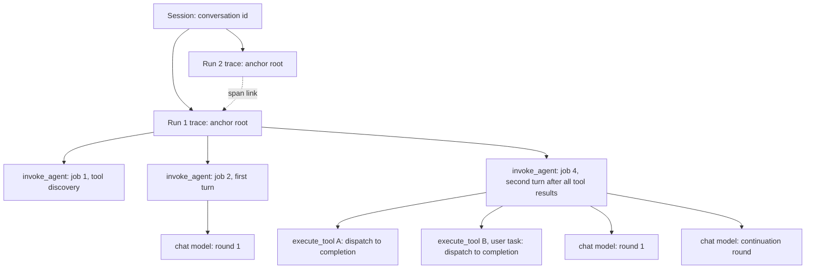

# AI Agent OpenTelemetry GenAI Tracing - Plan

## Goal Capsule

- **Objective:** Operators of self-managed and hybrid connector runtimes see every AI Agent run as an OpenTelemetry GenAI trace in their own LLM-observability backend (Langfuse, Arize Phoenix). Runs are grouped by conversation, and failed attempts are visible, so customers and the Agentic Orchestration pod can debug and evaluate agent behavior.
- **Means:** A second telemetry channel emitted by the AI Agent connector over OTLP, next to the unchanged agent-instance history API.
- **Product authority:** Agentic Orchestration pod owns the connector. Product has not prioritized OTel (product-hub#3314 "Production-Grade Observability for AI Agent Orchestration" is open but deprioritized; product wants to discover customer pull first). The PoC milestone is the evidence step that precedes a product decision on the production milestone.
- **Open blockers:** None for the PoC milestone. The production milestone is gated on the PoC exit criteria (Success Criteria) and on the product question in Outstanding Questions.

---

## Product Contract

### Summary

The AI Agent connector emits OTel GenAI semantic-convention spans over OTLP, enabled through Spring Boot's standard tracing configuration and off by default.
Each agent run, from an input to the final answer, becomes one trace: an early-exported anchor root, one `invoke_agent` span per job, and `chat` and `execute_tool` spans beneath it.
Runs of the same conversation group into one session, and consecutive runs are linked.
Delivery starts with a PoC slice that validates the trace shape in Langfuse and Arize Phoenix before the production hardening.

### Problem Frame

Customers have asked to see Camunda AI Agent executions in Arize Phoenix and Langfuse, the LLM-observability tools their AI teams already use for tracing and evaluation.
The pod needs the same view internally to evaluate agent behavior.
Today the only structured record is the agent-instance history API surfaced in Operate, which is Camunda-internal and records only the committed path of an agent.

Camunda has no trace propagation through jobs (camunda/camunda#9742 "As a Zeebe user, I want to see Open Telemetry support for Zeebe" and camunda/camunda#25864 "Introduce minimal job worker tracing" are open with no plan), and the connectors runtime has no tracing dependency at all.
Generic OTel Java agent instrumentation sees disconnected gRPC/HTTP calls but nothing about agents, turns, models, tokens, or tools.

The AI Agent's execution model makes naive tracing wrong.
An agent run is spread over many stateless job executions, possibly on different runtime instances.
Tool calls are BPMN activities that can take days (user tasks).
Parallel tool results produce partial-result jobs that do no agent work.
Jobs fail, retry, time out, and get superseded.
A trace design that holds spans open, re-emits spans, or assumes one process sees the whole run either loses data or produces duplicates and broken trees in the backends the customers named.

### Key Decisions

- **Connector-emitted channel over cluster-side reconstruction.** Only the connector sees failed attempts, model errors, stop reasons, request parameters, and LLM call start times. The cluster-side option remains a documented complement (see Cluster-Side Option Assessment). Governs R17, R10, R7. (session-settled: user-directed — chosen over reconstructing traces from agent-instance history records: the history data lacks required data points and the history API path must not be refactored now)
- **History API path stays unchanged.** The OTel channel is added beside the existing history pushes; no shared event seam refactor in this work. Governs R28. (session-settled: user-directed — chosen over refactoring the history API onto a shared event seam with two sinks: avoid touching the shipped history path now)
- **Hybrid topology: one trace per run with an early-exported anchor root.** The first job of a run creates and immediately exports a short anchor root and persists its context; later jobs parent their spans to it. This avoids orphaned children on cancellation and keeps sampling consistent across jobs. The anchor root's duration carries no meaning. Governs R4, R5, R6, R3. (session-settled: user-directed — chosen over one trace per job grouped only by session, and over one trace per run with a root emitted after the fact at completion: user proposed the mix of both)
- **Run boundary is input to final answer.** A new run starts when the previous turn ended without tool calls. The trace is then the evaluation unit backends attach scores to. Governs R4. (session-settled: user-approved — chosen over one trace per conversation: evaluation granularity, per-request aggregates, trace size caps, and start-time indexing)
- **Every attempt visible, each tool execution recorded once.** Failed and superseded job attempts keep their spans so wasted token spend shows; tool executions are emitted only by the job that consumes them and completes. Governs R15, R16, R17. (session-settled: user-approved — chosen over recording only the committed path like the history API: auditability of retries and spend)
- **LLM-observability backends are the acceptance bar, with strict OTel GenAI semconv.** Emitting the spec shape also gives generic APM a valid span tree. Governs R24, R25. (session-settled: user-approved — chosen over targeting generic APM first: the goal is tracking agent execution, not generic tracing)
- **Self-managed and hybrid first.** Configuration uses the standard runtime properties customers already operate. Governs R1. (session-settled: user-directed — chosen over requiring SaaS-hosted runtime export in v1: per-tenant exporter config and credentials are a separate problem)
- **Content capture off by default, enabled by a runtime flag; per-agent override later.** Follows semconv default; the capture policy is resolved in one place so the override is additive. Governs R20, R23. (session-settled: user-approved — chosen over on-by-default and over per-agent override in v1)
- **Redaction SPI in v1.** Content-on is the evaluation mode, and tool results carry business data. Governs R21. (session-settled: user-directed — chosen over truncation-only with Collector-side redaction, and over external content storage)
- **Supported mechanism, upstream-tracking vocabulary.** Enablement, configuration, trace shape, and failure semantics are supported; attribute names follow the pinned upstream GenAI semconv version, which is still "Development". Governs R24. (session-settled: user-approved — chosen over an experimental-only feature: aim for supported, at least experimental)
- **PoC slice first.** Validate backend rendering of the hybrid shape before production hardening. Governs the Delivery Milestones section. (session-settled: user-directed — chosen over building the production scope directly)

### Actors

- A1. Operator: configures the connector runtime, the OTLP endpoint, sampling, content capture, and redaction.
- A2. Agent builder or evaluator: reads traces and sessions, scores runs, and debugs agent behavior in the backend. Includes customer AI teams and Camunda pod engineers.
- A3. Connector runtime: executes agent jobs and emits spans.
- A4. LLM-observability backend: Langfuse or Arize Phoenix, receiving OTLP directly or via an OTel Collector.

### Trace Shape

Job 3 in this example is a partial-result job (tool A finished first) and emits no spans, per R15.

### Requirements

**Enablement and configuration**

- R1. Agent tracing is off by default and is enabled through the runtime's standard Spring Boot and OTel configuration, including the OTLP endpoint; when disabled it has no runtime effect.
- R2. Enabling agent tracing does not silently enable tracing for every other connector in the runtime; whether other connectors and HTTP clients are traced is an explicit operator choice.
- R3. The sampling decision is made once per run and holds for every span of that run across all jobs.

**Trace model**

- R4. One trace represents one agent run: it starts with the first job after an input (first activation, user message, or event) and ends with the turn whose model response has no tool calls; the next input starts a new run.
- R5. The run's anchor root is exported at run start and never depends on a later completion signal.
- R6. Every job that does agent work (tool discovery or a turn) produces one `invoke_agent` span with its real duration.
- R7. Every model call round, including provider continuation rounds, produces one `chat` span carrying provider, requested and response model, token usage, finish reason, and response id.
- R8. Every tool call result consumed by a turn produces one `execute_tool` span from tool dispatch to engine completion, carrying tool name, tool call id, BPMN element id, and outcome, including cancelled tools.
- R9. Gateway tool discovery (MCP, A2A) is visible as part of the run in which it happens.
- R10. Model rejections (content filter, context window, guardrail), limit hits, and other agent failures appear as error spans with a low-cardinality error type.
- R11. Token usage follows the semconv totals rule: input tokens include cached tokens, with cache and reasoning counts as subsets.

**Correlation**

- R12. Every span carries the conversation id as both `gen_ai.conversation.id` and `session.id`.
- R13. Each run's anchor root links to the previous run's anchor root of the same conversation.
- R14. Spans carry Camunda identity: process instance key, element instance key, BPMN process id, tenant, the agent instance key when one exists, and the agent definition key as the agent id.

**Retries, aborts, and idempotency**

- R15. Partial-result jobs that only collect tool results emit no spans.
- R16. Each `execute_tool` span is emitted exactly once, by the job that consumes the tool results, and only when that job completes successfully.
- R17. Each job activation produces its own spans; failed, timed-out, and superseded attempts are marked with their outcome and attempt, and their model calls and token usage remain visible.
- R18. Telemetry is best-effort: an export failure or slow backend never fails a job and adds no unbounded latency to it; when a worker crashes mid-job, that job's `invoke_agent` span is lost while already-exported `chat` spans remain in the run without their parent.
- R19. When a process or the agent's sub-process is terminated while tools run, the run's trace ends without a closing marker; this is a documented limitation.

**Content capture**

- R20. Message content (system instructions, input and output messages, tool definitions, tool arguments and results) is captured only when the runtime content flag is on.
- R21. A redaction SPI receives all captured content before export and can mask or drop it.
- R22. Captured content is bounded by a configurable size cap that keeps the structured format valid; Camunda documents are represented as references with metadata, never as bytes.
- R23. The capture policy is resolved once per job, so a later per-agent override needs no change at emit sites.

**Conformance and backends**

- R24. Spans follow a pinned version of the OTel GenAI semantic conventions through a single attribute-mapping layer, and the user docs state that attribute names track upstream while the conventions are in Development status.
- R25. Traces render with correct span types, model I/O, tool calls, tokens, and session grouping in Langfuse and in Arize Phoenix 15.10 or later; a generic APM backend renders a valid span tree.

**Coverage**

- R26. Both the AI Agent Sub-process and the AI Agent Task are covered.
- R27. HTTP calls to the LLM provider made within a job appear as child spans of the corresponding `chat` span.

**Compatibility**

- R28. The agent-instance history API behavior and the persisted agent context stay compatible; tracing state added to the agent context is additive, and losing it (for example during a rolling upgrade) degrades to starting a new trace rather than failing.
- R29. Tool call metadata reserves trace context for the tool's span so a later runtime feature can parent tool-internal spans to it; no runtime-wide propagation is built here.

### Delivery Milestones

- **PoC milestone.** Covers R1, R3–R18, R20, R28, R24 (core attributes only), and the R25 validation, for the AI Agent Sub-process only. Content capture is flag-only, without the redaction SPI and size cap. Validated end to end against local Langfuse and Arize Phoenix with a multi-tool agent that includes a user task. Exit criteria are in Success Criteria.
- **Production milestone.** Adds R2, R19 documentation, R21–R23, R26, R27, R29, full R24 mapping and user documentation, and a sampling policy. Starts only after the PoC exit criteria hold and the product question in Outstanding Questions is answered.

### Key Flows

- F1. Run with parallel tools including a user task
  - **Trigger:** A user message activates an AI Agent Sub-process with gateway tools.
  - **Actors:** A3, A4
  - **Steps:** The first job performs tool discovery, exports the anchor root, and emits its `invoke_agent` span. The next job runs the first turn and emits `invoke_agent` plus a `chat` span; the model calls tools A and B. Tool A completes; that partial-result job emits nothing. Tool B (user task) completes two days later; the proceeding job emits `invoke_agent`, `execute_tool` spans for A and B with their real dispatch and completion times, and `chat` spans for its model rounds. The model answers without tool calls, closing the run.
  - **Outcome:** One trace in the backend containing the whole run; the session lists it under the conversation.
  - **Covered by:** R4–R8, R12, R15, R16
- F2. Failed attempt and retry
  - **Trigger:** A job that continues an already-started run makes a successful model call, then fails and is retried.
  - **Actors:** A3, A4
  - **Steps:** The failing attempt's `invoke_agent` span ends with error status and outcome failed; its `chat` span and tokens are exported. The retry produces a new `invoke_agent` span with its own `chat` span in the same run trace.
  - **Outcome:** Both attempts and both model calls are visible in the run.
  - **Covered by:** R17, R18
- F3. Conversational re-trigger
  - **Trigger:** After the agent answered, a new user message or event reaches the same agent context.
  - **Actors:** A3, A2
  - **Steps:** The job sees that the previous turn had no tool calls, starts a new anchor root linked to the previous run's root, and persists the new context.
  - **Outcome:** A second trace in the same session, linked to the first.
  - **Covered by:** R4, R12, R13

### Acceptance Examples

- AE1. **Covers R15, R16.** Given a turn that called three tools in parallel, when the results arrive in three separate jobs, then the first two jobs emit no spans and the third job emits exactly three `execute_tool` spans.
- AE2. **Covers R16, R17.** Given the job consuming tool results (not the run-starting job) fails after its model call and is retried, when the retry completes, then the run shows two `invoke_agent` spans and two `chat` spans, and the `execute_tool` spans appear once, from the successful attempt.
- AE3. **Covers R17.** Given a job activation is superseded before it completes, when its completion command is rejected, then its `invoke_agent` span is exported with outcome superseded.
- AE4. **Covers R4, R13.** Given the agent answered without tool calls, when an event message arrives later, then a new trace starts with the same conversation id and a link to the previous run's anchor root.
- AE5. **Covers R20.** Given the content flag is off, when any span is exported, then it carries no message, instruction, tool-definition, tool-argument, or tool-result content.
- AE6. **Covers R19.** Given a user-task tool is still open, when the process instance is cancelled, then the run trace contains the anchor root and the completed jobs' spans, and no `execute_tool` span for the cancelled tool.
- AE7. **Covers R28.** Given a runtime on an older connector version rewrites the agent context and drops the tracing state, when the next job on a new runtime runs, then it starts a new run trace and the job succeeds.
- AE8. **Covers R5, R17.** Given the run-starting job exports the anchor root and then fails, when it is retried, then the retry finds no persisted anchor (the agent context was not written) and today would start a second trace, and on a conversation's very first job also a new conversation id; the target behavior is that the retry rejoins the failed attempt's trace (see Outstanding Questions).
- AE9. **Covers R10.** Given the model rejects a request because the context window is exceeded, when the job fails, then the `chat` span carries error status and a context-window error type.

### Success Criteria

- PoC exit criterion 1: Langfuse and Arize Phoenix render an anchor-root run trace whose child spans arrive hours or days after the root, with usable timeline, latency, and trace list ordering; any rendering defect has a documented mitigation or invalidates the topology decision.
- PoC exit criterion 1b: Both backends render a run in which one job's `invoke_agent` parent was never exported (worker crash) without hiding that job's `chat` spans.
- PoC exit criterion 2: Runs of one conversation appear as one session in both backends, using `session.id` and `gen_ai.conversation.id`.
- PoC exit criterion 3: The impact of adding tracing to the connector bundle on other connectors is measured, and a way to scope it per R2 is identified.
- Production: an evaluator can score a single run in Langfuse or Phoenix with content capture on and redaction applied, without reading process variables or Operate.

---

### Cluster-Side Option Assessment

Reconstructing traces from agent-instance and agent-history records (a custom Zeebe exporter in self-managed, or polling the agent-instance history search API, which also works for SaaS) was assessed as an alternative.
It has real advantages: one pipeline for Camunda and external agents (LangGraph, CrewAI) that report through the same API, visibility of process cancellation, no connector runtime change, and alignment with product's "standard data pipeline" direction.
It cannot meet this work's goal today because the records lack data points the traces need:

| Data point | Connector at runtime | Agent history record |
|---|---|---|
| Model call start time | Yes (span start) | No; only `producedAt` and a duration |
| Stop or finish reason | Yes | No |
| Response model and provider message id | Yes | No; model only on configuration items |
| Request parameters (temperature, max tokens) | Yes, in provider converters | No |
| Model rejections, limit hits, errors | Yes | No error items or failure status |
| Failed and retried attempts | Yes, per activation | No; items of other leases are discarded on commit, and items of never-completing jobs stay pending |
| Tool dispatch and completion time | Yes (message id time and engine completion) | Completion only (`producedAt` on tool results) |
| Trace and span ids, HTTP child spans | Yes | No |

Closing these gaps requires engine schema changes owned by the Core Features team.
The option stays a candidate complement for SaaS and external agents once those gaps close.

### Scope Boundaries

**Deferred for later**

- Export from the SaaS-hosted connectors runtime (per-cluster exporter configuration and credentials).
- Per-agent content capture override through an element template property.
- External content storage with references on spans (semconv has no reference format yet).
- Runtime-wide trace propagation into tool activities executed as other connector jobs; R29 only reserves the hook.
- Cluster-side reconstruction from agent-history records.
- A shared agent-event seam that also feeds the history API, and other sinks such as Kafka token metrics.
- Token-usage and duration metrics beyond what the chosen span instrumentation yields for free.

**Outside this work**

- Any change to the agent-instance history API, its records, or Operate.
- Camunda engine or Zeebe tracing.

### Dependencies / Assumptions

- OTel GenAI semconv is in Development status in the `semantic-conventions-genai` repository (split from the main semconv repository at v1.42.0 on 2026-06-12) with no tagged release; the core span types and attributes have been de facto stable since about v1.37.
- Arize Phoenix converts `gen_ai.*` attributes to OpenInference from 15.10.0; its documented mapping does not include `gen_ai.conversation.id` to `session.id`, which is why R12 emits both.
- Langfuse maps `gen_ai.operation.name` to observation types and reads the session from `session.id` or `gen_ai.conversation.id`; how it renders a short root with long-running later children is unverified and is PoC exit criterion 1.
- Arize Phoenix keeps the first write for a span id, so spans must never be re-emitted (R16, R17).
- Spring Boot's default trace sampling probability is 10% on upstream `main`; this is unverified against the 4.1.1 version the repo pins and must be checked, because a per-job ratio would leave gaps in runs (R3).
- Datadog APM rejects spans that start more than 18 hours in the past; `execute_tool` spans for long user tasks will not ingest there. Accepted, because Langfuse and Phoenix are the acceptance bar.
- Message ids are UUIDv7, so tool dispatch time is derivable from the emitting assistant message id; legacy messages with ids backfilled at read time need a fallback.
- Customer demand is stated by the pod (customers asking for Phoenix and Langfuse); the internal research found no written customer request naming these tools.

### Outstanding Questions

**Deferred to Planning**

- Does product want the production milestone tracked under product-hub#3314, and does it need a PDP before shipping as a supported feature? This gates the production milestone, not planning of the PoC milestone.
- Name and operation of the anchor root span (a GenAI `invoke_workflow` span or a Camunda-specific span) so that `invoke_agent` duration metrics stay correct.
- Which spans use the Micrometer Observation API (live spans with metrics) and which use Micrometer Tracing or the raw OTel span builder (spans with explicit start times and links).
- Attempt identification: lease token change versus adding the retries count to the connector SDK job context, which does not expose it today. The lease token is a fencing credential, so it may only derive an attempt discriminator and is never exported raw.
- Retry-stable run identity: derive the anchor trace id (and possibly the anchor span id) from a key that survives retries of the run-starting job, so a retry rejoins the same trace instead of opening a second one (AE8). The engine keeps the same job key across fail-with-retries and timeout re-activation, which makes it a candidate; the conversation id generated on a conversation's first job does not survive a failed first job.
- How tracing dependencies and auto-configuration are packaged in the bundle to satisfy R2.
- Sampling policy default and mechanism for R3.
- Default size cap and the structured content format for R22, and the redaction SPI contract for R21.
- Dispatch-time fallback for legacy message ids, and how the Task flavor's per-pass element instances interact with R4 and R14.
- Provider HTTP client instrumentation for R27: OkHttp for Anthropic, OpenAI, Mistral, and Gemini; the AWS SDK Netty client for Bedrock.

### Sources / Research

- Execution model: `connectors/agentic-ai/connector-agentic-ai/src/main/java/io/camunda/connector/agenticai/aiagent/agent/BaseAgentRequestHandler.java` (turn flow, continuation loop, partial-result no-op path, completion listeners) and `connectors/agentic-ai/docs/reference/ai-agent.md` (distributed execution model).
- History channel: `connectors/agentic-ai/connector-agentic-ai/src/main/java/io/camunda/connector/agenticai/aiagent/agentinstance/CamundaAgentInstanceClient.java`, ADR 008 and ADR 013 under `connectors/agentic-ai/docs/adr/`.
- Conversation id: `ConversationContext.conversationId()`, implemented by the in-process, Camunda document, and AWS AgentCore stores.
- Job completion callbacks: SDK `JobCompletionListener` and `connector-runtime/connector-runtime-spring/.../outbound/job/SpringConnectorJobHandler.java`.
- Earlier Camunda-specific tracing design (OTel listed as a non-goal): branch `agentic-ai-execution-tracing-solution-design`, `connectors/agentic-ai/docs/tracing/design.md`.
- Product context: product-hub#3314 "Production-Grade Observability for AI Agent Orchestration"; product-hub#3462 "Real-Time Agent Visibility"; camunda/camunda#9742 and #25864.
- OTel GenAI semconv: https://github.com/open-telemetry/semantic-conventions-genai
- Arize Phoenix GenAI conversion: https://arize.com/docs/phoenix/release-notes/05-2026/05-15-2026-otel-semconv-conversion.md
- Langfuse OTel ingestion: https://langfuse.com/integrations/native/opentelemetry
- Durable-execution precedents: Temporal OpenTelemetry interceptors (replay skipping, linked short spans), Azure Durable Task tracing (retroactive spans with explicit start time), Restate (one span per attempt).
- Micrometer Tracing span builder with start timestamp and links; Spring Boot OpenTelemetry starter: https://docs.spring.io/spring-boot/4.0/reference/actuator/tracing.html
